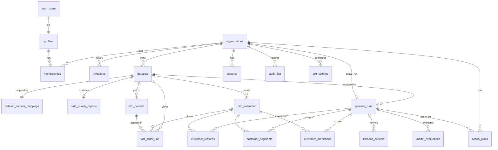

# CustomerIQ — Product Requirements Document (PRD)

| | |
|---|---|
| **Product** | CustomerIQ — Customer Behavior Analytics and Retention Intelligence |
| **Version** | 1.0 (MVP) |
| **Date** | 2026-10-21 |
| **Status** | Draft for review |
| **Source documents** | [`viability-analysis.md`](./viability-analysis.md), [`tech-stack.md`](./tech-stack.md) |

> **How to read this document.** Sections 1–2 explain *who* this is for and *why*. Section 3 is the build list: each feature has an ID (`F-xx`) used throughout the document. Sections 4–5 are the data and API contracts. Section 6 holds the quality bar every feature must meet. Section 7 lists what we are deliberately **not** building, and Section 8 explains how we will judge success. Appendices contain the exact analytic definitions (cleaning rules, RFM segment map, model protocol). A developer must follow them **exactly**, because they are what make the numbers trustworthy.

> **Strategic context.** The viability analysis found that generic RFM and churn dashboards are **already offered by Klaviyo, Shopify and Bloomreach**. As a result, this PRD does **not** describe a general-purpose Klaviyo competitor. The MVP has two jobs:
> 1. Deliver a rigorous, finishable **academic/portfolio analytics product** on the UCI Online Retail II dataset.
> 2. Serve as a **validation vehicle** for the one niche the analysis identified as underserved: **explainable repeat-purchase intelligence for small and mid-size online retailers with a large wholesale/B2B share, who don't run on Klaviyo**.
>
> Every feature below either serves both jobs or is marked P1/P2.

---

## Table of contents
1. [Executive summary](#1-executive-summary)
2. [User avatar deep dive](#2-user-avatar-deep-dive)
3. [Feature specification](#3-feature-specification)
4. [Database schema](#4-database-schema)
5. [API specification](#5-api-specification)
6. [Non-functional requirements](#6-non-functional-requirements)
7. [Out of scope](#7-out-of-scope)
8. [Success metrics](#8-success-metrics)
9. [Appendices](#9-appendices): A. Analytic definitions · B. Glossary · C. Assumptions & open questions · D. Milestones

---

## 1. Executive summary

### What we're building
CustomerIQ is a web application. An online retailer uploads its order history (CSV or Excel) and, within minutes, gets four things:
- a cleaned, auditable view of its customers;
- customer segments based on **Recency, Frequency and Monetary value (RFM)**, plus a statistical **K-means** clustering;
- a **calibrated probability that each customer buys again within the next 60 days**, from logistic regression and random forest models tested honestly against a simple baseline;
- a plain-language explanation of *why* each customer and segment scored as it did.

Analysts explore the results in interactive dashboards: revenue contribution by segment, purchasing trends, at-risk high-value customers, and model performance. They then export a prioritized target list to whatever tool sends their campaigns. The system is built with React + TypeScript (frontend), Python/FastAPI (analytics API and ML pipeline) and Supabase PostgreSQL (multi-tenant data, auth, storage). It is designed so that every number shown can be traced back to a specific dataset, cleaning rule, cutoff date and model version.

### Primary value proposition
> **"Know which customers are about to stop buying, why, and which ones are worth winning back, in under 15 minutes, from a spreadsheet you already have, with numbers you can defend to your boss."**

Three properties set this apart from the built-in analytics in Klaviyo and Shopify:
1. **Explainable, not a black box.** Every prediction shows its top drivers. Every segment shows the rule or centroid that defined it. Every model shows its honest out-of-time accuracy compared with a simple baseline.
2. **Works on any order export.** It doesn't depend on a particular platform, it handles wholesale/B2B buyers, and it has no minimum data threshold that locks out smaller stores (it needs about 200 identifiable customers; see F-06).
3. **Ends in a decision, not a chart.** A target list ranked by expected value, with a what-if simulator for campaign cost (P1).

### Target user persona (summary)
**"Jordan, the one-person analytics team."** Jordan is a marketing or CRM analyst at a 10–150-person online retailer with £2M–£50M annual revenue. Part of the business is repeat wholesale accounts. Jordan knows Excel deeply, has working SQL, and has used Power BI or Looker Studio, but has no data science team.

| Dimension | Detail |
|---|---|
| **Motivations** | Wants to be the person who brings *evidence*, not opinions, to the Monday meeting. Wants to prove that marketing spend on retention pays off. Wants to grow their skills in "real" predictive analytics without becoming a full-time ML engineer. |
| **Goals** | Cut churn among the most valuable customers. Stop spending discount budget on customers who would have bought anyway. Produce a monthly retention report in hours instead of days. |
| **Fears** | **Being caught out by a wrong number** in front of leadership. Recommending a campaign that loses money. Being replaced by a tool they don't understand ("the AI said so"). Spending weeks on a model that turns out to be leaking future data. |
| **Frustrations** | Platform analytics are black boxes ("Klaviyo says *at risk*, but why?"). Exports are messy (returns, cancellations, test orders, wholesalers distorting averages). Every analysis is rebuilt by hand in spreadsheets. |
| **Values** | Transparency, reproducibility, practicality. Would rather have a simple model they can explain than a complex one they can't. |

A **secondary persona**, "Dr. Rivera, the academic reviewer," is in Section 2.6. This person evaluates the academic deliverable and cares about method rigor more than UX.

---

## 2. User avatar deep dive

### 2.1 Who exactly is this for?

**Primary user: Jordan, CRM / Marketing / Business Analyst (the person who uses the product)**
- **Company profile:** an independent online retailer, often selling on its own site plus marketplaces. Has 2,000–200,000 identifiable customers and 20k–2M order lines per year. **At least 15% of revenue comes from repeat trade or wholesale buyers** (gift, homeware, specialty food, craft supplies, beauty, B2B parts). This matches the UCI dataset's profile (a UK gift-ware retailer where many customers are wholesalers).
- **Role:** "Marketing Analyst," "CRM Manager," "E-commerce Analyst," or the operations person who "does the data." Reports to the Head of Marketing, the E-commerce Director, or the founder.
- **Tool environment:** Shopify, WooCommerce, Magento or a custom platform; an email tool (Mailchimp, Klaviyo, Brevo, Omnisend); Excel or Google Sheets; sometimes Power BI. Usually no data warehouse.
- **Technical skill:** advanced Excel (pivot tables, XLOOKUP); intermediate SQL; can read a confusion matrix if it's explained; does **not** write Python day to day.

**Economic buyer: the Head of Marketing / E-commerce Director / Founder ("Sam")**
- Doesn't use the product every day, but reads the exported report or the overview dashboard.
- Cares about one question: *"How much revenue is at risk, and what is the return on trying to save it?"*

**Out of target for the MVP:** enterprise retailers that already have a customer data platform (Bloomreach) or a data science team; stores with fewer than about 200 identifiable repeat customers (too little data for a meaningful model); subscription businesses, where churn is a contractual event rather than a purchasing pattern.

### 2.2 Current painful workflow ("before CustomerIQ")

A realistic month for Jordan, preparing the retention review:

| Step | What they do today | Time | Pain |
|---|---|---|---|
| 1 | Export orders from the platform and maybe marketplaces into CSV/XLSX | 30–60 min | Different column names, date formats and currencies in each export |
| 2 | Clean in Excel: remove test orders, handle refunds/cancellations, drop blank customer IDs, de-duplicate | 2–4 h | Error-prone, never done the same way twice, undocumented. One wholesaler's £40k order skews every average. |
| 3 | Build RFM in a pivot table with manual score breakpoints | 2–3 h | Breakpoints are arbitrary and change month to month, so segments can't be compared over time |
| 4 | Try to answer "who is about to churn?" with a rule like "no order in 90 days" | 1 h | The rule ignores each customer's normal buying rhythm. A wholesaler who orders every 120 days gets flagged; a weekly buyer who stopped 30 days ago doesn't. |
| 5 | Check the platform's "at risk" segment, which disagrees with their own numbers, and can't explain why | 1 h | **Loss of credibility.** No way to reconcile. |
| 6 | Build charts for the meeting in PowerPoint or Power BI | 2–3 h | Static; any follow-up question means rebuilding |
| 7 | Hand a list to the email team | 30 min | No prioritization by value; discounts go to people who would have bought anyway |
| **Total** | | **≈ 9–13 hours/month** | Plus the constant worry that a number is wrong |

### 2.3 What success looks like for Jordan ("after CustomerIQ")
- **Time:** upload to first trustworthy insight in **under 15 minutes**; the full monthly review in **under 1 hour**.
- **Confidence:** can answer "how do you know?" for any number by pointing to the data-quality report, the segment rule, or the model's out-of-time accuracy compared with the baseline.
- **Consistency:** segment definitions are stable across months, so "Champions went from 412 to 455" means something.
- **Action:** a ranked list along the lines of "these 140 high-value customers have a 20–45% chance of buying in the next 60 days; the main driver is that their gap since last order is 2.3× their normal rhythm," exported straight into the email tool.
- **Career outcome:** is seen as the person who brought predictive analytics into the business.

**Success in Jordan's words:** *"I walked into the meeting, Sam asked 'why are these people at risk?', and I had the answer on screen."*

### 2.4 What would make them tell a colleague? (word-of-mouth triggers)
1. **The "it caught something I missed" moment:** CustomerIQ flags a top-20 wholesale account as at-risk, Jordan calls them, and the account reorders.
2. **The "the cleaning report saved me" moment:** the data-quality report shows that 23% of rows had no customer ID and that 4% were cancellations, which explains a discrepancy they had been chasing for months.
3. **The "honest model" moment:** the model page says plainly how much better the model is than a simple recency rule, including when the gain is small. Analysts trust (and recommend) tools that don't oversell.
4. **Shareable output:** a clean, read-only dashboard link or export that makes Jordan look good in front of leadership (P1: shareable report).
5. **Speed:** "I uploaded our Shopify export and had segments before my coffee was done."

### 2.5 Anti-goals (what would make them churn or complain)
- A number that can't be reconciled with their own Excel totals. **Mitigation:** the data-quality report shows reconciliation totals (F-03).
- Predictions that turn out to be badly calibrated ("it said 80%, nobody bought"). **Mitigation:** calibration curves and the evaluation protocol (F-07, Appendix A.5).
- Being forced to learn data science vocabulary. **Mitigation:** plain-language labels, with technical detail available on demand.

### 2.6 Secondary persona: "Dr. Rivera, the academic reviewer"
- **Who:** the capstone or thesis advisor, or a portfolio reviewer or hiring manager.
- **Motivations:** methodological rigor, reproducibility, clear research questions, honest limitations.
- **Fears:** data leakage, accuracy inflated by class imbalance, claims that go beyond what the data supports (for example, "modern e-commerce" claims based on 2009–2011 UK wholesale data).
- **What they need from the product:** a **Methods & Model Report** page (F-07) with research questions RQ1–RQ3, the dataset description, cleaning decisions, evaluation protocol, baseline comparison, calibration and limitations; a reproducible run ID; and the Power BI deliverable reading the same database views (F-19).

---

## 3. Feature specification

### 3.0 Priority definitions and feature map

| Priority | Meaning |
|---|---|
| **P0** | MVP-critical. The product cannot launch, or the academic deliverable cannot be submitted, without it. |
| **P1** | Important. Planned for MVP+1 (within about 4 weeks of launch), or as stretch work inside the MVP if time allows. |
| **P2** | Nice to have. Requires evidence of demand first. |

| ID | Feature | Priority | Persona(s) |
|---|---|---|---|
| F-01 | Authentication & account | P0 | All |
| F-02 | Organizations, roles & invitations (multi-tenancy) | P0 | All |
| F-03 | Dataset upload, column mapping & data-quality report | P0 | Jordan |
| F-04 | Cleaning & curation pipeline | P0 | Jordan, Rivera |
| F-05 | Analysis runs: orchestration, status & history | P0 | Jordan |
| F-06 | RFM scoring & rule-based segments | P0 | Jordan, Rivera |
| F-07 | K-means behavioral clustering | P0 | Jordan, Rivera |
| F-08 | Repeat-purchase prediction (60-day) | P0 | Jordan, Rivera |
| F-09 | Model performance & Methods report | P0 | Rivera, Jordan |
| F-10 | Overview dashboard | P0 | Jordan, Sam |
| F-11 | Segment explorer | P0 | Jordan |
| F-12 | Customer list & customer detail | P0 | Jordan |
| F-13 | Prediction explanations (drivers) | P0 (global + linear drivers), P1 (per-customer SHAP) | Jordan |
| F-14 | Target list export (CSV) | P0 | Jordan |
| F-15 | Demo workspace (UCI Online Retail II) | P0 | All |
| F-16 | What-if campaign ROI simulator & action plans | P1 | Jordan, Sam |
| F-17 | Cohort retention & purchasing-trend analysis | P1 | Jordan |
| F-18 | Run comparison (month-over-month segment migration) | P1 | Jordan |
| F-19 | Power BI connectivity & template | P1 (P0 for the academic deliverable) | Rivera |
| F-20 | BG/NBD probabilistic baseline & expected CLV | P1 | Rivera, Jordan |
| F-21 | Scheduled re-runs & email notifications | P1 | Jordan |
| F-22 | Audit log | P1 | Admins |
| F-23 | Shareable read-only report link / PDF | P2 | Sam |
| F-24 | Email-tool sync (Klaviyo / Mailchimp audiences) | P2 | Jordan |
| F-25 | Platform connectors (Shopify / WooCommerce API) | P2 | Jordan |
| F-26 | Data deletion & account closure (GDPR) | P0 | Admins |

Shared conventions for all features:
- Every analytic output is tied to a `pipeline_run` (`run_id`). The UI always shows which run and cutoff date the user is looking at.
- Each organization has one "active run" (`organizations.active_run_id`), and dashboards default to it.
- All money is shown in the dataset's currency (one currency per dataset in the MVP).
- All timestamps are stored in UTC and shown in the organization's timezone.

---

### F-01 Authentication & account — **P0**

**User stories**
- As a new visitor, I want to sign up with email/password or Google so that I can try CustomerIQ without talking to sales.
- As a returning user, I want to sign in with a magic link so that I don't have to remember another password.
- As a user, I want to reset my password and manage my profile (name, timezone) so that my account stays secure and dates show in my local time.

**Acceptance criteria**
1. Sign-up supports email + password (minimum 10 characters, checked against the Have I Been Pwned breached-password list through Supabase Auth's leaked-password protection) and Google OAuth.
2. Email verification is required before the user can create or join an organization.
3. Magic-link sign-in and password reset emails arrive within 60 seconds (sent through Resend SMTP).
4. The session persists across reloads. The access token refreshes silently, and the user is signed out after 7 days of inactivity.
5. A `profiles` row is created automatically on first sign-in (by a database trigger on `auth.users`).
6. Sign-out clears local session state and the TanStack Query cache.
7. Five failed sign-in attempts in 15 minutes trigger a cooldown, using Supabase Auth rate limits.

**Technical notes and dependencies**
- Supabase Auth with `@supabase/supabase-js` in the SPA. FastAPI verifies JWTs through JWKS (`PyJWKClient`), checking `iss`, `aud=authenticated` and `exp`.
- A custom access-token hook adds `org_id` (the active org) and `org_role` to the JWT claims, read from `profiles.active_org_id` + `memberships`.
- Depends on: Resend SMTP configuration and the Google OAuth client.

---

### F-02 Organizations, roles & invitations — **P0**

**User stories**
- As a new user, I want to create an organization (workspace) for my company so that my team's data is kept separate from everyone else's.
- As an org owner/admin, I want to invite colleagues by email with a role so that they can view or work on our analysis.
- As a user who belongs to several orgs (for example, a consultant), I want to switch between them so that I can work for several clients.

**Roles and permissions**

| Capability | owner | admin | analyst | viewer |
|---|:-:|:-:|:-:|:-:|
| View dashboards, segments, customers, model report | ✓ | ✓ | ✓ | ✓ |
| Export CSV target lists | ✓ | ✓ | ✓ | ✗ |
| Upload datasets, configure and start runs, set active run | ✓ | ✓ | ✓ | ✗ |
| Create and edit action plans / what-if scenarios (P1) | ✓ | ✓ | ✓ | ✗ |
| Invite/remove members, change roles (cannot change owner) | ✓ | ✓ | ✗ | ✗ |
| Delete datasets | ✓ | ✓ | ✗ | ✗ |
| Org settings (name, timezone, currency default) | ✓ | ✓ | ✗ | ✗ |
| Transfer ownership, delete organization (F-26) | ✓ | ✗ | ✗ | ✗ |

**Acceptance criteria**
1. After email verification, a user with no memberships is taken to "Create organization" (name and timezone required) or "Open demo workspace" (F-15).
2. The creator becomes `owner`. Each organization has exactly one owner at all times, enforced in the database.
3. Invitations are sent by email with a single-use token that expires after 7 days. Accepting requires being signed in as the matching email address (case-insensitive). The inviter sees the status: pending, accepted, expired or revoked.
4. The org switcher in the header lists all memberships. Switching calls `POST /v1/me/active-org`, refreshes the session so the JWT carries the new `org_id`, and reloads data. No data from the previous org stays visible.
5. **Isolation test (blocking for release):** an automated pgTAP + API test confirms that a user in org A gets zero rows and 404s for every org-B resource, through both Supabase and FastAPI.
6. Removing a member invalidates their access within one token lifetime (≤ 1 hour). FastAPI also re-checks membership on every write.
7. Plan limits are enforced on the `organizations.plan` column (`free`/`pilot`/`pro`). See the rate limits in §5.6.

**Technical notes**
- RLS helper functions are `app.current_org_id()` and `app.has_role(min_role)` (§4.4).
- The `memberships` table has a unique `(org_id, user_id)` constraint.

---

### F-03 Dataset upload, column mapping & data-quality report — **P0**

**User stories**
- As an analyst, I want to upload my order export (CSV or XLSX) and map its columns to CustomerIQ's fields so that I can use data from any platform without reformatting it in Excel.
- As an analyst, I want to see a data-quality report before analysis so that I understand what was removed, why, and whether the totals reconcile with my own figures.

**Canonical fields** (the mapping target)

| Canonical field | Required | Type after parsing | UCI column | Notes |
|---|:-:|---|---|---|
| `invoice_id` | ✓ | text | Invoice | An order or invoice number. Several rows per invoice is normal. |
| `invoice_ts` | ✓ | timestamptz | InvoiceDate | Accepted formats are listed in Appendix A.1. The user confirms a day-first or month-first date order if it's ambiguous. |
| `customer_ref` | ✓ | text | Customer ID | Any stable customer identifier. Emails are **hashed (SHA-256 + org salt) on ingest** (§6.2). |
| `quantity` | ✓ | numeric(14,3) | Quantity | Negative values mean returns or cancellations |
| `unit_price` | ✓ | numeric(14,4) | Price | In dataset currency |
| `stock_code` | optional | text | StockCode | Needed for the product-diversity feature and non-product filtering |
| `description` | optional | text | Description | |
| `country` | optional | text | Country | |
| `is_cancellation` | optional | boolean | (derived from invoice prefix `C`) | If not mapped, it is derived using the rules in A.2 |
| `line_total` | optional | numeric | — | If provided, it is used instead of quantity × unit_price |

**Acceptance criteria**
1. Accepts `.csv` (comma, semicolon or tab; UTF-8 or Windows-1252 with auto-detection) and `.xlsx` (all sheets or a chosen sheet; the UCI file has two sheets that must be combined). Maximum file size is **100 MB** and maximum rows **2,000,000** in the MVP.
2. The file uploads **directly from the browser to Supabase Storage** using a signed URL at `uploads/{org_id}/{dataset_id}/original.{ext}`. Uploads are resumable, with a progress bar.
3. After upload, the API reads the header plus the first 200 rows and returns **suggested mappings**, using name matching against a synonyms list (for example, `Customer ID|CustomerID|customer_id|Email → customer_ref`). Each suggestion has a confidence score.
4. The mapping screen shows a 20-row preview with the mapped columns highlighted. It blocks submission until all required fields are mapped and each mapped column parses successfully on at least 95% of preview rows. Parse errors are shown inline.
5. The user sets the dataset currency (ISO 4217; default is the org currency) and the source timezone (default is the org timezone).
6. Saved mappings can be reused: if a new file's header matches a previous one, the previous mapping is pre-applied.
7. After processing (F-04), the **data-quality report** shows at least:
   - total rows read; rows kept; rows excluded **by reason** (missing customer, cancellation, non-product code, zero or negative price, exact duplicate, unparseable date), each with a count and %;
   - date range; distinct customers, invoices and products; countries (top 10);
   - **reconciliation:** gross revenue as read, cancellations/returns, excluded rows, and the net revenue used. The net figure must equal gross minus all adjustments to the penny.
   - revenue concentration (share from the top 1% and top 10% of customers) and the wholesale-flag count (A.2);
   - warnings: fewer than 200 eligible customers (block prediction), less than 180 days of history (block prediction), more than 30% of rows missing customer, mixed currencies detected.
8. The report can be downloaded as CSV, along with the excluded rows themselves (a sample of up to 10k rows for each reason).

**Technical notes and dependencies**
- Parsing happens in the Python worker using pandas (with `openpyxl` for XLSX). On first read, the file is converted to Parquet (`uploads/{org}/{dataset}/normalized.parquet`) so it never has to be parsed again.
- Depends on F-04 and F-05. The tables involved are `datasets`, `dataset_column_mappings` and `data_quality_reports`.

---

### F-04 Cleaning & curation pipeline — **P0**

**User story**
- As an analyst, I want my raw orders cleaned with consistent, documented rules so that every segment and prediction is built on the same, defensible data.

**Acceptance criteria**
1. Applies the cleaning rules in **Appendix A.2** in a fixed order, and records each rule's effect in `data_quality_reports.rules_applied` (rule ID, rows affected, revenue affected).
2. Writes curated data to `dim_customer`, `dim_product` and `fact_order_line` for the dataset. Re-processing the same dataset is **idempotent**: it deletes and re-inserts in one transaction per table, so there are never duplicates.
3. The org can configure (with saved defaults) the non-product stock-code list, the wholesale-flag rule (A.2-R8), and the cancellation handling mode (`net`, the default, or `exclude`).
4. The same pipeline code (`packages/ml/customeriq/cleaning.py`) is used by the worker, by notebooks and by the GitHub Actions batch job. Unit tests cover every rule with fixtures that include edge cases (a cancellation with no matching original, a negative-quantity row without the `C` prefix, duplicate rows).
5. The UCI dataset processes end to end (parse → curated tables) in **≤ 5 minutes** on the reference worker (2 GB RAM).

**Technical notes:** bulk-load with `COPY` through psycopg 3 into a staging table, then `INSERT … SELECT` into the curated tables. Wrap each dataset's load in a transaction. Use the direct Postgres connection for bulk loading (session mode), not the transaction pooler.

---

### F-05 Analysis runs: orchestration, status & history — **P0**

**User stories**
- As an analyst, I want to start an analysis run with a clear cutoff date and prediction window so that I know exactly what period the insights describe.
- As an analyst, I want to see live progress and get notified when the run finishes or fails so that I don't have to keep refreshing.
- As an analyst, I want to choose which completed run is "active" so that my team sees the version I have validated.

**Run configuration**

| Parameter | Default | Allowed |
|---|---|---|
| `dataset_id` | latest processed dataset | any `ready` dataset in the org |
| `cutoff_date` (T) | last date in data − `horizon_days` (so the test labels can be observed) | must leave ≥ 180 days of history before T |
| `horizon_days` (H) | 60 | 30, 60, 90 |
| `scoring_mode` | `evaluate_and_score` | `evaluate_and_score` (out-of-time evaluation, then refit and score everyone as of the last data date) |
| `kmeans_k` | `auto` (3–8) | `auto` or an integer 3–10 |
| `models` | `["baseline_recency","logreg","random_forest"]` | P1 adds `"bgnbd"` |
| `exclude_wholesale` | false | true/false (for the sensitivity analysis the viability analysis requires) |

**Run stages (in order):** `queued → loading → features → segmentation → training → evaluation → scoring → publishing → succeeded | failed | cancelled`

**Acceptance criteria**
1. `POST /v1/runs` validates the config, rejects it if the org already has a run in progress (MVP: one concurrent run per org), creates a `pipeline_runs` row with status `queued`, and returns 202 with the `run_id`.
2. The worker claims queued runs with `SELECT … FOR UPDATE SKIP LOCKED`, updates `status`, `stage` and `progress_pct` at least once per stage, and writes `error_code`/`error_message` on failure. The UI never sees a raw stack trace.
3. The UI subscribes to the run row through Supabase Realtime (or polls every 3 seconds as a fallback) and shows a stepper with the current stage and elapsed time.
4. A user can cancel a queued or running run. The worker checks for cancellation between stages.
5. On success, the user is asked "Set as active run?" (the default is Yes for the first run). Setting a run active updates `organizations.active_run_id` and refreshes the materialized views.
6. The run history page lists runs with dataset, cutoff, horizon, models, best model and its PR-AUC, duration, status and creator. Failed runs show a human-readable reason and suggested fix (for example, "Fewer than 200 eligible customers at this cutoff. Choose an earlier cutoff or upload more history.").
7. The full UCI run (features → scoring) completes in **≤ 10 minutes** on the reference worker.
8. Runs are **reproducible**: given the same dataset and config, a re-run produces the same segments and metrics (`random_state=42` everywhere; the library versions are stored in `pipeline_runs.environment`).

**Technical notes:** at MVP, the worker is a separate Render Background Worker process that polls `pipeline_runs`. Supabase Queues (pgmq) comes in at the growth stage. Model artifacts are saved with `joblib` to Storage at `models/{org_id}/{run_id}/{model_name}.joblib`.

---

### F-06 RFM scoring & rule-based segments — **P0**

**User stories**
- As an analyst, I want every customer scored on Recency, Frequency and Monetary value so that I can rank customers consistently.
- As an analyst, I want customers placed into named, understandable segments (for example, Champions, At Risk, Inactive) so that I can plan a specific action for each group.

**Acceptance criteria**
1. Computes R, F and M as of the scoring date using the exact definitions in **Appendix A.3**. The eligible population is customers with ≥ 1 kept order in the 365 days before the scoring date.
2. Assigns quintile scores 1–5 for each dimension (R reversed, so recent = 5). Ties are broken using `rank(method="first")` so the quintiles are equal-sized.
3. Assigns exactly one of the **eight named segments** using the rule table in **Appendix A.4**. The rules are evaluated in order, so every customer matches exactly one.
4. The segment names match the concept's language. Loyal, high-value, infrequent and potentially inactive customers are all directly identifiable.
5. Results are written to `customer_segments` (`rfm_r`, `rfm_f`, `rfm_m`, `rfm_score` as a string like "545", `rfm_segment`).
6. The segment summary (count, % of customers, revenue, % of revenue, average R/F/M, average repeat probability) is available through `v_segment_summary`.
7. Each segment has a fixed **plain-language description and a suggested action** (in Appendix A.4), shown in the UI.

**Technical notes:** implemented in pandas inside the pipeline. A SQL version (`sql/rfm_reference.sql`) is kept for the academic report and is checked against the pandas output in CI (the same scores on the UCI fixture).

---

### F-07 K-means behavioral clustering — **P0**

**User story**
- As an analyst, I want a data-driven clustering alongside the rule-based segments so that I can find natural groupings that fixed rules might miss, and compare the two approaches.

**Acceptance criteria**
1. Clustering features: `log1p(recency_days)`, `log1p(frequency)`, `log1p(monetary)`, standardized with `StandardScaler`. Wholesale-flagged customers are included unless `exclude_wholesale` is set.
2. When `k=auto`: try k = 3…8 with `n_init=10` and `random_state=42`. Pick the k with the highest silhouette score (computed on a sample of ≤ 10k customers), but reject any k that produces a cluster smaller than 2% of customers. Store the elbow (inertia) and silhouette values for every k tried.
3. Each cluster gets an **auto-generated name** (the most common RFM segment among its members plus a descriptor, for example "Cluster 3 · mostly *At Risk* · high spend"). Analysts with the `analyst` role or higher can rename clusters, and the name is stored per run.
4. A cluster profile table shows size, mean and median R/F/M (in original units), revenue share, and the centroid in standardized units.
5. A **cross-tab of RFM segments by K-means clusters** (counts) is shown, so analysts and reviewers can see how far the two methods agree. The adjusted Rand index between the two labelings is reported.
6. Visuals: an R vs. M scatter (log axes) coloured by cluster, with the full eligible population downsampled to ≤ 5,000 points and outlines of the full density; and the elbow and silhouette charts on the Methods page.

**Technical notes:** scikit-learn `KMeans` and `silhouette_score`. The scaler and model are stored per run. New customers can only be assigned within a run (scoring). Clusters are not comparable across runs unless the F-18 alignment is used (P1).

---

### F-08 Repeat-purchase prediction (60-day) — **P0**

**User stories**
- As an analyst, I want each active customer's probability of buying again in the next 60 days so that I can focus retention effort where it matters.
- As an analyst, I want to know that the model is better than a simple rule, and by how much, so that I can trust it and defend it.

**Acceptance criteria**
1. Uses the **evaluation protocol in Appendix A.5 without changes**: rolling monthly cutoffs, features computed only from data on or before the cutoff, label = any kept purchase in the window (T, T+H], an out-of-time split (train → validation → test cutoff), and no random splitting. **This is the most important acceptance criterion in the PRD.** A leakage test is required in CI: shuffling future transactions must not change any feature value.
2. The feature set is exactly as listed in **Appendix A.3** (16 features). Any feature added later must be documented there first.
3. Models trained:
   - `baseline_recency`: the probability is the training-set repeat rate for the customer's recency decile. No ML. This is the reference point every other model must beat.
   - `logreg`: scikit-learn `LogisticRegression` (L2, `class_weight="balanced"`, C tuned on validation from {0.01, 0.1, 1, 10}), on standardized features with one-hot country (top 10 countries + "Other").
   - `random_forest`: `RandomForestClassifier` (`n_estimators=300`, `max_depth` tuned on validation from {6, 10, 14, None}, `min_samples_leaf=20`, `class_weight="balanced_subsample"`, `random_state=42`).
   - P1: `bgnbd` (F-20).
4. **Calibration:** each ML model is calibrated on the validation set (`CalibratedClassifierCV` with `method="isotonic"` if there are ≥ 1,000 positive validation rows, otherwise `"sigmoid"`, `cv="prefit"`).
5. **Model selection:** the model with the highest **validation PR-AUC** becomes the run's `selected_model`. Ties within 0.005 go to the simpler model (logreg). If no ML model beats `baseline_recency` on validation PR-AUC by ≥ 0.01, the run is flagged `model_gain_low`. The UI then says so plainly ("The model adds little over a simple recency rule for this data"), and the baseline is used for scores.
6. **Scoring:** after evaluation, the selected model configuration is refitted on all labeled cutoffs (including test) and used to score every eligible customer as of the **last data date**. The resulting `p_repurchase` values are written to `customer_predictions`.
7. Each scored customer also gets a `risk_band`: `high_chance` (p ≥ 0.6), `medium` (0.3–0.6), `low_chance` (< 0.3). Bands are configurable per org (P1).
8. Prediction requires ≥ 200 eligible customers and ≥ 30 positive labels in each of train, validation and test. Otherwise the stage is skipped with error code `INSUFFICIENT_DATA`, and segmentation results are still published.

**Technical notes:** training data is built as a stack of customer × cutoff snapshots (about 20 monthly cutoffs × about 3–4k customers ≈ 60–80k rows for UCI, which fits comfortably in memory). Evaluation outputs go to `model_evaluations`, and the selected model's file goes to Storage.

---

### F-09 Model performance & Methods report — **P0**

**User stories**
- As an academic reviewer, I want a single page that documents the data, methods, evaluation protocol, results and limitations so that I can assess rigor and reproducibility.
- As an analyst, I want to see in plain language how accurate the predictions are so that I know how much to rely on them.

**Acceptance criteria**
1. **Plain-language summary card** at the top, for example: "On customers the model had never seen (cutoff 2011-08-10), the top 20% of customers by predicted probability contained 51% of the people who actually bought again. A simple recency rule captured 44%." The figures come from the run's test-set metrics.
2. **Metrics table** for each model on the **test** set (validation shown on toggle): ROC-AUC, PR-AUC, Brier score, log loss, precision/recall/F1 at the chosen threshold, accuracy, base rate, and lift and capture rate in the top decile and top 20%.
3. **Charts:** ROC curves, PR curves (with a base-rate reference line), a calibration (reliability) curve with 10 bins, confusion matrix at the threshold, lift/gain chart, and for each model either the feature importance (permutation importance on the test set for RF) or the standardized coefficients (logreg).
4. **Threshold selector:** the default threshold maximizes F1 on validation. The user can move it and see precision, recall and confusion-matrix counts update live (computed client-side from the stored score/label arrays of the test set; ≤ 50k pairs are stored per run).
5. **Methods section** (auto-generated from the run metadata): dataset (name, date range, rows), cleaning rule counts (from F-03), eligible-population definition, cutoffs (train/validation/test dates), horizon, features, models and hyperparameter grid, chosen hyperparameters, library versions, and run ID.
6. **Segmentation section:** the k-selection charts, cluster profiles, and the RFM × cluster cross-tab with the adjusted Rand index (from F-07).
7. **Limitations section:** fixed text plus data-driven warnings (for example, wholesale share > 20%, a single country > 80% of rows, data older than 3 years, the `model_gain_low` flag).
8. **Research questions panel:** RQ1–RQ3 from the viability analysis, each linked to the evidence on the page.
9. The page can be printed to PDF from the browser cleanly (a print stylesheet; P2 adds a server-rendered PDF).

---

### F-10 Overview dashboard — **P0**

**User story**
- As an analyst or executive, I want a single overview of customer health and revenue at risk so that I can understand the situation in under a minute.

**Acceptance criteria**
1. **KPI tiles** (for the active run, as of the last data date, each with a comparison to the same period one year earlier where the data allows it):
   - Active customers (eligible population)
   - Net revenue, last 12 months
   - Repeat customer rate (share with ≥ 2 orders in the last 12 months)
   - Average order value
   - **Expected repeat customers in the next 60 days** (sum of `p_repurchase`)
   - **Revenue at risk:** the trailing-12-month revenue of customers in the `At Risk` and `Can't Lose` segments with `p_repurchase` < 0.3
2. **Charts:**
   - monthly net revenue and order count (dual series, with the last 24 months shown by default);
   - revenue contribution by RFM segment (a 100% bar or treemap);
   - customer count by segment;
   - distribution of `p_repurchase` (histogram) split by risk band;
   - top 10 countries by revenue.
3. Filters (stored in the URL): country, wholesale flag (all / exclude / only), segment. All tiles and charts respect the filters.
4. Every chart has an "i" tooltip defining the metric (from Appendix A), and a "View as table" toggle (for accessibility, §6.3).
5. The page loads (all tiles and charts rendered) in ≤ 2.0 s p75 for orgs with up to 200k customers on the reference setup (§6.1).
6. An empty state guides the user to upload data or open the demo.

**Technical notes:** reads only from views and materialized views in Supabase (`v_overview_kpis`, `mv_monthly_revenue`, `v_segment_summary`, `mv_country_revenue`) through PostgREST. Filtered variants use RPC functions `rpc_overview(p_country, p_wholesale, p_segment)`. The browser never receives raw transactions.

---

### F-11 Segment explorer — **P0**

**User story**
- As an analyst, I want to drill into any segment or cluster to see who is in it, what they buy, and what to do about them.

**Acceptance criteria**
1. A toggle switches between **RFM segments** and **K-means clusters**.
2. Segment cards show size, % of customers, revenue and % revenue, average R/F/M, average `p_repurchase`, and the suggested action (A.4).
3. The segment detail page shows the R/F/M distributions (box or violin plots), the `p_repurchase` distribution, the top 10 products by revenue in the segment (if `stock_code` was mapped), the country mix, and the customer table (F-12) pre-filtered to that segment.
4. An RFM grid heatmap (R score × F score, coloured by count or revenue) lets the user click a cell to filter.
5. "Export this segment" goes to F-14.

---

### F-12 Customer list & customer detail — **P0**

**User stories**
- As an analyst, I want to search, filter and sort customers by segment, probability, value and recency so that I can build target lists.
- As an analyst, I want a single customer's full picture so that I can prepare for a call with an important account.

**Acceptance criteria**
1. **List:** server-side paginated (50 per page; 25, 50 or 100 selectable). It is sortable by `p_repurchase`, monetary, recency, frequency and expected value (`p_repurchase × avg_order_value`). Filters: segment, cluster, risk band, country, wholesale flag, p-range slider, and minimum monetary. Search by `customer_ref` uses a prefix/trigram match.
2. Columns: customer ref, country, segment, cluster, R/F/M (raw and score), last order date, orders, net revenue, `p_repurchase` (shown as a percentage with a band chip), and the top driver (F-13).
3. Filter state lives in the URL. The total count and the filtered revenue sum are shown.
4. **Detail page:** profile header (ref, country, first and last purchase, tenure, wholesale flag); a timeline of orders (monthly bars); key metrics compared with segment medians; segment and cluster membership with history across runs (P1); the prediction with drivers (F-13); and the top products purchased.
5. Customer detail loads in ≤ 1.0 s p75.

**Technical notes:** the list reads `v_customer_scores` (a join of segments, predictions and features for the active run) through PostgREST with `range` headers. Count uses `count=estimated` above 10k rows. Detail is a FastAPI endpoint (it needs per-customer explanations).

---

### F-13 Prediction explanations (drivers) — **P0 / P1**

**User story**
- As an analyst, I want to see *why* a customer has a high or low repeat probability so that I can trust the score and personalize the outreach.

**Acceptance criteria**
- **P0 (global):** the Methods page and the segment pages show global feature importance (permutation importance for RF; standardized coefficients for logreg).
- **P0 (per-customer, when `selected_model = logreg` or as a fallback):** the top 3 contributions (coefficient × standardized value), shown as plain-language sentences generated from templates in A.6. Example: "Days since last order (148) is 2.4× this customer's usual gap → lowers likelihood."
- **P1 (per-customer, for RF):** TreeSHAP values computed during scoring for every scored customer, with the top 5 positive and negative drivers stored in `customer_predictions.top_drivers` (jsonb) and shown as a waterfall chart.
- Explanations must never mention features that aren't in the model, and must use the same units as the customer detail page.

**Technical notes:** `shap.TreeExplainer` on the uncalibrated RF. A note states that SHAP values explain the pre-calibration score. The computation is batched and its budget is included in the 10-minute run target.

---

### F-14 Target list export (CSV) — **P0**

**User story**
- As an analyst, I want to export a filtered, ranked customer list so that I can load it into my email tool or CRM and act on it.

**Acceptance criteria**
1. Export is available from the customer list (current filters and sort), from segment pages, and from action plans (P1).
2. Columns: `customer_ref` (original, or a hashed reference if the original was an email; the original email is never stored, see §6.2), segment, cluster, `p_repurchase`, risk band, recency_days, frequency, monetary, last_order_date, expected_value, top_driver_text, run_id, and cutoff/scoring date.
3. Exports up to 200k rows are generated asynchronously (≤ 30 s for 200k rows), stored in Storage at `exports/{org}/{export_id}.csv`, and downloaded through a signed URL valid for 15 minutes. The file is deleted after 7 days.
4. Each export is logged (who, when, filters, row count) in `exports` and in the audit log (P1).
5. Viewers cannot export (F-02).

---

### F-15 Demo workspace (UCI Online Retail II) — **P0**

**User stories**
- As a new visitor, I want to explore a fully working example without uploading my own data so that I can judge the product's value in two minutes.
- As the academic author, I want the canonical UCI analysis available as a permanent, reproducible workspace.

**Acceptance criteria**
1. A system-owned org, `demo`, holds the UCI Online Retail II dataset (CC BY 4.0, attributed in the UI footer and the Methods page). It is processed by the standard pipeline using a pinned config: cutoff = 2011-10-10, H = 60. The exact cutoff is confirmed in week 1 against the measured base rates.
2. Every signed-in user can open the demo read-only (`viewer` role, provided through an RLS policy that grants select on `org_id = demo_org_id`). Users cannot upload, run or export in the demo. Export is allowed only with a 1,000-row cap.
3. The demo is rebuilt from source by the `seed-demo` GitHub Actions workflow, which downloads the zip from UCI directly. It does **not** use `ucimlrepo`, because the dataset has no `data_url` (see the viability analysis).
4. A banner says "Demo data: a UK online gift retailer, 2009–2011, many wholesale customers," with a link to the limitations.

---

### F-16 What-if campaign ROI simulator & action plans — **P1**

**User story**
- As an analyst, I want to enter a campaign's cost per contact, expected uplift and margin, and see which customers are worth targeting and the expected return, so that I don't waste discounts.

**Acceptance criteria**
1. Inputs: target population (segment, cluster or filter), cost per contact (£), gross margin %, assumed relative uplift in repeat probability (%, default 10%), and the incentive cost if redeemed.
2. Per-customer expected incremental profit = `p × uplift × AOV × margin − cost − p_redeem × incentive`, where `p_redeem` = `p × (1 + uplift)`. Customers are ranked by this value. The result shows the optimal cut-off (max cumulative profit), the expected contacts, expected incremental orders and revenue, and the ROI.
3. A clear disclaimer: uplift is an **assumption**, not a measured causal effect. A/B test holdouts are recommended (with a 10% random holdout list included in the export).
4. Scenarios can be saved as `action_plans` and exported (F-14).

---

### F-17 Cohort retention & purchasing trends — **P1**

**User story:** As an analyst, I want monthly acquisition-cohort retention curves and repeat-purchase timing so that I understand how loyalty develops over time.

**Acceptance criteria:**
- A cohort heatmap (first-purchase month × months since, showing % of the cohort purchasing).
- A distribution of days between first and second order.
- Revenue by month split into new and returning customers.
- Computed in SQL materialized views, refreshed when a run is published.

---

### F-18 Run comparison & segment migration — **P1**

**User story:** As an analyst, I want to compare two runs (for example, this month and last month) so that I can see how many customers moved between segments.

**Acceptance criteria:**
- A Sankey diagram of RFM segment migration between run A and run B, matched on `customer_ref`.
- KPI deltas between the runs.
- A metric comparison table.
- K-means clusters are matched across runs by Hungarian assignment on centroid distance, with a warning that the clusters may not be comparable.

---

### F-19 Power BI connectivity & template — **P1** (P0 for the academic deliverable)

**User story:** As the academic author or a BI-savvy analyst, I want to connect Power BI to the same curated views so that the Power BI report matches the web app exactly.

**Acceptance criteria:**
1. A per-org **read-only Postgres role** (`bi_reader_{org_short}`) with `SELECT` only on `bi.*` views. These views are filtered to that org with `security_barrier` views keyed by role → org mapping.
2. Connection goes through the Supabase pooler in session mode with SSL required.
3. A `.pbit` template for the demo org (overview, segments, model performance pages) using DAX measures listed in `/bi/measures.md`.
4. Numbers match the web app for the same run (CI check against the view outputs).

---

### F-20 BG/NBD probabilistic baseline & expected CLV — **P1**

**User story:** As a reviewer or analyst, I want the standard "buy-till-you-die" model as an extra benchmark, plus expected 12-month customer value.

**Acceptance criteria:**
- Fit BG/NBD (`pymc-marketing` `BetaGeoModel`, MAP fit) on the training cutoff using calibration/holdout periods aligned with A.5.
- Convert to P(≥ 1 purchase in H days) and evaluate it with the same metrics as the other models.
- Gamma-Gamma for expected order value, giving expected 12-month CLV per customer (shown in the customer detail and as a sortable column).

---

### F-21 Scheduled re-runs & notifications — **P1**

**User story:** As an analyst, I want runs to happen automatically every month when I upload new data, and to get an email when insights are ready.

**Acceptance criteria:**
- Per-org schedule (monthly on day N).
- The run uses the latest dataset.
- An email on success or failure through Resend, with a summary (segment changes, revenue at risk).
- Users can opt out per user.

---

### F-22 Audit log — **P1**

**Acceptance criteria:** Append-only `audit_log` records sign-in to an org, member changes, uploads, deletions, runs, active-run changes and exports, with actor, timestamp, IP hash and payload. Owners and admins can view and filter it. Retention is 1 year.

---

### F-23 to F-25 — **P2**

- **F-23 Shareable report:** a tokenized, read-only, expiring link to the overview and segment summary, with no customer-level data. Server-rendered PDF export.
- **F-24 Email-tool sync:** push a segment or action plan to a Klaviyo list or Mailchimp audience through OAuth. This requires matching on email, which conflicts with the MVP's privacy-minimizing design (§6.2), so it needs a design review.
- **F-25 Platform connectors:** Shopify Admin GraphQL bulk export and the WooCommerce REST API. These require a Shopify app review and the protected-customer-data process.

---

### F-26 Data deletion & account closure — **P0**

**User stories**
- As an admin, I want to delete a dataset and all derived results so that I can remove data we no longer need.
- As an owner, I want to delete our organization and all of its data so that we can leave the service and meet GDPR obligations.

**Acceptance criteria:**
1. Deleting a dataset removes its curated rows, every run built on it, the predictions, the Storage objects (original file, Parquet, models, exports), and refreshes the views. It requires typing the dataset name to confirm.
2. Deleting an org is soft-deleted immediately (access revoked) and hard-deleted within **30 days** by a scheduled job, which cascades through all tables keyed on `org_id` and removes every Storage prefix.
3. Users can delete their own account. If a user is the sole owner of an org, they must transfer ownership or delete the org first.
4. Backups age out according to the backup retention (≤ 35 days). This is documented in the privacy policy.

---

## 4. Database schema

### 4.1 Architecture overview
- **Engine:** Supabase PostgreSQL 15+. Schemas:
  - `public`: tenant-facing tables and views, protected by RLS;
  - `app`: helper functions;
  - `staging`: unlogged load tables, no RLS, no API exposure;
  - `bi`: Power BI views (F-19).
- **Tenancy model:** **shared database, shared schema, `org_id` column on every tenant-scoped row**, enforced by **Row-Level Security**. This is chosen over schema-per-tenant or database-per-tenant because it is simple at our scale (≤ 2,000 orgs), cheap (one Supabase project), and fully supported by Supabase tooling. It can be revisited if an enterprise tenant requires physical isolation.
- **Identity:** `auth.users` (managed by Supabase) → `public.profiles` (1:1) → `public.memberships` (many-to-many with `organizations`).
- **Keys:** `uuid` primary keys (`gen_random_uuid()`) for entities. `bigint generated always as identity` for high-volume fact rows. Every foreign key that crosses into tenant data includes `org_id`, so cross-tenant references are impossible: composite foreign keys use `(org_id, id)` where noted.
- **Migrations:** SQL files in `supabase/migrations/`, applied with the Supabase CLI. Never edit the schema through the dashboard.

### 4.2 Entity-relationship diagram



### 4.3 Tables

Conventions:
- Every table has `created_at timestamptz not null default now()`. Mutable tables also have `updated_at` (maintained by a trigger).
- `org_id uuid not null references organizations(id) on delete cascade` on every tenant table.
- Types: `text` with `CHECK` constraints instead of `varchar(n)`; `numeric` for money; `timestamptz` for all times.

#### Identity & tenancy

**`organizations`**
| Column | Type | Constraints / notes |
|---|---|---|
| id | uuid | PK, default `gen_random_uuid()` |
| name | text | not null, `char_length(name) between 2 and 100` |
| slug | text | not null, unique, `~ '^[a-z0-9-]{3,40}$'` |
| plan | text | not null default `'free'`, `in ('free','pilot','pro','system')` |
| timezone | text | not null default `'UTC'`, validated against `pg_timezone_names` by trigger |
| default_currency | char(3) | not null default `'GBP'`, `~ '^[A-Z]{3}$'` |
| active_run_id | uuid | nullable, FK → `pipeline_runs(id)` on delete set null (deferrable) |
| is_demo | boolean | not null default false. Exactly one row is true (partial unique index). |
| deleted_at | timestamptz | soft-delete marker (F-26) |
| created_at, updated_at | timestamptz | |

**`profiles`**
| Column | Type | Constraints / notes |
|---|---|---|
| id | uuid | PK, FK → `auth.users(id)` on delete cascade |
| full_name | text | `char_length ≤ 120` |
| timezone | text | nullable (falls back to the org timezone) |
| active_org_id | uuid | FK → organizations(id) on delete set null. Read by the JWT hook. |
| email_notifications | boolean | default true |
| created_at, updated_at | timestamptz | |

**`memberships`**
| Column | Type | Constraints / notes |
|---|---|---|
| org_id | uuid | PK part, FK → organizations |
| user_id | uuid | PK part, FK → profiles(id) on delete cascade |
| role | text | not null, `in ('owner','admin','analyst','viewer')` |
| invited_by | uuid | FK → profiles(id) |
| created_at | timestamptz | |
| | | **Partial unique index** `(org_id) where role='owner'`, so there is exactly one owner. A deferred constraint trigger makes sure an owner always exists. |

**`invitations`**
| Column | Type | Constraints / notes |
|---|---|---|
| id | uuid | PK |
| org_id | uuid | FK |
| email | citext | not null, email regex check |
| role | text | `in ('admin','analyst','viewer')` (cannot invite an owner) |
| token_hash | text | not null, unique (SHA-256 of the token; the raw token appears only in the email) |
| status | text | `in ('pending','accepted','revoked','expired')` default `'pending'` |
| expires_at | timestamptz | not null default `now() + interval '7 days'` |
| invited_by | uuid | FK → profiles |
| accepted_by | uuid | FK → profiles, nullable |
| | | Unique `(org_id, lower(email)) where status='pending'` |

**`org_settings`** (one row per org)
| Column | Type | Notes |
|---|---|---|
| org_id | uuid | PK, FK |
| non_product_codes | text[] | default `{POST,DOT,M,D,C2,CRUK,BANK CHARGES,AMAZONFEE,ADJUST,ADJUST2,TEST001,TEST002,PADS,B,S}` |
| wholesale_rule | jsonb | default `{"type":"percentile_monetary","value":0.99,"or_avg_qty_per_line_gt":50}` |
| cancellation_mode | text | `in ('net','exclude')` default `'net'` |
| risk_bands | jsonb | default `{"high":0.6,"medium":0.3}` |
| horizon_days_default | int | `in (30,60,90)` default 60 |

#### Data ingestion

**`datasets`**
| Column | Type | Constraints / notes |
|---|---|---|
| id | uuid | PK |
| org_id | uuid | FK |
| name | text | not null, 1–120 chars. Unique `(org_id, name)`. |
| source_type | text | `in ('upload','demo','connector')` |
| original_filename | text | not null |
| storage_path | text | not null, must start with `uploads/{org_id}/` (check via trigger) |
| file_size_bytes | bigint | `between 1 and 104857600` (100 MB) |
| file_sha256 | text | for duplicate-upload detection (warn, don't block) |
| currency | char(3) | not null |
| source_timezone | text | not null |
| status | text | `in ('uploaded','mapping','processing','ready','failed','deleting')` |
| row_count_raw | int | |
| row_count_kept | int | |
| date_min, date_max | timestamptz | |
| error_message | text | |
| uploaded_by | uuid | FK → profiles |
| created_at, updated_at | timestamptz | |

**`dataset_column_mappings`**
| Column | Type | Notes |
|---|---|---|
| dataset_id | uuid | PK, FK → datasets on delete cascade |
| org_id | uuid | FK |
| mapping | jsonb | not null, e.g. `{"invoice_id":"Invoice","invoice_ts":"InvoiceDate",...}`. Validated against a JSON schema by `app.validate_mapping()`. All required keys must be present. |
| date_format | text | e.g. `'%d/%m/%Y %H:%M'` or `'auto'` |
| sheets | text[] | XLSX sheets to combine |
| header_signature | text | hash of the sorted header names, for reuse (F-03 AC6) |

**`data_quality_reports`**
| Column | Type | Notes |
|---|---|---|
| dataset_id | uuid | PK, FK |
| org_id | uuid | FK |
| rules_applied | jsonb | array of `{rule_id, description, rows_affected, revenue_affected}` |
| reconciliation | jsonb | `{gross_revenue, cancellations, excluded_revenue, net_revenue}`. Check: net = gross − cancellations − excluded (±0.01). |
| profile | jsonb | distinct customers, invoices and products; top countries; concentration (top 1%, top 10%); wholesale count |
| warnings | jsonb | array of `{code, severity, message}` |
| excluded_sample_path | text | Storage path |

**`staging.raw_transactions`** (UNLOGGED, truncated after each load; not exposed through the API)
`load_id uuid, org_id uuid, dataset_id uuid, row_num int, invoice_id text, invoice_ts_raw text, customer_ref_raw text, stock_code text, description text, quantity_raw text, unit_price_raw text, country text, line_total_raw text`

#### Curated (star schema)

**`dim_customer`**
| Column | Type | Constraints / notes |
|---|---|---|
| id | uuid | PK |
| org_id | uuid | FK |
| dataset_id | uuid | FK → datasets on delete cascade |
| customer_ref | text | not null, 1–128 chars (hashed if it was an email) |
| country | text | |
| first_purchase_ts | timestamptz | |
| last_purchase_ts | timestamptz | `>= first_purchase_ts` |
| is_wholesale | boolean | not null default false (rule A.2-R8) |
| | | Unique `(org_id, dataset_id, customer_ref)`. Unique `(org_id, id)` for composite FKs. |

**`dim_product`**
| Column | Type | Notes |
|---|---|---|
| id | uuid | PK |
| org_id, dataset_id | uuid | FK |
| stock_code | text | not null |
| description | text | most frequent description for the code |
| is_non_product | boolean | |
| | | Unique `(org_id, dataset_id, stock_code)` |

**`fact_order_line`**
| Column | Type | Constraints / notes |
|---|---|---|
| id | bigint | PK, identity |
| org_id | uuid | not null |
| dataset_id | uuid | not null, FK on delete cascade |
| customer_id | uuid | FK `(org_id, customer_id)` → dim_customer(org_id, id) |
| product_id | uuid | nullable FK → dim_product |
| invoice_id | text | not null |
| invoice_ts | timestamptz | not null |
| quantity | numeric(14,3) | not null, `<> 0` |
| unit_price | numeric(14,4) | not null, `>= 0` |
| line_revenue | numeric(16,4) | not null (= quantity × unit_price or the mapped line_total; negative for cancellations) |
| is_cancellation | boolean | not null |
| source_row_num | int | traceability back to the uploaded file |
| | | Excluded rows are **not** stored here; they're in the data-quality sample. |

**Partitioning:** not partitioned in the MVP. When the table exceeds about 50M rows in total, use `PARTITION BY HASH (org_id)` with 16 partitions (a planned migration, §4.7).

#### Analytics outputs

**`pipeline_runs`**
| Column | Type | Constraints / notes |
|---|---|---|
| id | uuid | PK |
| org_id | uuid | FK |
| dataset_id | uuid | FK → datasets on delete cascade |
| status | text | `in ('queued','running','succeeded','failed','cancelled')` |
| stage | text | `in ('queued','loading','features','segmentation','training','evaluation','scoring','publishing','done')` |
| progress_pct | smallint | `between 0 and 100` |
| config | jsonb | the F-05 parameters, validated by `app.validate_run_config()` |
| cutoff_date | date | not null |
| scoring_date | date | not null, `>= cutoff_date` |
| horizon_days | smallint | `in (30,60,90)` |
| train_cutoffs | date[] | |
| validation_cutoff, test_cutoff | date | `validation_cutoff < test_cutoff`. `test_cutoff + horizon_days <= dataset.date_max` (trigger) |
| kmeans_k | smallint | chosen k |
| selected_model | text | `in ('baseline_recency','logreg','random_forest','bgnbd')` |
| flags | text[] | e.g. `{model_gain_low, high_wholesale_share}` |
| summary | jsonb | headline numbers for history lists |
| environment | jsonb | python and library versions, git SHA |
| error_code | text | e.g. `INSUFFICIENT_DATA`, `PARSE_ERROR`, `TIMEOUT` |
| error_message | text | user-safe message |
| created_by | uuid | FK → profiles |
| started_at, finished_at | timestamptz | |
| cancel_requested | boolean | default false |
| | | Partial unique index `(org_id) where status in ('queued','running')`, so there is one active run per org (MVP) |

**`customer_features`** (one row per customer per run at the scoring date. Training snapshots are **not** stored; they are recomputed. Only scoring features are kept, for display.)
| Column | Type | Notes |
|---|---|---|
| run_id | uuid | PK part, FK → pipeline_runs on delete cascade |
| customer_id | uuid | PK part |
| org_id | uuid | not null |
| recency_days | int | `>= 0` |
| frequency | int | `>= 1` |
| monetary | numeric(16,2) | net, can be ≤ 0 only if cancellation_mode=net (flagged) |
| tenure_days | int | `>= recency_days` |
| avg_order_value | numeric(14,2) | |
| avg_interpurchase_days | numeric(10,2) | null if frequency = 1 |
| std_interpurchase_days | numeric(10,2) | |
| recency_ratio | numeric(10,3) | recency_days / avg_interpurchase_days |
| orders_30d, orders_90d, orders_180d | int | |
| revenue_90d | numeric(16,2) | |
| order_trend | numeric(8,3) | orders in the last 90 days − orders in the 90 days before that |
| distinct_products | int | |
| return_rate | numeric(5,4) | `between 0 and 1` |
| country_bucket | text | top-10 country or `'Other'` |
| is_wholesale | boolean | |

**`customer_segments`**
| Column | Type | Notes |
|---|---|---|
| run_id, customer_id | uuid | PK |
| org_id | uuid | |
| rfm_r, rfm_f, rfm_m | smallint | `between 1 and 5` |
| rfm_score | char(3) | `~ '^[1-5]{3}$'` |
| rfm_segment | text | `in ('champions','loyal','high_value_infrequent','new_promising','needs_attention','at_risk','cant_lose','inactive')`. Display names are in A.4. |
| kmeans_cluster | smallint | `>= 0` |

**`kmeans_clusters`**
| Column | Type | Notes |
|---|---|---|
| run_id | uuid | PK part |
| cluster | smallint | PK part |
| org_id | uuid | |
| name | text | auto-generated, editable (1–60 chars) |
| size | int | |
| centroid_std | jsonb | `{r, f, m}` (standardized) |
| profile | jsonb | median/mean R, F, M in original units; revenue share |
| k_selection | jsonb | (stored on cluster 0 only) inertia and silhouette per k |

**`customer_predictions`**
| Column | Type | Notes |
|---|---|---|
| run_id, customer_id | uuid | PK |
| org_id | uuid | |
| model_name | text | the selected model |
| p_repurchase | numeric(6,5) | `between 0 and 1` |
| risk_band | text | `in ('high_chance','medium','low_chance')` |
| expected_value | numeric(14,2) | p × avg_order_value |
| top_drivers | jsonb | array of ≤ 5 `{feature, value, contribution, direction, text}` |
| expected_clv_12m | numeric(14,2) | P1 (F-20) |

**`model_evaluations`**
| Column | Type | Notes |
|---|---|---|
| id | uuid | PK |
| run_id | uuid | FK |
| org_id | uuid | |
| model_name | text | |
| split | text | `in ('validation','test')` |
| metrics | jsonb | roc_auc, pr_auc, brier, log_loss, precision, recall, f1, accuracy, base_rate, threshold, lift_top10, capture_top20 |
| curves | jsonb | roc and PR points (≤ 200 each), calibration bins (10), lift/gain (deciles) |
| scores_path | text | Storage path to the score/label arrays (≤ 50k pairs) for the threshold UI |
| feature_importance | jsonb | `[{feature, importance, std}]` |
| hyperparameters | jsonb | |
| n_rows, n_positive | int | |
| | | Unique `(run_id, model_name, split)` |

#### Actions, exports, audit

**`action_plans`** (P1)
`id uuid PK, org_id, run_id FK, name text (1–120), filter jsonb, inputs jsonb {cost_per_contact, margin_pct, uplift_pct, incentive_cost}, results jsonb, holdout_pct numeric(4,3) default 0.10, created_by, created_at, updated_at`. Checks: `margin_pct between 0 and 1`, `cost_per_contact >= 0`.

**`exports`**
`id uuid PK, org_id, run_id, requested_by, source text in ('customers','segment','action_plan'), filter jsonb, status text in ('queued','ready','failed','expired'), row_count int, storage_path text, expires_at timestamptz default now()+7 days, created_at`.

**`audit_log`** (P1; append-only: no UPDATE or DELETE grants, enforced by a trigger)
`id bigint identity PK, org_id, actor_id uuid, action text, target_type text, target_id text, payload jsonb, ip_hash text, created_at`.

### 4.4 Row-Level Security (multi-tenancy enforcement)

```sql
-- Helper functions (schema app, SECURITY DEFINER where noted, STABLE)
create function app.current_org_id() returns uuid language sql stable as
$$ select nullif(auth.jwt() ->> 'org_id','')::uuid $$;

create function app.role_rank(r text) returns int language sql immutable as
$$ select case r when 'viewer' then 1 when 'analyst' then 2 when 'admin' then 3 when 'owner' then 4 else 0 end $$;

create function app.has_role(min_role text) returns boolean
language sql stable security definer set search_path = '' as $$
  select exists (
    select 1 from public.memberships m
    where m.user_id = auth.uid()
      and m.org_id  = app.current_org_id()
      and app.role_rank(m.role) >= app.role_rank(min_role));
$$;

create function app.demo_org_id() returns uuid language sql stable as
$$ select id from public.organizations where is_demo $$;

-- Pattern applied to EVERY tenant table (example: customer_segments)
alter table public.customer_segments enable row level security;

create policy "read own org or demo" on public.customer_segments for select
  using ( (org_id = app.current_org_id() and app.has_role('viewer'))
          or org_id = app.demo_org_id() );

-- Analytics outputs are written only by the worker (service role, which bypasses RLS);
-- no insert/update/delete policies exist for authenticated users on these tables.
```

| Table group | SELECT | INSERT/UPDATE/DELETE by end users |
|---|---|---|
| organizations | members of the org (+ demo) | update by admin+, through the API only |
| memberships, invitations | members (viewer+) | admin+, through the API only (FastAPI uses the service role with explicit checks) |
| datasets, mappings, quality reports | viewer+ | analyst+ through the API |
| dim_*, fact_*, analytics outputs | viewer+ (+ demo) | **none**: worker only |
| action_plans | viewer+ | analyst+ (RLS insert/update with `app.has_role('analyst')`) |
| exports | analyst+ | through the API |
| audit_log | admin+ | none (inserts by trigger/service) |

**Storage RLS:** buckets `uploads`, `models` and `exports` are private. Policies allow `select`/`insert` only where `(storage.foldername(name))[1] = app.current_org_id()::text`, and `insert` on `uploads` only for `analyst+`. The `models` and `exports` buckets are written only by the service role.

**Mandatory tests** (pgTAP, run in CI): for each table, a user from org A cannot select, insert, update or delete org B rows. A viewer cannot write. The demo org is read-only for non-members.

### 4.5 Views & materialized views (dashboard read layer)

| Object | Type | Purpose | Refreshed |
|---|---|---|---|
| `v_active_run` | view | `organizations.active_run_id` for the current org | — |
| `v_customer_scores` | view (`security_invoker = true`) | joins dim_customer + customer_features + customer_segments + customer_predictions + kmeans_clusters.name for the active run | — |
| `v_segment_summary` | view | counts, revenue, average R/F/M and average p per RFM segment and per cluster for the active run | — |
| `v_overview_kpis` | view | the KPI tiles in F-10 | — |
| `mv_monthly_revenue` | materialized | (org_id, dataset_id, month, net_revenue, orders, customers, new_customers) | at the end of publishing; `REFRESH … CONCURRENTLY` |
| `mv_country_revenue` | materialized | (org_id, dataset_id, country, revenue, customers) | same |
| `mv_cohort_retention` (P1) | materialized | cohort × month offset | same |

Materialized views cannot use RLS, so they are **not exposed directly**. They are read through `security_invoker` views or `SECURITY DEFINER` RPC functions that filter by `app.current_org_id()`.

**RPC functions** (PostgREST `/rpc/...`, all `stable`, all filter by `app.current_org_id()`):
- `rpc_overview(p_country text default null, p_wholesale text default 'all', p_segment text default null)` returns jsonb.
- `rpc_segment_detail(p_segment text, p_kind text)` returns jsonb.
- `rpc_rfm_grid(p_metric text)` returns a table.

### 4.6 Indexing strategy

| Query pattern (feature) | Index |
|---|---|
| Tenant scoping on everything | Leading `org_id` in every composite index below. Never use `org_id` alone on large tables. |
| Customer list sorted by probability (F-12) | `customer_predictions (run_id, p_repurchase desc) include (customer_id, risk_band)` |
| Filter by segment / cluster (F-11/12) | `customer_segments (run_id, rfm_segment)`, `customer_segments (run_id, kmeans_cluster)` |
| Customer search (F-12) | `dim_customer using gin (customer_ref gin_trgm_ops)` + btree `(org_id, dataset_id, customer_ref)` (unique) |
| Customer timeline (F-12 detail) | `fact_order_line (org_id, customer_id, invoice_ts)` |
| Monthly revenue and feature computation (F-04/10) | `fact_order_line (org_id, dataset_id, invoice_ts)`. Use BRIN on `invoice_ts` if the table exceeds 50M rows. |
| Product rollups per segment (F-11) | `fact_order_line (org_id, dataset_id, product_id)` |
| Run history (F-05) | `pipeline_runs (org_id, created_at desc)` |
| Worker queue claim (F-05) | partial `pipeline_runs (created_at) where status = 'queued'` |
| One active run per org | partial unique `pipeline_runs (org_id) where status in ('queued','running')` |
| RLS membership lookup | PK `memberships (org_id, user_id)` + `memberships (user_id)` |
| Invitations by token | unique `invitations (token_hash)` |
| Exports cleanup job | `exports (expires_at) where status = 'ready'` |
| Audit log browsing | `audit_log (org_id, created_at desc)` |

All indexes are created in migrations. Large-table indexes in later migrations use `CREATE INDEX CONCURRENTLY`. Supabase index advisor and performance advisor output is reviewed before each release (available through Supabase MCP).

### 4.7 Data validation rules (summary)

Validation happens at **three layers**, and each layer catches what the one before it misses:

| Layer | Mechanism | Examples |
|---|---|---|
| 1. Client | Zod schemas (generated from OpenAPI where possible) | file extension and size before upload; mapping completeness; run config ranges; what-if inputs ≥ 0 |
| 2. API | Pydantic v2 models (strict mode); business rules in services | `horizon_days ∈ {30,60,90}`; the cutoff leaves ≥ 180 days of history and `test_cutoff + H ≤ date_max`; role checks; plan limits |
| 3. Database | `NOT NULL`, `CHECK`, `UNIQUE`, FKs, triggers | probability in [0,1]; RFM scores 1–5; one owner per org; one running run per org; storage path prefix equals org_id; audit log append-only; reconciliation equality |
| Pipeline (data content) | pandera schemas on DataFrames at each stage | after cleaning: `quantity ≠ 0`, `unit_price > 0` for kept non-cancellation rows, `invoice_ts` within [1990-01-01, now()+1 day], `customer_ref` not null; after features: no NaN except allowed columns; label rate between 1% and 99% (else `INSUFFICIENT_DATA`) |

**Migration and backup policy** (from tech-stack.md):
- Forward-only SQL migrations, each reviewed in a PR.
- Destructive changes use expand → backfill → contract across two releases.
- Nightly `pg_dump` to Cloudflare R2 from day one.
- Supabase Pro daily backups (7-day retention) once there are external users.
- A quarterly restore drill.

---

## 5. API specification

### 5.1 Overview
- **Two API surfaces:**
  1. **Supabase (PostgREST + Storage + Realtime + Auth)** for tenant-scoped **reads** of views and RPCs, direct-to-storage **uploads**, and **auth**. Every request carries the user's JWT, and RLS enforces tenancy.
  2. **CustomerIQ API (FastAPI)** at `https://api.customeriq.app/v1` for everything that changes state, runs Python, or needs multi-step business logic.
- **Format:** JSON (UTF-8). `snake_case` fields. Timestamps in ISO 8601 UTC (`2026-10-21T14:03:00Z`). Dates as `YYYY-MM-DD`. Money as decimal strings (`"1234.50"`) to avoid floating-point errors. Probabilities as numbers between 0 and 1.
- **Versioning:** URL prefix `/v1`. Breaking changes go to `/v2`. Additive changes are allowed within v1.
- **Contract:** FastAPI generates `openapi.json`, and CI generates the TypeScript client (`openapi-typescript`). The spec published at `/v1/openapi.json` is the source of truth. This section is the design intent.
- **Authentication:** `Authorization: Bearer <Supabase access token>`, verified against the Supabase JWKS. The org context comes from the `org_id` JWT claim. Endpoints with `{org_id}` in the path also require it to match the claim, otherwise they return 404.
- **Idempotency:** `POST` endpoints that create resources accept an `Idempotency-Key` header (UUID). It is stored for 24 hours, and a repeated request returns the original response.
- **Pagination:** cursor-based (`?limit=50&cursor=<opaque>`), returning `{ "data": [...], "next_cursor": "..." | null, "total_estimate": 1234 }`.
- **Errors:** RFC 9457 `application/problem+json`:
```json
{ "type": "https://docs.customeriq.app/errors/insufficient-data",
  "title": "Not enough data to train a prediction model",
  "status": 422,
  "code": "INSUFFICIENT_DATA",
  "detail": "Only 143 eligible customers at cutoff 2010-03-01 (minimum 200).",
  "instance": "/v1/runs",
  "request_id": "req_01J…" }
```
Standard codes: `400 VALIDATION_ERROR`, `401 UNAUTHENTICATED`, `403 FORBIDDEN` (a member without the required role), `404 NOT_FOUND` (also returned for other orgs' resources, so their existence isn't revealed), `409 CONFLICT` (for example, `RUN_IN_PROGRESS`), `413 PAYLOAD_TOO_LARGE`, `422` domain errors, `429 RATE_LIMITED`, `500 INTERNAL`, `503 UNAVAILABLE`.

### 5.2 Authentication requirement levels

| Level | Meaning |
|---|---|
| `public` | No token |
| `user` | Valid JWT. No org needed. |
| `viewer` / `analyst` / `admin` / `owner` | Valid JWT + membership in the claim's org with at least this role (checked against the DB on every request; cached for 60 s) |
| `worker` | Internal only. Service-role credentials, not reachable from the internet (private network / separate service). |

### 5.3 CustomerIQ API (FastAPI) — endpoints

#### System & identity
| Method | Path | Auth | Description |
|---|---|---|---|
| GET | `/v1/health` | public | Liveness: `{ "status": "ok", "version": "1.0.0", "git_sha": "…" }` |
| GET | `/v1/me` | user | Profile, memberships and active org |
| PATCH | `/v1/me` | user | Update `full_name`, `timezone`, `email_notifications` |
| POST | `/v1/me/active-org` | user | Switch org. The client must then call `supabase.auth.refreshSession()`. |
| DELETE | `/v1/me` | user | Delete account (F-26). Blocked if the user is the sole owner of any org. |

`GET /v1/me` → 200
```json
{
  "id": "6c1e…", "email": "jordan@example.com", "full_name": "Jordan Lee", "timezone": "Europe/London",
  "active_org_id": "0b7d…",
  "memberships": [
    { "org_id": "0b7d…", "org_name": "Acme Gifts", "role": "analyst", "plan": "pilot" },
    { "org_id": "demo…", "org_name": "Demo — UCI Online Retail II", "role": "viewer", "plan": "system" }
  ]
}
```

`POST /v1/me/active-org` request `{ "org_id": "0b7d…" }` → 200 `{ "active_org_id": "0b7d…", "refresh_required": true }`

#### Organizations & members
| Method | Path | Auth | Description |
|---|---|---|---|
| POST | `/v1/orgs` | user (email verified) | Create an org. The caller becomes owner and the org becomes active. |
| GET | `/v1/orgs/{org_id}` | viewer | Org details + settings |
| PATCH | `/v1/orgs/{org_id}` | admin | Update name, timezone, default_currency |
| PATCH | `/v1/orgs/{org_id}/settings` | admin | Update `org_settings` (non-product codes, wholesale rule, cancellation mode, risk bands) |
| DELETE | `/v1/orgs/{org_id}` | owner | Soft-delete + schedule hard delete (F-26). Body: `{ "confirm_name": "Acme Gifts" }` |
| GET | `/v1/orgs/{org_id}/members` | viewer | List members |
| PATCH | `/v1/orgs/{org_id}/members/{user_id}` | admin | Change role (cannot change or set owner) |
| DELETE | `/v1/orgs/{org_id}/members/{user_id}` | admin (or self) | Remove member |
| POST | `/v1/orgs/{org_id}/transfer-ownership` | owner | `{ "new_owner_id": "…" }` |
| GET | `/v1/orgs/{org_id}/invitations` | admin | List invitations |
| POST | `/v1/orgs/{org_id}/invitations` | admin | `{ "email": "...", "role": "analyst" }` → 201 (sends email) |
| DELETE | `/v1/orgs/{org_id}/invitations/{id}` | admin | Revoke |
| POST | `/v1/invitations/accept` | user | `{ "token": "…" }` → 200 `{ "org_id": "…", "role": "analyst" }` |

`POST /v1/orgs` request/response
```json
// request
{ "name": "Acme Gifts", "timezone": "Europe/London", "default_currency": "GBP" }
// 201
{ "id": "0b7d…", "name": "Acme Gifts", "slug": "acme-gifts", "plan": "free",
  "timezone": "Europe/London", "default_currency": "GBP", "role": "owner", "refresh_required": true }
```

#### Datasets
| Method | Path | Auth | Description |
|---|---|---|---|
| POST | `/v1/datasets/upload-url` | analyst | Reserve a dataset ID and get a signed resumable upload URL |
| POST | `/v1/datasets` | analyst | Register an uploaded file. Returns suggested mappings. |
| GET | `/v1/datasets` | viewer | List datasets (paginated) |
| GET | `/v1/datasets/{id}` | viewer | Dataset detail + status |
| GET | `/v1/datasets/{id}/preview` | analyst | First 20 parsed rows using the current or proposed mapping |
| PUT | `/v1/datasets/{id}/mapping` | analyst | Save the mapping and start processing (F-04) |
| GET | `/v1/datasets/{id}/quality-report` | viewer | Data-quality report (F-03) |
| GET | `/v1/datasets/{id}/quality-report/excluded.csv` | analyst | Signed URL redirect (302) to the excluded-rows sample |
| DELETE | `/v1/datasets/{id}` | admin | Delete the dataset and everything derived from it. Body: `{ "confirm_name": "…" }` → 202 |

`POST /v1/datasets/upload-url`
```json
// request
{ "filename": "orders_2024.xlsx", "size_bytes": 45872311, "content_type": "application/vnd.openxmlformats-officedocument.spreadsheetml.sheet" }
// 201
{ "dataset_id": "9f2a…", "bucket": "uploads", "path": "uploads/0b7d…/9f2a…/original.xlsx",
  "signed_upload_url": "https://<project>.supabase.co/storage/v1/upload/resumable?...", "token": "…", "expires_at": "2026-10-21T15:03:00Z" }
// 413 if size_bytes > plan limit
```

`POST /v1/datasets`
```json
// request (after the upload completes)
{ "dataset_id": "9f2a…", "name": "Orders 2024", "currency": "GBP", "source_timezone": "Europe/London" }
// 200
{ "dataset_id": "9f2a…", "status": "mapping",
  "detected": { "format": "xlsx", "sheets": ["Year 2009-2010", "Year 2010-2011"], "encoding": null, "delimiter": null,
                "columns": ["Invoice","StockCode","Description","Quantity","InvoiceDate","Price","Customer ID","Country"] },
  "suggested_mapping": {
    "invoice_id": { "column": "Invoice", "confidence": 0.99 },
    "invoice_ts": { "column": "InvoiceDate", "confidence": 0.98, "date_format": "auto" },
    "customer_ref": { "column": "Customer ID", "confidence": 0.97 },
    "quantity": { "column": "Quantity", "confidence": 0.99 },
    "unit_price": { "column": "Price", "confidence": 0.95 },
    "stock_code": { "column": "StockCode", "confidence": 0.99 },
    "description": { "column": "Description", "confidence": 0.99 },
    "country": { "column": "Country", "confidence": 0.99 }
  },
  "reused_mapping_from": null }
```

`PUT /v1/datasets/{id}/mapping`
```json
// request
{ "mapping": { "invoice_id": "Invoice", "invoice_ts": "InvoiceDate", "customer_ref": "Customer ID",
               "quantity": "Quantity", "unit_price": "Price", "stock_code": "StockCode",
               "description": "Description", "country": "Country" },
  "date_format": "auto", "date_order": "DMY", "sheets": ["Year 2009-2010", "Year 2010-2011"] }
// 202
{ "dataset_id": "9f2a…", "status": "processing", "job": { "type": "ingest", "id": "…" } }
// 422 MAPPING_INVALID with per-field errors: { "errors": { "invoice_ts": "Only 61% of preview rows parsed as dates" } }
```

`GET /v1/datasets/{id}/quality-report` → 200
```json
{ "dataset_id": "9f2a…",
  "rows": { "read": 1067371, "kept": 805549 },
  "rules_applied": [
    { "rule_id": "R2", "description": "Missing customer identifier", "rows_affected": 243007, "revenue_affected": "-1520345.12" },
    { "rule_id": "R4", "description": "Cancellation / return lines (netted)", "rows_affected": 18744, "revenue_affected": "-871234.10" }
  ],
  "reconciliation": { "gross_revenue": "20972968.12", "cancellations": "-871234.10", "excluded_revenue": "-1890011.02", "net_revenue": "18211723.00" },
  "profile": { "customers": 5878, "invoices": 36969, "products": 4631, "date_min": "2009-12-01", "date_max": "2011-12-09",
               "top_countries": [{ "country": "United Kingdom", "rows_pct": 0.91 }],
               "revenue_share_top1pct": 0.29, "revenue_share_top10pct": 0.61, "wholesale_customers": 74 },
  "warnings": [{ "code": "HIGH_MISSING_CUSTOMER", "severity": "warning", "message": "22.8% of rows have no customer ID…" }] }
```
*(The numbers above show the format only. Real values come from the week-1 measurement.)*

#### Runs
| Method | Path | Auth | Description |
|---|---|---|---|
| POST | `/v1/runs` | analyst | Start a run (F-05) → 202 |
| GET | `/v1/runs` | viewer | List runs (paginated, `?status=`) |
| GET | `/v1/runs/{id}` | viewer | Status, stage, progress, config, summary, errors |
| POST | `/v1/runs/{id}/cancel` | analyst | Request cancellation → 202 |
| POST | `/v1/runs/{id}/activate` | analyst | Set as the org's active run → 200 |
| GET | `/v1/runs/{id}/evaluation` | viewer | All `model_evaluations` for the run (F-09) |
| GET | `/v1/runs/{id}/evaluation/{model}/scores` | viewer | Signed URL to the test-set score/label arrays (threshold UI) |
| GET | `/v1/runs/{id}/clusters` | viewer | K-means clusters + k-selection data |
| PATCH | `/v1/runs/{id}/clusters/{cluster}` | analyst | Rename a cluster `{ "name": "Big seasonal wholesalers" }` |
| GET | `/v1/runs/{id}/methods` | viewer | The auto-generated Methods report payload (F-09) |
| GET | `/v1/runs/compare?a={id}&b={id}` | viewer | P1 (F-18): segment migration matrix + KPI deltas |

`POST /v1/runs`
```json
// request
{ "dataset_id": "9f2a…", "cutoff_date": "2011-10-10", "horizon_days": 60, "kmeans_k": "auto",
  "models": ["baseline_recency", "logreg", "random_forest"], "exclude_wholesale": false }
// 202
{ "run_id": "r_51c…", "status": "queued", "stage": "queued", "progress_pct": 0,
  "resolved_config": { "train_cutoffs": ["2010-06-10", "…", "2011-06-10"], "validation_cutoff": "2011-08-10",
                       "test_cutoff": "2011-10-10", "scoring_date": "2011-12-09" },
  "realtime_channel": "pipeline_runs:id=eq.r_51c…" }
// 409 RUN_IN_PROGRESS · 422 INSUFFICIENT_HISTORY (cutoff leaves < 180 days) · 422 HORIZON_NOT_OBSERVABLE
```

`GET /v1/runs/{id}` → 200
```json
{ "id": "r_51c…", "status": "succeeded", "stage": "done", "progress_pct": 100,
  "dataset_id": "9f2a…", "cutoff_date": "2011-10-10", "scoring_date": "2011-12-09", "horizon_days": 60,
  "kmeans_k": 5, "selected_model": "random_forest", "flags": ["high_wholesale_share"],
  "summary": { "eligible_customers": 4312, "base_rate_test": 0.41,
               "test_metrics": { "random_forest": { "roc_auc": 0.0, "pr_auc": 0.0 }, "baseline_recency": { "pr_auc": 0.0 } } },
  "started_at": "…", "finished_at": "…", "duration_s": 412, "error_code": null, "error_message": null,
  "is_active": true }
```

#### Customers & explanations
| Method | Path | Auth | Description |
|---|---|---|---|
| GET | `/v1/customers/{customer_id}` | viewer | Full detail for the active run (or `?run_id=`): profile, features, segment, cluster, prediction, drivers, monthly order timeline, top products |
| GET | `/v1/customers/{customer_id}/explain` | viewer | Detailed explanation: full SHAP or linear contributions with plain-language text |
| GET | `/v1/customers/{customer_id}/history` | viewer | P1: segment and probability across runs |

*The customer **list** comes directly from Supabase (`v_customer_scores`), see §5.4.*

`GET /v1/customers/{id}/explain` → 200
```json
{ "customer_id": "c_88…", "run_id": "r_51c…", "model": "random_forest", "p_repurchase": 0.27, "risk_band": "low_chance",
  "base_value": 0.41, "method": "tree_shap_uncalibrated",
  "drivers": [
    { "feature": "recency_ratio", "value": 2.4, "contribution": -0.18, "direction": "down",
      "text": "It's been 2.4× longer than this customer's usual gap between orders." },
    { "feature": "orders_180d", "value": 1, "contribution": -0.07, "direction": "down",
      "text": "Only 1 order in the last 6 months (segment median: 4)." },
    { "feature": "frequency", "value": 14, "contribution": 0.06, "direction": "up",
      "text": "A long history of 14 orders raises the likelihood." }
  ] }
```

#### Simulations & action plans (P1)
| Method | Path | Auth | Description |
|---|---|---|---|
| POST | `/v1/simulations/what-if` | analyst | Compute ROI for a filter + inputs (not saved) |
| GET | `/v1/action-plans` | viewer | List |
| POST | `/v1/action-plans` | analyst | Save a scenario |
| GET / PATCH / DELETE | `/v1/action-plans/{id}` | viewer / analyst / analyst | |

`POST /v1/simulations/what-if`
```json
// request
{ "run_id": "r_51c…", "filter": { "rfm_segment": ["at_risk", "cant_lose"], "min_monetary": "200" },
  "inputs": { "cost_per_contact": "0.50", "margin_pct": 0.45, "uplift_pct": 0.10, "incentive_cost": "5.00" } }
// 200
{ "population": 612, "optimal_contacts": 238, "expected_incremental_orders": "21.4",
  "expected_incremental_revenue": "6420.00", "expected_profit": "1103.50", "roi": 0.92,
  "curve": [{ "contacts": 50, "cum_profit": "410.20" }, "…"],
  "assumptions_note": "Uplift is an assumption, not a measured effect. Keep a 10% holdout to measure it." }
```

#### Exports
| Method | Path | Auth | Description |
|---|---|---|---|
| POST | `/v1/exports` | analyst | `{ "source": "customers", "run_id": "…", "filter": {…}, "sort": "-p_repurchase", "limit": 5000 }` → 202 `{ "export_id": "…", "status": "queued" }` |
| GET | `/v1/exports/{id}` | analyst | Status. When ready, `{ "download_url": "<signed, 15 min>", "row_count": 5000, "expires_at": … }` |
| GET | `/v1/exports` | analyst | List recent exports |

#### Admin (P1)
| Method | Path | Auth | Description |
|---|---|---|---|
| GET | `/v1/audit-log` | admin | Filter by action, actor and date (paginated) |
| GET/PUT | `/v1/schedules` | admin | F-21 schedule config |
| POST | `/v1/orgs/{org_id}/bi-credentials` | admin | F-19: create or rotate the read-only BI role; the password is returned once |

#### Internal (worker; not public)
The worker talks to Postgres directly (it claims queued runs with `FOR UPDATE SKIP LOCKED`) and to Storage with the service role. There are no public HTTP endpoints. Render's private network isolates it. If a webhook is ever needed (for example, a Storage upload-complete trigger), it is protected by an HMAC signature.

### 5.4 Supabase direct-read surface (PostgREST)

All requests: `apikey: <publishable key>`, `Authorization: Bearer <user JWT>`. RLS applies.

| Resource | Example request | Used by |
|---|---|---|
| `v_overview_kpis` | `GET /rest/v1/v_overview_kpis?select=*` | F-10 |
| `rpc_overview` | `POST /rest/v1/rpc/rpc_overview` `{ "p_country": "France", "p_wholesale": "exclude" }` | F-10 filters |
| `v_segment_summary` | `GET /rest/v1/v_segment_summary?kind=eq.rfm&order=revenue.desc` | F-10, F-11 |
| `v_customer_scores` | `GET /rest/v1/v_customer_scores?rfm_segment=eq.at_risk&p_repurchase=lt.0.3&order=monetary.desc&limit=50&offset=0` + header `Prefer: count=estimated` | F-12 |
| `rpc_segment_detail` | `POST /rest/v1/rpc/rpc_segment_detail` `{ "p_segment": "champions", "p_kind": "rfm" }` | F-11 |
| `rpc_rfm_grid` | `POST /rest/v1/rpc/rpc_rfm_grid` `{ "p_metric": "revenue" }` | F-11 |
| `pipeline_runs` (Realtime) | subscribe `postgres_changes` on `pipeline_runs` filter `id=eq.<run_id>` | F-05 |
| `datasets`, `pipeline_runs`, `action_plans` | standard select | lists |
| Storage `uploads` | resumable (TUS) upload with the signed token | F-03 |

PostgREST is configured with `max_rows = 1000`. The UI never requests more than 100 rows per page, and aggregate views handle the totals.

### 5.5 Endpoint authentication summary

| Area | public | user | viewer | analyst | admin | owner |
|---|:-:|:-:|:-:|:-:|:-:|:-:|
| health | ✓ | | | | | |
| me, active-org, accept invitation, create org | | ✓ | | | | |
| read datasets, runs, evaluation, customers, explanations, clusters, methods, supabase views | | | ✓ | | | |
| upload, mapping, preview, start/cancel/activate run, rename cluster, exports, what-if, action plans | | | | ✓ | | |
| members, invitations, org settings, delete dataset, audit log, schedules, BI credentials | | | | | ✓ | |
| delete org, transfer ownership | | | | | | ✓ |

### 5.6 Rate limiting

**Implementation:**
- MVP (single API instance): `slowapi` with an in-memory store, keyed by `user_id` (authenticated) or IP (public).
- Growth (more than one instance): move the store to Upstash Redis, or to a Postgres-backed token bucket.
- Supabase Auth and PostgREST endpoints are covered by Supabase's built-in limits, plus Cloudflare rules in front of the SPA.
- Responses include `RateLimit-Limit`, `RateLimit-Remaining` and `RateLimit-Reset`. A 429 includes `Retry-After`.

| Scope | Limit (free / pilot / pro) | Reason |
|---|---|---|
| Global per user (all `/v1`) | 120 / 300 / 600 requests per minute | Protects the small API instance |
| `GET /v1/health` per IP | 60/min | Prevents abuse |
| `POST /v1/datasets/upload-url` per org | 5 / 20 / 50 per day | Storage cost and abuse |
| Max file size | 25 MB / 100 MB / 100 MB | Worker memory (512 MB → 2 GB) |
| Max rows per dataset | 250k / 2M / 2M | Pipeline time budget |
| Datasets stored per org | 2 / 10 / 50 | Storage and DB size |
| `POST /v1/runs` per org | 3 / 20 / 50 per day; **1 concurrent** (all plans in MVP) | Worker capacity (single worker) |
| `POST /v1/exports` per user | 10 / 30 / 100 per hour; max rows 1k (demo) / 50k / 200k | DB load, data exfiltration risk |
| `POST /v1/simulations/what-if` per user | 30/min | CPU |
| `GET /v1/customers/{id}/explain` per user | 60/min | CPU (SHAP on demand if not cached) |
| `POST /v1/orgs/{id}/invitations` per org | 20/day | Email reputation (Resend limits) |
| Auth (Supabase) | Supabase defaults; email sends per hour as configured in project settings | Prevents brute force and spam |

**Abuse and cost safeguards:**
- Worker jobs have a hard timeout of 20 minutes, after which the run fails with `TIMEOUT`.
- Uploads are validated by checking the file's actual signature (magic bytes), not just the extension.
- Datasets that stay in `uploaded` status for more than 24 hours are deleted automatically.

---

## 6. Non-functional requirements

### 6.1 Performance targets

The reference environment is Supabase Pro (Micro compute), a Render Starter API (512 MB), a Render Standard worker (2 GB), and Cloudflare Pages. The reference tenant has 200k customers and 2M order lines. The UCI demo is about 5.9k customers and about 0.8M kept lines.

| Metric | Target | Measured by |
|---|---|---|
| SPA initial load (Largest Contentful Paint), dashboard route, 4G mid-range mobile | ≤ 2.5 s p75 | Lighthouse CI + PostHog web vitals |
| Interaction to Next Paint (INP) | ≤ 200 ms p75 | Web vitals |
| Cumulative Layout Shift (CLS) | ≤ 0.1 | Web vitals |
| JS bundle (initial, gzipped) | ≤ 250 KB. ECharts is lazy-loaded per route. | CI bundle-size check |
| Overview dashboard fully rendered (data loaded) | ≤ 2.0 s p75 | Playwright timing + RUM |
| PostgREST view / RPC queries | ≤ 300 ms p95 | Supabase query performance logs |
| FastAPI read endpoints (`/customers/{id}`, `/runs/{id}`) | ≤ 400 ms p95 (≤ 1.0 s p95 for `/explain` when not cached) | Sentry performance |
| Customer list page change / filter | ≤ 800 ms p95 | RUM |
| Ingest (parse + clean + load) | UCI ≤ 5 min; 2M rows ≤ 10 min | Run `stage` timings |
| Full analysis run (features → publish) | UCI ≤ 10 min; 200k customers ≤ 20 min (hard timeout) | Run duration |
| Export generation | 200k rows ≤ 30 s | Export job timing |
| Realtime run-status latency | ≤ 3 s from DB update to UI | Manual test + logs |
| API cold start | Not allowed in production: Starter instance or higher, always on. Free tier is for demos only. | Uptime monitor |
| Availability (pilot) | 99.5% monthly for the SPA and API (best effort on a single region; no SLA) | Uptime monitor (Better Stack free tier or similar) |
| Recovery objectives | RPO ≤ 24 h (nightly dump; Supabase daily backup); RTO ≤ 4 h | Quarterly restore drill |

### 6.2 Security requirements

**Standards:** OWASP ASVS 4.0 Level 2 as the target (Level 1 required at MVP launch), plus the OWASP Top 10 (2021) and OWASP API Security Top 10 (2023).

| Area | Requirement |
|---|---|
| **Tenant isolation** | RLS on every tenant table and storage bucket. Automated cross-tenant tests (pgTAP + API) are a **release gate**. FastAPI queries made with the service role must go through a repository layer that requires an `org_id`, enforced by a lint rule and code review. |
| **Authentication** | Supabase Auth; JWT verified through JWKS (asymmetric keys); token lifetime ≤ 1 h; refresh rotation on; leaked-password protection on; email verification required. MFA (TOTP) available for all users at MVP and **required for owners and admins** by P1. |
| **Authorization** | Role checks on every FastAPI endpoint (dependency injection), re-checked against `memberships`, not only the JWT. 404 instead of 403 for resources in other orgs. |
| **Secrets** | The service-role key and DB password live only in Render/GitHub secrets, **never** in the SPA or in git. Gitleaks runs in CI and GitHub secret scanning is on. Keys rotate every quarter and immediately on staff changes. |
| **Data minimization (PII)** | The MVP stores **no names, emails, phone numbers or addresses**. If the mapped `customer_ref` looks like an email (regex), it is replaced with `HMAC-SHA256(org_salt, lower(email))` during ingest. The original upload file is deleted after successful ingest by default (retention configurable 0–30 days; default 7 days so failed runs can be re-processed). |
| **Encryption** | TLS 1.2+ everywhere (HSTS on the SPA and API). Encryption at rest is provided by Supabase/AWS (AES-256). Storage objects are reached only through signed URLs that expire in ≤ 15 minutes. |
| **Input handling** | Pydantic strict validation; parameterized SQL only (no string-formatted SQL; a Ruff rule bans f-strings in `execute`); file signature (magic-byte) checks; XLSX parsed with `openpyxl` in read-only mode (no macros, no external links); CSV-injection protection in exports (cells starting with `= + - @` are prefixed with `'`). |
| **Web security headers** | Content Security Policy (script-src self; connect-src the Supabase and API origins), `X-Content-Type-Options: nosniff`, `Referrer-Policy: strict-origin-when-cross-origin`, frame-ancestors none. CORS allow-list: the production domain + `*.customeriq.pages.dev` previews (regex). |
| **Dependencies** | Dependabot/Renovate; `pip-audit` and `pnpm audit` in CI, which fail on high/critical vulnerabilities; pinned lockfiles (`uv.lock`, `pnpm-lock.yaml`). |
| **Logging & monitoring** | Sentry for errors, with PII scrubbing on and request bodies not sent. Structured JSON logs with `request_id`, `org_id` and `user_id`, but no data values. Audit log (P1). Alerts for 5xx rate > 2% over 5 minutes, worker failures, and RLS policy advisor findings. |
| **Privacy & compliance** | GDPR/UK GDPR: a Data Processing Agreement template; deletion within 30 days (F-26); a documented subprocessor list (Supabase, Render, Cloudflare, Resend, Sentry, PostHog). PostHog runs with `person_profiles: 'identified_only'` and **masks all inputs in session replay**. No customer-level data goes to analytics tools. |
| **ML-specific** | Model files are loaded only from the org's own Storage path, and the `joblib` path is never user-supplied, because unpickling untrusted files can execute code. Explanations never expose another tenant's statistics. |
| **MCP / AI tooling** | Claude Code MCP servers connect to **dev/staging** projects. Production access is read-only (Supabase MCP `read_only=true`, project-scoped). The service role is never used in MCP config. |
| **Security review** | Before admitting the first external pilot: run `/security-review` on the codebase, do an RLS policy review, and do a manual OWASP ZAP baseline scan against staging. |

### 6.3 Accessibility standards

**Target: WCAG 2.2 Level AA** for the entire application. The demo and the academic deliverable must meet it at launch.

| Requirement | Detail |
|---|---|
| Keyboard | Every interactive element can be reached and operated by keyboard; visible focus indicator (≥ 2px, 3:1 contrast); no keyboard traps; skip-to-content link. Chart tooltips are available on focus as well as hover. |
| Screen readers | Semantic landmarks; shadcn/Radix primitives (correct ARIA); every chart has an `aria-label` summary and a **"View as table" alternative** containing the same data; live regions announce run-status changes. |
| Colour & contrast | Text ≥ 4.5:1 (≥ 3:1 for large text); chart marks ≥ 3:1 against the background; **a colour-blind-safe categorical palette** (validated for deuteranopia and protanopia), with no meaning carried by colour alone (risk bands also use labels and icons). |
| Charts | ECharts `aria` option enabled (auto-generated descriptions); patterns or decals available for bar series; data tables sortable. |
| Text & zoom | Usable at 200% zoom and at 320 CSS px width with reflow, without loss of content (WCAG 1.4.10). Relative font units throughout. |
| Motion | Respect `prefers-reduced-motion` (turn off chart animations). |
| Forms | Labels on every input; error messages linked through `aria-describedby`; no timeouts on forms. |
| Language | Plain-language labels first, with the technical term second (for example, "Chance of buying again (60 days)" with a tooltip "repeat-purchase probability"). Readability aims for UK/US Grade 9 in help text. |
| Testing | `axe-core` checks in Playwright end-to-end tests (fail on serious/critical issues); a manual screen-reader pass (NVDA + VoiceOver) before launch; Lighthouse accessibility score ≥ 95. |

### 6.4 Mobile responsiveness requirements

Primary usage is on desktop (≥ 1280 px). Mobile is for **reading and checking**, not for configuration.

| Breakpoint | Layout | Supported features |
|---|---|---|
| ≥ 1280 px (desktop) | Sidebar nav, multi-column dashboards, wide tables | **All features** |
| 768–1279 px (tablet) | Collapsible sidebar, 2-column grid | All features. Column mapping is usable but cramped. |
| 360–767 px (phone) | Bottom nav or hamburger, single-column cards, charts full-width | Overview KPIs and charts, segment summaries, customer search and detail, run status, notifications. **Upload/mapping and the Methods page show a "best on desktop" notice but stay functional.** |

Requirements:
- Minimum supported width is **360 px**, with no horizontal page scrolling (tables scroll inside their own container, and the first column is sticky).
- Touch targets ≥ 44 × 44 px (WCAG 2.5.8 requires at least 24 px; we use 44).
- Charts re-render on resize, and dense charts (the RFM scatter) become simpler summaries below 768 px.
- Tested on iOS Safari (last 2 major versions) and Android Chrome (last 2 versions), plus Chrome, Edge, Firefox and Safari desktop (last 2 versions).
- Playwright end-to-end tests run on the `iPhone 13` and `Pixel 7` device profiles for core flows.
- A native mobile app is out of scope (§7).

---

## 7. Out of scope

### 7.1 Explicitly NOT in the MVP

| Not building | Why / what to do instead |
|---|---|
| **Native mobile apps** (React Native / Expo) | Usage is desktop-first; the responsive web app covers phones. Revisit in v2. |
| **Live platform connectors** (Shopify, WooCommerce, Magento, Amazon APIs) | App review, OAuth, protected-customer-data approval and rate-limit handling cost weeks each. File upload validates demand first (F-25 = P2). |
| **Sending campaigns** (email/SMS) or **email-tool sync** | Klaviyo/Mailchimp already do this well. We export CSV (F-14). Sync is P2 (F-24). |
| **Storing personal data** (names, emails, addresses, phone numbers) | Privacy-by-design reduces compliance scope. Emails are hashed on ingest. |
| **Real-time / streaming event ingestion** (web events, clickstream) | Batch analysis of order history is the core value. No CDP features. |
| **Product recommendations / next-best-product** | A different ML problem. Possible in v2. |
| **Causal uplift modelling / automated A/B testing** | The MVP uses *assumed* uplift with a holdout recommendation (F-16, P1). |
| **Deep learning, AutoML, or a model zoo beyond LR/RF (+ BG/NBD P1)** | Interpretability and rigor matter more than marginal accuracy here. Gradient boosting (LightGBM) is a possible v2 candidate if the gain is shown. |
| **Multi-currency conversion within a dataset** | One currency per dataset. Mixed-currency files produce a warning, and the user splits them. |
| **Custom segment builder** (user-defined rules) | Fixed RFM map + K-means at MVP. Custom rules come in v2. |
| **LLM-generated narratives / chat with your data** | Explanations are template-based and deterministic, which keeps them trustworthy and testable. Possible v2 feature with guardrails. |
| **Billing, subscriptions, self-serve upgrades** (Stripe) | Pilot orgs are set manually by changing `plan`. Build billing only after validation (tech-stack.md build order step 5). |
| **SSO/SAML, SCIM, custom roles** | Enterprise features; they require the Supabase Team plan. |
| **White-labelling, custom domains per tenant, public API keys for third parties** | No demand evidence. |
| **Data warehouse integrations** (BigQuery/Snowflake) | Not needed at target scale. |
| **Localization** (non-English UI) | English (UK/US) only. Number and date formatting does follow the user's locale. |
| **On-premise / self-hosted deployment** | SaaS only. |
| **Multi-region hosting, formal SLA, SOC 2** | Single region (EU, for GDPR-friendliness with the UK/EU pilot audience). SOC 2 comes after revenue. |

### 7.2 Future considerations (v2+)
1. **Platform connectors:** Shopify first (largest share of SMB merchants), then WooCommerce. Scheduled incremental sync.
2. **Audience sync** to Klaviyo/Mailchimp/Brevo, with an explicit consent and email-handling design (this reverses the no-PII rule, so it needs a DPIA).
3. **Measured uplift:** built-in holdout tracking. Upload the campaign results, then compute the realized lift and use it in the next F-16 simulation.
4. **B2B/wholesale-specific features** (the niche identified in the viability analysis): per-account reorder-cycle prediction, expected reorder date, account-level alerts ("Account X is 30 days past its usual reorder").
5. **Gradient boosting + monotonic constraints**, survival models (time-to-next-purchase) and expected-date predictions.
6. **Custom segments and saved views**, scheduled PDF reports to stakeholders (F-23 extended).
7. **LLM assistant** for "explain this dashboard," with retrieval restricted to the org's aggregates and no row-level PII.
8. **Billing and plans** (Stripe), usage metering, and self-serve onboarding.
9. **Multi-region / data residency**, SSO, and SOC 2 Type I.
10. **Native mobile app** (Expo), focused on alerts and account look-ups, reusing the TypeScript API client and TanStack Query hooks.

---

## 8. Success metrics

Two tracks are measured separately, because the MVP has two jobs (see the strategic context at the top).

### 8.1 Track A: Analytical quality (applies to every run; release gate for the demo)

| Metric | Target | Notes |
|---|---|---|
| Leakage tests | 100% pass | CI gate (F-08 AC1) |
| Reproducibility | Same metrics (±0.001) and segments on a re-run with the same config | CI gate on the UCI fixture |
| Data reconciliation | Net revenue = gross − adjustments (±£0.01) | Every dataset |
| **Model gain over baseline** (UCI demo, test set) | Selected model PR-AUC ≥ baseline PR-AUC + 0.03 **and** ROC-AUC ≥ 0.70 | *These are hypotheses, not promises.* The base rate isn't measured yet (viability analysis, week-1 task 2). If they aren't met, the result is reported honestly through the `model_gain_low` flag, which is still a valid academic finding. |
| Calibration | Brier score better than baseline; expected calibration error ≤ 0.05 | Test set |
| Segmentation quality | Silhouette ≥ 0.30 for the chosen k; no cluster < 2% | Reported, not gated |
| Sensitivity analysis | Results reported with and without wholesalers | Required for the academic deliverable |
| Pipeline performance | UCI run ≤ 10 min; ingest ≤ 5 min | §6.1 |

### 8.2 Track B: Product & validation metrics

**Instrumentation:** PostHog events (no PII), each with the `org_id` hash, the role and a timestamp:
`signed_up`, `org_created`, `demo_opened`, `dataset_uploaded`, `mapping_completed`, `quality_report_viewed`, `run_started`, `run_succeeded`, `run_failed{error_code}`, `dashboard_viewed`, `segment_viewed`, `customer_viewed`, `explanation_viewed`, `export_created{rows}`, `what_if_run`, `member_invited`, `feedback_submitted{score}`.

**Definitions:**
- **Activated org:** an org that completes at least one successful run on **its own** data **and** views at least one segment or customer detail within 7 days of sign-up.
- **Time-to-first-insight (TTFI):** time from `dataset_uploaded` to the first `segment_viewed` (own data).
- **Weekly active org (WAO):** an org with ≥ 1 user doing ≥ 3 meaningful events (view or export or run) in a 7-day window.
- **Acted-on rate:** the share of activated orgs that create at least one export (a proxy for using the insight).
- **Sean Ellis PMF score:** the % of surveyed active users who would be "very disappointed" if they could no longer use CustomerIQ.

| Metric | Launch week (week 1 after pilot launch) | Month one | Month three |
|---|---|---|---|
| Demo workspace visitors (signed up) | ≥ 30 | ≥ 100 | ≥ 300 |
| Pilot orgs that uploaded their own data | ≥ 3 | ≥ 10 | ≥ 25 |
| Upload → successful run success rate | ≥ 70% | ≥ 85% | ≥ 90% |
| Activation rate (of orgs created) | ≥ 30% | ≥ 40% | ≥ 50% |
| Median TTFI (own data) | ≤ 30 min | ≤ 20 min | **≤ 15 min** (value proposition) |
| Acted-on rate (export created) | ≥ 1 org | ≥ 50% of activated orgs | ≥ 60% of activated orgs |
| Weekly active orgs | n/a | ≥ 5 | ≥ 12 |
| Month-2 org retention (cohort returning in month 2) | n/a | n/a | ≥ 40% |
| Customer discovery interviews completed | ≥ 5 | ≥ 12 | ≥ 20 cumulative |
| Sean Ellis "very disappointed" | n/a | measured (n ≥ 10) | **≥ 40%** (PMF signal) |
| Qualitative "it caught something" stories (§2.4 trigger) | ≥ 1 | ≥ 3 | ≥ 8 |
| Willingness to pay: pilots agreeing to a paid plan or letter of intent at ≥ £49/month | n/a | ≥ 1 conversation on pricing | **≥ 3** |
| Reliability: Sentry crash-free sessions | ≥ 99% | ≥ 99.5% | ≥ 99.5% |
| Security incidents / cross-tenant data exposure | **0** | **0** | **0** |
| Infrastructure cost | ≤ $10/mo | ≤ $35/mo | ≤ $50/mo (tech-stack.md budget) |

**Academic track milestones** (for the capstone timeline):

| When | Target |
|---|---|
| Week 1 | Data measured; base rates known; protocol signed off by the advisor |
| Week 6 | Full pipeline + Methods page on UCI |
| Week 8 | Power BI deliverable matching the web app; write-up draft with RQ1–RQ3 answered |
| Final | Reviewer can reproduce the headline results from the run ID |

### 8.3 Decision gates (what we do with these numbers)

| Gate (end of month 3) | Signal | Decision |
|---|---|---|
| **Continue to commercial v2** | PMF ≥ 40% **and** ≥ 3 willing-to-pay pilots **and** activation ≥ 50% | Build connectors (Shopify), billing and the B2B reorder features (§7.2) |
| **Pivot niche** | Strong engagement from one sub-segment (for example, wholesale-heavy retailers) but weak overall | Narrow positioning and features to that sub-segment; re-interview |
| **Stop commercial effort** | PMF < 25% **or** 0 willing-to-pay pilots **or** activation < 25% | Keep it as a portfolio/academic product. Do not build billing or connectors. This matches the viability analysis's NO-GO default. |

---

## 9. Appendices

### Appendix A: Analytic definitions (normative)

#### A.1 Parsing
- **Dates:** ISO 8601; `DD/MM/YYYY HH:MM`; `MM/DD/YYYY HH:MM`; Excel serial numbers. If the day/month order is ambiguous (every day ≤ 12 in the sample), the user must confirm it. Naive timestamps are localized to `source_timezone` and then converted to UTC.
- **Numbers:** strip currency symbols and thousands separators. A decimal comma is allowed if the CSV delimiter is `;`.
- **Invoice IDs and stock codes:** trimmed and upper-cased. **Customer refs:** trimmed. Numeric refs are normalized (`"12345.0"` → `"12345"`).

#### A.2 Cleaning rules (applied in order; each is logged in the data-quality report)
| ID | Rule | Default action |
|---|---|---|
| R1 | Unparseable date, quantity or price | Exclude (reason `parse_error`) |
| R2 | Missing or blank `customer_ref` | Exclude from customer analytics. Counted in the reconciliation as `excluded_revenue`. |
| R3 | Exact duplicate rows (all mapped fields equal) | Keep the first, exclude the rest |
| R4 | Cancellation: `invoice_id` starts with `C`, **or** quantity < 0 | `net` mode: keep as a negative `line_revenue` with `is_cancellation=true` (reduces monetary). `exclude` mode: drop it. Never counted as a purchase for frequency or recency. |
| R5 | `unit_price` ≤ 0 on a non-cancellation line | Exclude (adjustments, free samples) |
| R6 | `stock_code` in the org's non-product list (postage, manual, discount, bank charges, Amazon fee, test codes) | Exclude from product analytics. **Exclude from revenue** by default (configurable). |
| R7 | `invoice_ts` in the future or before 1990-01-01 | Exclude |
| R8 | **Wholesale flag:** customer's net monetary ≥ the 99th percentile **or** average quantity per line > 50 | Flag only (`is_wholesale=true`); not excluded unless `exclude_wholesale` is set on the run |

**A "purchase" (order)** is a distinct `invoice_id` with ≥ 1 kept non-cancellation line and positive net invoice revenue.

#### A.3 Features (computed as of cutoff T using only data with `invoice_ts ≤ T`)
**Eligible population at T:** customers with ≥ 1 purchase in [T − 365 days, T].

| Feature | Definition |
|---|---|
| `recency_days` | T − date of the last purchase (days) |
| `frequency` | number of purchases in [T − 365, T] |
| `monetary` | net revenue in [T − 365, T] (including cancellations in `net` mode) |
| `tenure_days` | T − date of the first-ever purchase |
| `avg_order_value` | gross purchase revenue / number of purchases in [T − 365, T] |
| `avg_interpurchase_days` | mean gap between consecutive purchases (all history ≤ T); null → filled with `tenure_days` for single-purchase customers, with an indicator feature `is_single_purchase` |
| `std_interpurchase_days` | standard deviation of the gaps (0 if < 3 purchases) |
| `recency_ratio` | `recency_days / max(avg_interpurchase_days, 1)` |
| `orders_30d`, `orders_90d`, `orders_180d` | purchases in the trailing windows |
| `revenue_90d` | net revenue in [T − 90, T] |
| `order_trend` | `orders_90d − orders in (T − 180, T − 90]` |
| `distinct_products` | distinct kept stock codes in [T − 365, T] (0 if not mapped) |
| `return_rate` | `|cancelled revenue| / gross revenue` in [T − 365, T], clipped to [0, 1] |
| `country_bucket` | the customer's most frequent country → top 10 by customer count in training, else `Other` (one-hot) |
| `is_wholesale` | rule R8, computed on data ≤ T |

**Label** `y(T) = 1` if the customer makes ≥ 1 purchase in (T, T + H], else 0.

#### A.4 RFM segment map (evaluated top to bottom; the first match wins)
| # | Segment (key → display) | Rule (R, F, M quintile scores 1–5) | Plain-language description | Suggested action |
|---|---|---|---|---|
| 1 | `champions` → **Champions** | R ≥ 4 and F ≥ 4 and M ≥ 4 | Bought recently, buy often, spend the most | Reward and retain; early access; don't discount unnecessarily |
| 2 | `cant_lose` → **Can't lose them** | R ≤ 2 and F ≥ 4 and M ≥ 4 | Former top customers who have gone quiet | Urgent personal win-back; find out why they stopped |
| 3 | `loyal` → **Loyal** | F ≥ 4 and R ≥ 3 | Regular repeat buyers | Loyalty perks, cross-sell, ask for reviews and referrals |
| 4 | `high_value_infrequent` → **High-value, infrequent** | M ≥ 4 and F ≤ 2 | Spend a lot per order but buy rarely (often wholesale or seasonal) | Time outreach to their usual buying cycle; personal account contact |
| 5 | `at_risk` → **At risk** | R ≤ 2 and (F ≥ 3 or M ≥ 3) | Valuable customers who are slipping away | Targeted win-back with a reason to return |
| 6 | `new_promising` → **New / promising** | R ≥ 4 and F ≤ 2 | Recent first or second-time buyers | Onboarding sequence; encourage the second purchase |
| 7 | `needs_attention` → **Needs attention** | R = 3 | Average customers drifting toward inactivity | Re-engage with relevant products; limited-time offer |
| 8 | `inactive` → **Inactive** | everything else (mostly R ≤ 2, F ≤ 2, M ≤ 2) | Low value, haven't bought in a long time | Low-cost automated reactivation, or suppress to save budget |

*Rows are evaluated in table order and the first match wins, so every customer gets exactly one segment. The map covers the concept's "loyal, high-value, infrequent and potentially inactive" groups.*

#### A.5 Evaluation protocol (normative; F-08)
1. Let `D_max` be the last data date and H the horizon. **Test cutoff** `T_test = D_max − H`. **Validation cutoff** `T_val = T_test − H`.
2. **Training cutoffs:** monthly, from `T_min = D_min + 180 days` up to `T_val − H` inclusive. Each training snapshot's label window (T, T + H] must end ≤ `T_val`, which prevents overlap with validation labels.
3. Training rows are the union of eligible customers × training cutoffs. A customer can appear in several cutoffs. Use `GroupKFold`-free tuning: hyperparameters are tuned on the validation cutoff only.
4. **Fit** on training → **tune and calibrate** on validation → **report** on test exactly once per configuration. The test set is never used for any choice.
5. **Score:** refit the selected configuration on all labeled cutoffs ≤ `T_test`, recalibrate on `T_test`, then compute features at `D_max` and score.
6. **Metrics:** as in F-09. Lift and capture are computed by ranking the test customers by score.
7. **Leakage test (CI):** perturb all transactions after T (shuffle the amounts, drop rows) and assert that the feature matrix at T is unchanged byte for byte.

For the UCI demo (D_max = 2011-12-09, H = 60): T_test ≈ 2011-10-10, T_val ≈ 2011-08-11, and training cutoffs run monthly from about 2010-05-30 to about 2011-06-12 (about 13 cutoffs). The exact dates come from the resolved config.

#### A.6 Explanation text templates (examples)
| Feature | Direction | Template |
|---|---|---|
| recency_ratio | down | "It's been {value:.1f}× longer than this customer's usual gap between orders." |
| recency_days | down | "No order for {value} days (segment median: {seg_median})." |
| orders_90d | up | "{value} orders in the last 3 months, more active than usual." |
| frequency | up | "A long history of {value} orders raises the likelihood." |
| order_trend | down | "Ordering less often than 3 months ago ({prev} → {value})." |
| return_rate | down | "{value:.0%} of spend was returned or cancelled." |
| is_wholesale | up/down | "Buys in wholesale quantities; these accounts reorder on longer cycles." |

### Appendix B: Glossary
| Term | Meaning |
|---|---|
| **RFM** | Recency (how recently), Frequency (how often), Monetary (how much). A classic customer-value framework. |
| **K-means** | An algorithm that groups customers into k clusters of similar R/F/M values |
| **Repeat-purchase probability (`p_repurchase`)** | The model's calibrated estimate that a customer makes ≥ 1 purchase in the next H days |
| **Cutoff (T)** | The "as-of" date. The model only sees data up to T. |
| **Horizon (H)** | The prediction window length (default 60 days) |
| **Out-of-time validation** | Testing on a later period than training, which mimics real use |
| **ROC-AUC / PR-AUC** | Ranking quality metrics. PR-AUC is more informative when buyers are the minority. |
| **Calibration** | Whether "30%" really means that about 30 of 100 such customers buy |
| **Lift / capture** | How concentrated the actual buyers are among the top-scored customers |
| **BG/NBD** | Beta-Geometric/Negative Binomial: the standard probabilistic "buy-till-you-die" repeat-purchase model |
| **SHAP** | A method that attributes a prediction to each feature's contribution |
| **RLS** | Row-Level Security: Postgres policies that restrict rows per user or org |
| **Active run** | The completed analysis run an org's dashboards display by default |

### Appendix C: Assumptions & open questions
| # | Assumption / question | Owner | Resolve by |
|---|---|---|---|
| 1 | The 60-day repurchase base rate on UCI is between 15% and 70% (enough for both classes). If not, change the default H to 90. | Data lead | Week 1 |
| 2 | Pilot users can export order lines with a stable customer identifier. Shopify exports include a customer email or ID. | PM | First 5 interviews |
| 3 | Hashing emails on ingest is acceptable to users who later want to email the exported list. They re-join using their own ID or email in their tool. Confirm with pilots. | PM | Month 1 |
| 4 | Single-region hosting in the EU is acceptable to the target audience (the UK/EU dataset suggests an initial UK/EU focus). | Founder | Before pilot |
| 5 | Is the uplift default of 10% in F-16 reasonable? It needs a literature or industry benchmark source in the write-up. | Data lead | P1 start |
| 6 | Power BI licensing through the university (viability analysis risk). If unavailable, the academic deliverable uses the React app + a static `.pbix`. | Author | Week 1 |
| 7 | Pricing hypothesis for willingness-to-pay tests: £49–£149/org/month. | Founder | Month 2 |

### Appendix D: Milestones (aligned to the tech-stack build order)
| Week | Deliverable | Features |
|---|---|---|
| 1 | Repo scaffold, Supabase schema v1 + RLS + pgTAP, UCI loaded, base rates measured | F-01 (basic), F-04, F-15 (data) |
| 2–4 | Pipeline: features, RFM, K-means, models, evaluation, leakage tests | F-05, F-06, F-07, F-08 |
| 4–6 | FastAPI + React: auth/orgs, overview, segments, customers, Methods page | F-01, F-02, F-09, F-10, F-11, F-12, F-13 |
| 6–8 | Upload + mapping + quality report, exports, deletion, accessibility/perf hardening, Power BI | F-03, F-14, F-26, F-19 |
| 8 | **Pilot launch** (launch-week metrics start) | — |
| 9–12 | P1 features based on pilot feedback; interviews; decision gate | F-16 … F-22 |
