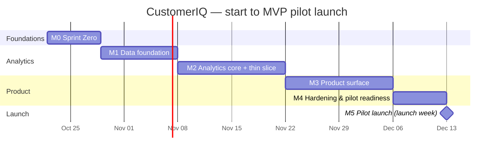

# CustomerIQ — Build Roadmap

**Date:** 2026-10-21
**Owner:** `architect` (with `customeriq-meta` for sequencing and user decisions)
**Inputs:** [`viability-analysis.md`](./viability-analysis.md) · [`tech-stack.md`](./tech-stack.md) · [`PRD.md`](./PRD.md) · [`skills.md`](./skills.md) · [`agents.md`](./agents.md) · [`../.claude/CLAUDE.md`](../.claude/CLAUDE.md)

> **Planning assumptions.** About one full-time-equivalent builder: you plus the agent team, with Claude doing most implementation and you making decisions, doing the human-only steps, and reviewing. Durations are calendar weeks. If you work part-time on this, multiply by about 1.5–2. The plan follows PRD Appendix D, with Sprint Zero split out explicitly.

---

## 1. MVP definition

### 1.1 What the MVP is
The MVP is the **P0 feature set from PRD §3.0**, delivered so that **one analyst at one pilot organization can go from an order export to a defensible, exportable retention list in under 15 minutes** (PRD §1 value proposition, §8.2 time-to-first-insight). It must also produce the complete academic deliverable on the UCI demo data.

| PRD feature | In MVP? | Notes / scope trim |
|---|---|---|
| F-01 Authentication & account | ✅ | Email/password + magic link. Google OAuth only if it takes under a day; otherwise move it to P1. |
| F-02 Organizations, roles & invitations | ✅ | Full role matrix. Org switcher included (consultants are a likely early user). |
| F-03 Upload, column mapping & data-quality report | ✅ | CSV + XLSX; mapping reuse included; the excluded-row sample download can slip to the first week of the pilot. |
| F-04 Cleaning & curation pipeline | ✅ | All rules R1–R8, no trimming (correctness-critical). |
| F-05 Analysis runs (orchestration, status, history) | ✅ | One concurrent run per org; Realtime status with polling fallback. |
| F-06 RFM scoring & segments | ✅ | |
| F-07 K-means clustering | ✅ | Required for the academic deliverable (RQ1). The cluster-rename UI can be minimal. |
| F-08 Repeat-purchase prediction (60-day) | ✅ | Baseline + logreg + RF, calibrated, protocol A.5 exactly. |
| F-09 Model performance & Methods report | ✅ | The threshold slider is in. A server-side PDF is P2; browser print is enough. |
| F-10 Overview dashboard | ✅ | |
| F-11 Segment explorer | ✅ | |
| F-12 Customer list & detail | ✅ | Segment history across runs is P1. |
| F-13 Explanations | ✅ (P0 part only) | Global importance + logreg per-customer drivers. RF TreeSHAP is P1. |
| F-14 Target list export | ✅ | |
| F-15 Demo workspace (UCI) | ✅ | **Also the first thing shipped** (see 1.2). |
| F-26 Data deletion & account closure | ✅ | Required before any real customer data is uploaded. |
| F-19 Power BI connectivity | ✅ for the academic track only | The `bi.*` views and read-only role are in the MVP. The `.pbit` is built by a human in Power BI Desktop. |

### 1.2 The smallest thing that delivers value (the "thin slice")
Shipped at the end of **Milestone 2** (about week 5), before the full MVP:

> **A read-only, signed-in demo workspace on the UCI data** showing the data-quality report, RFM segments with revenue share, each customer's 60-day repurchase probability next to the recency baseline, and a CSV export of the "At risk / Can't lose" list.

Why this slice:
- It proves the riskiest assumptions: data quality, a leakage-free model, and whether the model beats the baseline.
- It produces the academic results (RQ1–RQ2).
- It is the thing to put in front of the first 5 interviewees (PRD §8.2 launch-week target).
- It doesn't need uploads, multi-tenant writes or deletion flows, which are the hardest product surface.

### 1.3 Explicitly deferred (post-MVP)
- **P1 (weeks 9–12, only if pilot evidence supports them):**
  - F-16 what-if ROI simulator and action plans
  - F-17 cohort retention
  - F-18 run comparison
  - F-20 BG/NBD and CLV (*an academic stretch goal; may be pulled into M4 if time allows*)
  - F-21 scheduled runs and email notifications
  - F-22 audit log
  - F-13 RF per-customer SHAP
  - F-12 segment history
  - Google OAuth (if trimmed)
  - load testing (S71)
- **P2 (after the month-3 decision gate, PRD §8.3):** F-23 shareable report / PDF, F-24 Klaviyo/Mailchimp sync, F-25 Shopify/WooCommerce connectors.
- **Out of scope (PRD §7):**
  - native mobile apps
  - sending campaigns
  - storing personal data (PII)
  - streaming ingestion
  - recommendations
  - causal uplift modelling
  - deep learning or AutoML
  - multi-currency
  - custom segment builder
  - LLM narratives
  - billing
  - SSO/SCIM
  - white-labelling
  - warehouse integrations
  - localization
  - self-hosting
  - multi-region / SOC 2

---

## 2. Milestones

**Total: about 8 weeks to pilot launch** (matches PRD Appendix D). M2 ends with the thin slice (§1.2).

---

### M0 · Sprint Zero: foundations and data truth
- **Duration:** 1 week.
- **Deliverables:**
  1. Monorepo scaffold (`apps/web`, `apps/api`, `packages/ml`, `supabase/`) that builds, lints and tests green locally and in CI.
  2. GitHub Actions `ci.yml` (web, api and db jobs, gitleaks) running on PRs and on `main`.
  3. Supabase schema v1: identity and tenancy tables, `app.*` helper functions, RLS, profile trigger, custom access-token hook, plus pgTAP cross-tenant tests.
  4. Auth scaffolding: FastAPI JWT/JWKS dependency with role checks, and a Supabase client in the SPA.
  5. The agent team installed: `.claude/agents/*.md`, guard hook scripts, permission rules, work ledger, seed ADRs.
  6. **Data truth:** a UCI data profile (missing customer IDs, cancellation share, revenue concentration, 60-day base rate at several cutoffs), with a recommendation on the default horizon.
  7. Netlify: the GitHub → Netlify pipeline live with a URL (docs site).
- **Agent assignments:**

  | Deliverable | Owner | Reviewers |
  |---|---|---|
  | 1, 2 | devops-engineer | architect, qa-engineer |
  | 3 | db-engineer + identity-access | security-reviewer |
  | 4 | identity-access | security-reviewer |
  | 5 | customeriq-meta + architect | security-reviewer (hooks) |
  | 6 | research-analyst + data-engineer | ml-validator |
  | 7 | devops-engineer (config) + **you** (Netlify import) | — |

- **Dependencies:** research docs complete (done). Your approvals listed in §3.2.
- **Success criteria:**
  - The Sprint Zero checklist (§3) is all green.
  - The CI workflow is green on `main`.
  - pgTAP cross-tenant tests pass.
  - The data profile exists, and the horizon decision is recorded (kept at 60 days, or changed through `/spec-change`).

### M1 · Data foundation
- **Duration:** 1.5 weeks.
- **Deliverables:**
  1. Parsing and column mapping backend (F-03 API + A.1), including email hashing.
  2. Cleaning rules R1–R8 with exact reconciliation and the data-quality report (F-04, F-03 AC7).
  3. Curated star schema + bulk load (PRD §4.3 ingestion and curated tables).
  4. Storage buckets and policies.
  5. Pipeline worker skeleton (claim, stages, progress, cancel, timeout, error codes) running a "load only" run (F-05 core).
  6. UCI demo org seeded through the standard pipeline (F-15 data).
- **Agent assignments:**
  - data-engineer (1, 2, 5)
  - db-engineer (3, 4, 6 SQL side)
  - api-engineer (dataset endpoints)
  - ml-validator (reconciliation and determinism)
  - qa-engineer
  - security-reviewer (storage policies, email hashing)
- **Dependencies:** M0 (schema v1, CI, auth guard, data profile).
- **Success criteria:**
  - UCI ingest finishes in ≤ 5 min.
  - Reconciliation holds to ±£0.01.
  - Re-ingesting the same file creates no duplicates.
  - Cross-tenant tests cover the new tables and buckets.
  - A demo-org dataset reaches `ready`.

### M2 · Analytics core + thin slice
- **Duration:** 2 weeks.
- **Deliverables:**
  1. Feature snapshots at the cutoff, with leakage property tests (A.3, A.5).
  2. RFM scores and the 8 segments (F-06), with the SQL reference matching the pandas output.
  3. K-means with automatic k (F-07).
  4. Baseline, logistic regression and random forest models, calibration, selection and the `model_gain_low` flag; evaluation outputs (F-08, F-09 backend).
  5. Logistic-regression drivers and plain-language templates (F-13 P0).
  6. Reproducibility test.
  7. The read layer: `v_*` views, `mv_*` materialized views, `rpc_*` functions.
  8. **The thin slice (§1.2)** deployed on staging and visible on the demo org, with a minimal UI.
  9. Academic notebook for RQ1–RQ2.
- **Agent assignments:**
  - ml-scientist (2, 3, 4, 5)
  - data-engineer (1, worker stages)
  - ml-validator (1, 6, protocol audit; **blocks on failure**)
  - db-engineer (7)
  - api-engineer (runs and evaluation endpoints)
  - frontend-engineer (thin-slice UI)
  - research-analyst (9)
  - web-researcher (check current scikit-learn calibration API details)
- **Dependencies:** M1 (curated data, worker skeleton).
- **Success criteria:**
  - A full UCI run in ≤ 10 min.
  - Leakage and reproducibility tests are green.
  - ml-validator PASS.
  - Model metrics reported honestly against the baseline. Target: PR-AUC at least baseline + 0.03; otherwise the run carries the `model_gain_low` flag. Both outcomes are acceptable **if reported honestly**.
  - Thin slice shown to ≥ 3 interviewees.

### M3 · Product surface
- **Duration:** 2 weeks.
- **Deliverables:**
  1. Sign-up, sign-in and organization flows (F-01, F-02 UI and server).
  2. Upload wizard: mapping screen, data-quality report view and live run status (F-03 UI, F-05 UI).
  3. Overview dashboard (F-10).
  4. Segment explorer (F-11).
  5. Customer list and detail (F-12).
  6. Methods page with the threshold slider (F-09 UI).
  7. Export (F-14).
  8. Deletion (F-26).
  9. Rate limits (§5.6).
  10. Error catalog wired end to end.
  11. **Netlify switches from the docs site to the app build** (`apps/web/netlify.toml`).
- **Agent assignments:**
  - frontend-engineer (2–6, 11 UI)
  - identity-access (1, 8)
  - api-engineer (7, 9, 10)
  - ux-accessibility (copy and audits per page)
  - qa-engineer (E2E journeys)
  - devops-engineer (Netlify switch, Render staging)
  - security-reviewer (exports, deletion, uploads)
- **Dependencies:** M2 (analytics outputs and read layer); API contracts frozen at the start of M3 (architect sign-off).
- **Success criteria:**
  - All P0 acceptance criteria are mapped to passing tests (qa-engineer acceptance map).
  - The core E2E journey (sign up → upload → run → segments → export) passes on desktop, iPhone 13 and Pixel 7 profiles.
  - No serious or critical axe findings.

### M4 · Hardening and pilot readiness
- **Duration:** 1 week.
- **Deliverables:**
  1. Security review (ASVS L1 complete, L2 gaps listed) and an OWASP ZAP baseline scan on staging.
  2. Performance budgets met (PRD §6.1).
  3. Full WCAG 2.2 AA audit, plus a manual screen-reader pass by you.
  4. Sentry, uptime monitoring and alerts live.
  5. Backup and restore drill.
  6. Docs: API reference, help glossary, runbooks, privacy notes.
  7. Power BI views, read-only role and the measures guide (F-19). You build the `.pbit`.
  8. Academic write-up draft from stored runs.
  9. Pilot onboarding kit: screener, interview guide, data-handling one-pager.
  10. Launch checklist (§5) signed off.
- **Agent assignments:**
  - security-reviewer (1)
  - qa-engineer (2)
  - ux-accessibility (3)
  - devops-engineer (4, 5)
  - docs-writer (6)
  - integrations-engineer + db-engineer (7)
  - research-analyst (8)
  - product-analyst (9)
  - architect (final drift review)
  - customeriq-meta (sign-off with you)
- **Dependencies:** M3 feature-complete.
- **Success criteria:** every launch-checklist item is ✅, with no open critical or high security findings.

### M5 · Pilot launch (launch week)
- **Duration:** a launch event, then the first week.
- **Deliverables:**
  1. Production deploy (you run `/deploy production`).
  2. 3–5 pilot organizations invited.
  3. PostHog dashboards for the PRD §8.2 metrics.
  4. Launch-week metrics report.
- **Agent assignments:**
  - customeriq-meta (coordination)
  - devops-engineer (deploy preflight)
  - product-analyst (metrics, interviews)
  - incident-responder (on call)
  - web-researcher (competitor watch baseline)
- **Dependencies:** M4.
- **Success criteria (PRD §8.2, launch week):**
  - ≥ 30 sign-ups.
  - ≥ 3 orgs uploading their own data.
  - Upload → run success ≥ 70%.
  - ≥ 5 interviews.
  - 0 security incidents.

---

## 3. Sprint Zero checklist

Status key: ✅ done · 🔄 in progress (this session) · ⏳ waiting on you · ⬜ not started

### 3.1 Must be true before any feature code

**Repository setup**
- ✅ Research docs, CLAUDE.md, path-scoped rules on `main`
- ✅ `main` is the production branch; work happens on session or feature branches
- ✅ Monorepo scaffold: pnpm workspace (`apps/web`) and uv workspace (`apps/api`, `packages/ml`), with lint, format and typecheck configs
- ✅ `.env.example` per app (names only), `.gitignore` covering env files, build output and data
- ✅ Agent team installed: `.claude/agents/*.md` ×20, `scripts/agent-guards/*.sh` (tested), `.claude/settings.json` permissions, `docs/agents/ledger.md`, seed ADRs 0001–0009
- ⏳ GitHub branch protection on `main` (require CI) — **you, in GitHub settings**

**CI/CD pipeline**
- ✅ `.github/workflows/ci.yml` (verified locally; first GitHub run on push):
  - web: lint, typecheck, test, build
  - api and ml: ruff, mypy, pytest
  - db: migrations applied and SQL tests run
  - gitleaks
- ✅ Netlify config (`netlify.toml`) and build script
- ⏳ Netlify site imported from GitHub, production branch `main`, URL shared — **you**
- ⬜ Render staging service (in M1/M2, when the API has an endpoint worth deploying)

**Development environment**
- ✅ Toolchain present here: Node 22, pnpm 10, uv, Python 3.12+, Docker, Postgres 16 client
- ✅ One-command setup (`pnpm install && uv sync`) documented in the README
- ⬜ SessionStart hook for cloud sessions (S07) — after the scaffold settles
- ⬜ `.mcp.json` (S53): Supabase dev (read-only for prod), GitHub, Context7, Firecrawl — **runs only with your approval** (user-only skill)

**Database provisioning**
- ✅ `supabase/config.toml` + migration v1 (organizations, profiles, memberships, invitations, org_settings, `app.*` helpers, RLS) + SQL tests
- ✅ **Supabase dev project** `customeriq-dev` (eu-west-2, free) created; migration v1 applied; security advisor clean
- ⬜ Production project (Pro, $25/mo) — at M4, not now

**Authentication scaffolding**
- ✅ Custom access-token hook (`org_id`, `org_role` claims) in migration v1
- ✅ FastAPI `get_current_user` (JWKS) + `require_role()` with unit tests using locally signed tokens
- ✅ SPA Supabase client module + typed env
- ⏳ Auth providers and SMTP (Resend) configured in the Supabase dashboard — **you**, when the dev project exists

**Data truth** (week-1 validation from the viability analysis)
- ⏳ **Download UCI Online Retail II**: approved, but blocked by the environment's network policy (403 on archive.ics.uci.edu). Allow the host or upload the zip; the profiling script is ready (`notebooks/profile_uci.py`).
- ⬜ Data profile + 60-day base rate → horizon decision

### 3.2 Decisions and actions needed from you
| # | Item | Why it's yours | Recommendation |
|---|---|---|---|
| 1 | Approve downloading the UCI dataset in this environment | External download (CLAUDE.md §4) | **Approve**. It unblocks the data profile, the base-rate check, M1 and M2. |
| 2 | Create a Supabase **dev** project (free) and provide its project ref, or approve me creating it through the Supabase MCP | Creates an external resource | Approve the free dev project; production waits until M4 |
| 3 | Import the repo into Netlify (production branch `main`) | Needs your Netlify login | Do it now; share the URL |
| 4 | Turn on branch protection for `main` (require CI) | GitHub settings | After CI's first green run |
| 5 | Set `"agent": "customeriq-meta"` as the default session agent | Changes how every future session behaves | **Decided: no** (2026-10-21). Use `claude --agent customeriq-meta` when wanted |
| 6 | Power BI access (Windows + Pro licence via the university?) | Licensing | Confirm by M4 |

---

## 4. Risk register

Likelihood and impact use H/M/L.

| # | Milestone | Risk | L | I | Mitigation | Owner |
|---|---|---|---|---|---|---|
| R1 | M0 | Supabase CLI or local stack won't run in the cloud sandbox (Docker image pulls through the proxy) | M | M | Verify migrations against plain Postgres 16 with a Supabase-compatible `auth` stub; run the full `supabase start` in CI | db-engineer, devops-engineer |
| R2 | M0 | UCI download not approved or blocked | L | H | Ask now (§3.2 #1). Fallback: you upload the zip; a synthetic fixture lets unit tests proceed | meta |
| R3 | M0–M2 | **60-day base rate unsuitable** (too low or too high), giving unstable metrics | M | H | Measure in M0; switch to 90 days through `/spec-change` before modelling; keep the horizon configurable (30/60/90) | research-analyst, ml-scientist |
| R4 | M1 | Messy real-world exports (encodings, date formats, Excel quirks) break parsing | H | M | Fixture corpus of messy files; per-field parse rates; mapping preview blocks bad mappings; collect 2–3 real exports from interviewees early | data-engineer, qa-engineer |
| R5 | M1 | Reconciliation can't be made exact (rounding, cancellations without a matching original) | M | M | Decimal arithmetic end to end; explicit unmatched-cancellation rule; tests on known totals | data-engineer, ml-validator |
| R6 | M2 | **Label leakage or protocol errors** inflate metrics | M | H | Leakage property tests from day one; independent ml-validator with blocking power; out-of-time split only | ml-validator |
| R7 | M2 | Model adds little over the baseline (`model_gain_low`) | M | M | Treated as a valid finding; product value shifts to segments, explanations and the export. Report honestly (PRD §8.1) | ml-scientist, research-analyst |
| R8 | M2 | Worker memory or time limits on the 1M-row data | M | M | Parquet conversion, dtype optimization, heavy jobs on GitHub Actions, Render Standard (2 GB) only when needed | data-engineer, devops-engineer |
| R9 | M3 | RLS or tenancy bug leaks data across organizations | L | H | Policy pattern per table, pgTAP + API cross-tenant meta-test as a release gate, security-reviewer on every policy change | identity-access, security-reviewer |
| R10 | M3 | UI scope creep (charts, polish) delays the launch | H | M | P0 criteria only; architect freezes contracts at M3 start; P1 ideas go to the backlog | orchestrator, architect |
| R11 | M3 | Upload wizard complexity (resumable uploads, mapping UX) | M | M | Start it first in M3; fall back to non-resumable uploads ≤ 25 MB for the pilot if needed | frontend-engineer |
| R12 | M3–M5 | Netlify free-plan credit cap pauses the site mid-pilot | M | M | Upgrade to Personal ($9) before M5; keep deploys to `main` batched | devops-engineer, you |
| R13 | M4 | Performance budgets missed (dashboard > 2 s) | M | M | Materialized views and RPC aggregates from M2; perf checks in CI from M3 | db-engineer, qa-engineer |
| R14 | M4 | Accessibility gaps in charts | M | M | Table alternative built into the chart component from the start; axe in E2E | frontend-engineer, ux-accessibility |
| R15 | M4 | Power BI unavailable (Windows or licence) | M | L | Static `.pbix` screenshots, or rely on the web app's Methods page for the academic deliverable | research-analyst, you |
| R16 | M5 | Too few pilot organizations recruited | H | H | Start recruiting in M2 with the thin slice; target wholesale-heavy SMB retailers; web-researcher builds a prospect list from public sources | product-analyst |
| R17 | All | Agent coordination overhead or misrouting slows work | M | M | Small tasks go to a single specialist; the ledger shows status; weekly architect drift sweep; adjust the agent definitions after M0 | meta, architect |
| R18 | All | Budget creep past $50/mo | L | M | cost-watch weekly; Supabase Pro only from M4; Render Starter only when staging is needed | devops-engineer |

---

## 5. Launch checklist (M4 exit, before `/deploy production`)

**Security review**
- [ ] security-reviewer full sweep: ASVS L1 complete; all L2 gaps listed with plans; zero open critical or high findings
- [ ] Cross-tenant meta-test passes: every `org_id` table and bucket has RLS and tests; API returns 404 for other orgs' resources
- [ ] Permission-matrix audit matches PRD F-02 / §5.5
- [ ] No PII stored: email refs hashed; Sentry PII scrubbing verified by test; PostHog sends no customer-level data and masks inputs
- [ ] Secrets: gitleaks clean; nothing secret in `VITE_*`; production secrets only in Render, Netlify, Supabase and GitHub stores; rotation runbook exists
- [ ] Headers: CSP, HSTS, nosniff, referrer and frame-ancestors on Netlify; CORS limited to production + preview regex
- [ ] Uploads: magic-byte check, size limits, openpyxl read-only; exports protected against CSV injection; signed URLs ≤ 15 min
- [ ] Dependencies: pip-audit and pnpm audit show no high or critical issues
- [ ] OWASP ZAP baseline on staging: no high alerts
- [ ] Deletion (F-26) verified: zero residual rows or objects after dataset and org deletion

**Performance benchmarks (PRD §6.1)**
- [ ] LCP ≤ 2.5 s p75, INP ≤ 200 ms, CLS ≤ 0.1 (Lighthouse CI)
- [ ] Initial JS ≤ 250 KB gzipped
- [ ] Overview dashboard ≤ 2.0 s p75; PostgREST views ≤ 300 ms p95; API reads ≤ 400 ms p95
- [ ] UCI ingest ≤ 5 min; full run ≤ 10 min; 200k-row export ≤ 30 s
- [ ] Restore drill done: RPO ≤ 24 h, RTO ≤ 4 h

**Analytical quality (PRD §8.1)**
- [ ] Leakage tests 100% pass; reproducibility within ±0.001
- [ ] Reconciliation exact on UCI and pilot fixtures
- [ ] Methods page shows the model against the baseline honestly (including `model_gain_low` if applicable)
- [ ] Sensitivity analysis with and without wholesalers reported

**User testing completed**
- [ ] ≥ 5 usability sessions with the target persona on the thin slice or MVP (product-analyst synthesis in `research/interviews/`)
- [ ] Core journey completed unaided by ≥ 4 of 5 testers in ≤ 15 minutes
- [ ] All top usability issues fixed or explicitly deferred
- [ ] WCAG 2.2 AA audit: no serious or critical axe findings; keyboard-only journey passes; manual screen-reader pass done (you)
- [ ] Mobile check at 360 px: no horizontal scroll; read-only views usable

**Documentation ready**
- [ ] API reference + error-code pages generated from OpenAPI
- [ ] In-app help and glossary match PRD Appendix A/B
- [ ] Runbooks: deploy and rollback, incident response, backup and restore, secrets rotation
- [ ] Privacy and data-handling one-pager for pilots (what we store, hashing, deletion within 30 days, subprocessors)
- [ ] CHANGELOG and release notes for v1.0.0
- [ ] CLAUDE.md §3 current; ledger closed out for M0–M4

**Operations**
- [ ] Sentry alerts, uptime monitor and failing-job alerts tested
- [ ] Supabase production on Pro, backups confirmed; Netlify on Personal; Render Starter
- [ ] Cost check: projected monthly ≤ $50 for pilot volume

---

## 6. Sprint Zero execution log

*(The architect and meta update this as Sprint Zero runs. See the git log for details.)*

| Date | Workstream | Agent role(s) | Status | Evidence |
|---|---|---|---|---|
| 2026-10-21 | Roadmap written | architect | ✅ | this file |
| 2026-10-21 | Monorepo scaffold + CI | devops-engineer | ✅ | web lint/typecheck/test/build pass; ruff, mypy, pytest (33) pass; actionlint, gitleaks clean |
| 2026-10-21 | Schema v1 + auth scaffolding | db-engineer, identity-access | ✅ | 74 SQL assertions on Postgres 16; 28 auth tests; applied to Supabase dev; security advisor clean |
| 2026-10-21 | Agent team infrastructure | meta, architect | ✅ | 20 agents extracted with no drift; guard self-tests 94/94; 4 guard defects fixed |
| 2026-10-21 | UCI data profile | research-analyst | ⏳ blocked | network policy denies archive.ics.uci.edu; script tested on synthetic data only |
| 2026-10-27 | Browser analytics app (user-requested same-day scope; ADR-0012) | data-engineer, ml-scientist, frontend-engineer | ✅ | engine 59 tests, UI 29 tests; real-browser run of sample, CSV and XLSX; live at the Netlify URL |
