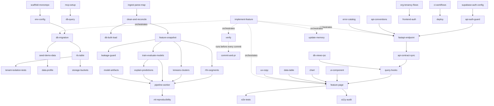

# CustomerIQ — Skills Inventory

**Date:** 2026-10-21
**Inputs:** [`PRD.md`](./PRD.md), [`tech-stack.md`](./tech-stack.md), [`viability-analysis.md`](./viability-analysis.md), [`.claude/CLAUDE.md`](../.claude/CLAUDE.md)
**Reference:** Claude Code skills documentation ([code.claude.com/docs/en/skills][cc-skills], reviewed 2026-10-21)

---

## 0. How to read this inventory

### What "skill" means here
Each entry is a candidate **Claude Code skill**: a `.claude/skills/<name>/SKILL.md` file (plus optional `reference.md`, `examples.md` and `scripts/`). It packages a repeatable procedure or body of domain knowledge that an agent needs to build CustomerIQ. Each entry is also a **capability** the project needs. Even if a capability never becomes a skill file, someone or something has to be able to do it.

### Key facts from the skills documentation that shaped this inventory
| Fact (from the docs) | How it is applied here |
|---|---|
| A skill's body loads **only when invoked**, but its `description` is always in context. The listing budget is about 1% of the context window, and descriptions get dropped once the listing overflows. | 88 skills are identified (because "exhaustive" was asked for), but **§3 recommends building them in waves** (about 15–25 active at a time). Some are marked *fold into another skill* or *use a rule or hook instead*. |
| `disable-model-invocation: true` means only the user can trigger the skill. The docs recommend it for anything with side effects (deploy, commit, sending messages). | Applied to deploy, secrets rotation, destructive data operations, seeding, and external downloads. These match the "never without approval" list in CLAUDE.md. |
| `user-invocable: false` means only Claude can load it. Intended for background knowledge. | Applied to *reference* skills (API conventions, error catalog, UX copy, analytic definitions). |
| `context: fork` (+ `agent:`) runs the skill in an isolated subagent that **doesn't see the conversation**. | Applied to self-contained, read-heavy audits (a11y, security, permission matrix, cost check, data profiling). |
| `paths:` globs mean the skill auto-loads only when matching files are touched. | Applied to area-specific skills, so they stay quiet elsewhere. |
| `allowed-tools` pre-approves tools for that turn only. | Used sparingly, mainly for read-only checks such as `Bash(pnpm lint *)`. |
| `$ARGUMENTS`, `$0`, `$1`, and named `arguments:` | Shown in each **Example invocation**. |
| ``!`command` `` dynamic context injection runs before Claude reads the skill. | Used to inject `git diff`, the current run status, or the `CLAUDE.md` §3 state. |
| A **project skill named `verify`** (or `simplify`) is run by Claude **right before each commit** (Claude Code ≥ 2.1.286). | **S02 is deliberately named `verify`** to get this pre-commit gate for free. |
| Keep `SKILL.md` under 500 lines and move detail into supporting files. A rule that must hold every time belongs in a **hook**, not a skill. | Hard rules (no secrets, no prod migrations) are listed in §4 as hook candidates, in addition to any skill. |
| Bundled skills already exist: `/code-review`, `/security-review`, `/simplify`, `/run`, `/verify`, `/run-skill-generator`, `/debug`, `/batch`, `/loop`, `/doctor`, `/init`. This environment also provides `dataviz`, `session-start-hook` and `skill-creator`. | §2 maps these to our needs so we **reuse rather than rebuild** them. Our skills wrap them with project context where needed. |

### Entry format
Every skill lists: **Description · Input · Output · Dependencies** (libraries / external APIs / other skills) **· Docs · Complexity · Example invocation**. Most entries also list **Frontmatter** (recommended config), **Priority** (from the PRD features each skill serves) and **PRD refs**. Documentation links are reference-style. The full URL list is in **§6**, so every link is clickable without repeating the same URL dozens of times.

**Complexity scale:**
- **Simple:** a single procedure of mostly templated steps. Less than a day to author and verify.
- **Moderate:** several steps with judgement calls, or touches 2–3 subsystems.
- **Complex:** domain-critical, many edge cases, correctness can't be eyeballed, needs fixtures and tests to verify.

---

## 1. Summary table

| ID | Skill | Category | Complexity | Priority | Wave |
|---|---|---|---|---|---|
| S01 | `implement-feature` | Meta / workflow | Complex | P0 | 0 |
| S02 | `verify` | Meta / testing | Simple | P0 | 0 |
| S03 | `update-memory` | Meta / docs | Simple | P0 | 0 |
| S04 | `spec-change` | Meta / docs | Simple | P0 | 0 |
| S05 | `commit-and-pr` | Meta / git | Simple | P0 | 0 |
| S06 | `scaffold-monorepo` | Setup | Moderate | P0 | 0 |
| S07 | `cloud-session-setup` | Setup | Simple | P0 | 0 |
| S08 | `env-config` | Setup | Simple | P0 | 0 |
| S09 | `db-migration` | Database | Moderate | P0 | 0 |
| S10 | `rls-table` | Database / authz | Moderate | P0 | 0 |
| S11 | `db-views-rpc` | Database | Moderate | P0 | 2 |
| S12 | `db-query` | Database | Simple | P0 | 0 |
| S13 | `db-performance` | Database | Moderate | P0 | 3 |
| S14 | `db-bulk-load` | Database | Moderate | P0 | 1 |
| S15 | `storage-buckets` | Database / storage | Moderate | P0 | 1 |
| S16 | `db-backup-restore` | Database / infra | Moderate | P0 | 3 |
| S17 | `seed-demo-data` | Database / data | Moderate | P0 | 0 |
| S18 | `supabase-auth-config` | Auth | Moderate | P0 | 2 |
| S19 | `api-auth-guard` | Auth | Moderate | P0 | 2 |
| S20 | `org-tenancy-flows` | Auth / multi-tenancy | Moderate | P0 | 2 |
| S21 | `frontend-auth` | Auth / frontend | Moderate | P0 | 2 |
| S22 | `permission-matrix-audit` | Auth / testing | Simple | P0 | 3 |
| S23 | `data-profile` | Data / ML | Simple | P0 | 0 |
| S24 | `ingest-parse-map` | Data / ML | Complex | P0 | 1 |
| S25 | `clean-and-reconcile` | Data / ML | Complex | P0 | 1 |
| S26 | `feature-snapshot` | Data / ML | Complex | P0 | 1 |
| S27 | `leakage-guard` | Data / ML / testing | Moderate | P0 | 1 |
| S28 | `rfm-segments` | Data / ML | Moderate | P0 | 1 |
| S29 | `kmeans-clusters` | Data / ML | Moderate | P0 | 1 |
| S30 | `train-evaluate-models` | Data / ML | Complex | P0 | 1 |
| S31 | `explain-predictions` | Data / ML | Moderate | P0/P1 | 1 |
| S32 | `bgnbd-clv` | Data / ML | Complex | P1 | 4 |
| S33 | `pipeline-worker` | Data / ML / backend | Complex | P0 | 1 |
| S34 | `model-artifacts` | Data / ML | Simple | P0 | 1 |
| S35 | `ml-reproducibility` | Data / ML / testing | Simple | P0 | 1 |
| S36 | `academic-notebook` | Data / docs | Simple | P0 | 1 |
| S37 | `what-if-roi` | Analytics feature | Moderate | P1 | 4 |
| S38 | `cohort-retention` | Analytics feature | Moderate | P1 | 4 |
| S39 | `run-comparison` | Analytics feature | Moderate | P1 | 4 |
| S40 | `api-conventions` | API (reference) | Simple | P0 | 2 |
| S41 | `fastapi-endpoint` | API | Moderate | P0 | 2 |
| S42 | `api-contract-sync` | API / frontend | Simple | P0 | 2 |
| S43 | `rate-limiting` | API | Simple | P0 | 3 |
| S44 | `async-export` | API | Moderate | P0 | 3 |
| S45 | `data-deletion-gdpr` | API / compliance | Moderate | P0 | 3 |
| S46 | `audit-log` | API / compliance | Simple | P1 | 4 |
| S47 | `scheduled-jobs` | API / infra | Simple | P1 | 4 |
| S48 | `transactional-email` | Integration | Simple | P0 | 2 |
| S49 | `product-analytics` | Integration | Simple | P0 | 3 |
| S50 | `powerbi-bi-layer` | Integration | Moderate | P1 (P0 academic) | 3 |
| S51 | `platform-connector` | Integration | Complex | P2 | — |
| S52 | `audience-sync` | Integration | Complex | P2 | — |
| S53 | `mcp-setup` | Integration / tooling | Simple | P0 | 0 |
| S54 | `feature-page` | Frontend | Moderate | P0 | 2 |
| S55 | `ui-component` | Frontend | Simple | P0 | 2 |
| S56 | `chart` | Frontend | Moderate | P0 | 2 |
| S57 | `data-table` | Frontend | Moderate | P0 | 2 |
| S58 | `query-hooks` | Frontend | Simple | P0 | 2 |
| S59 | `form` | Frontend | Simple | P0 | 2 |
| S60 | `upload-wizard` | Frontend | Complex | P0 | 3 |
| S61 | `realtime-run-status` | Frontend | Simple | P0 | 2 |
| S62 | `methods-report-page` | Frontend / docs | Moderate | P0 | 2 |
| S63 | `ux-copy` | Frontend (reference) | Simple | P0 | 2 |
| S64 | `responsive-check` | Frontend / testing | Simple | P0 | 3 |
| S65 | `python-tests` | Testing | Moderate | P0 | 1 |
| S66 | `web-unit-tests` | Testing | Simple | P0 | 2 |
| S67 | `e2e-tests` | Testing | Moderate | P0 | 3 |
| S68 | `tenant-isolation-tests` | Testing / security | Moderate | P0 | 0 |
| S69 | `a11y-audit` | Testing | Moderate | P0 | 3 |
| S70 | `perf-budget` | Testing | Moderate | P0 | 3 |
| S71 | `load-test` | Testing | Moderate | P1 | 4 |
| S72 | `security-audit` | Testing / security | Moderate | P0 | 3 |
| S73 | `ci-workflows` | Deployment | Moderate | P0 | 0→3 |
| S74 | `deploy` | Deployment | Moderate | P0 | 3 |
| S75 | `hosting-config` | Deployment | Simple | P0 | 3 |
| S76 | `secrets-rotation` | Deployment / security | Simple | P0 | 3 |
| S77 | `cost-watch` | Infrastructure | Simple | P0 | 3 |
| S78 | `dependency-hygiene` | Infrastructure | Simple | P0 | 3 |
| S79 | `academic-writeup` | Documentation | Moderate | P0 (academic) | 3 |
| S80 | `api-reference-docs` | Documentation | Simple | P0 | 3 |
| S81 | `adr` | Documentation | Simple | P0 | 0 |
| S82 | `release-notes` | Documentation | Simple | P1 | 3 |
| S83 | `observability-setup` | Error handling / logging | Moderate | P0 | 2 |
| S84 | `error-catalog` | Error handling (reference) | Simple | P0 | 2 |
| S85 | `incident-triage` | Error handling | Moderate | P0 | 3 |
| S86 | `customer-interview` | Product validation | Simple | P0 (validation) | 3 |
| S87 | `success-metrics-review` | Product validation | Simple | P0 (validation) | 4 |
| S88 | `web-research` | Research (Firecrawl) | Simple | P0 | 0 |

**Totals:** 88 skills. By complexity: 38 Simple · 37 Moderate · 13 Complex. By priority: 72 P0, 9 P1, 2 P2, plus 5 marked P0 for the academic or validation track only (S36, S50, S79, S86, S87). The complex ones (S01, S24, S25, S26, S30, S32, S33, S51, S52, S60 and others) carry most of the project's risk and should be written first and reviewed most carefully.

### Dependency graph (core path only)

---

## 2. Bundled and available skills to reuse (don't rebuild these)

| Existing skill | Use it for | Our wrapper or addition |
|---|---|---|
| `/code-review` (bundled) | Correctness review of diffs and PRs | S01 calls it before a PR. S02 doesn't duplicate it. |
| `/security-review` (bundled) | Security review of pending changes | S72 adds the CustomerIQ-specific checklist (RLS, service role, PII, joblib, CSV injection) |
| `/simplify` (bundled) | Cleanup after a feature lands | Optional final step in S01 |
| `/run`, `/verify`, `/run-skill-generator` (bundled) | Launching the app, confirming behavior in the real app | Run `/run-skill-generator` **once** after S06 to record the launch recipe (Supabase local + API + worker + web). **Our S02 `verify` replaces the bundled `/verify`** with lint, typecheck, tests, leakage and RLS checks, plus an optional run step. |
| `/debug` (bundled) | Diagnosing failures | S85 uses it after pulling Sentry context |
| `/batch` (bundled) | Applying a change across many files | Large refactors (for example, renaming a feature column across layers) |
| `/loop` (bundled) | Repeating a task on an interval | Watching a long pipeline run or CI |
| `/init`, `/doctor`, `/doctor prompt-audit` (bundled) | CLAUDE.md upkeep, setup checks, auditing instructions for conflicts | Run `/doctor prompt-audit` after adding each skill wave |
| `dataviz` (available in this environment) | Chart form, colour palettes and accessibility rules | S56 `chart` **defers to it** for palettes, marks and stat tiles, and adds ECharts and CustomerIQ specifics |
| `session-start-hook` (available) | Building SessionStart hooks for cloud sessions | S07 uses it to generate our hook |
| `skill-creator` (available) | Writing, evaluating and tuning skill descriptions | Use it to author every skill in this inventory and to run trigger evals |
| `claude-api` (bundled) | Only if an LLM feature is added (out of scope for the MVP, PRD §7) | Not needed for the MVP |

---

## 3. Skill specifications

### Category A: Meta and workflow

#### S01 · `implement-feature`
| | |
|---|---|
| **Description** | End-to-end delivery of one PRD feature (`F-xx`) as a vertical slice. It reads the feature's stories, acceptance criteria, schema and API sections, and Appendix A definitions. It then plans the slice, calls the relevant area skills (DB → pipeline → API → UI → tests), runs `verify`, updates memory, and prepares a commit. |
| **Input** | Feature ID (`F-06`), optional scope note (`"P0 criteria only"`), current `CLAUDE.md` §3 state (injected), PRD sections for that feature. |
| **Output** | Code, migrations and tests satisfying every acceptance criterion. A checklist mapping each criterion to the file or test that proves it. An updated `CLAUDE.md` §3. A commit (not a PR) referencing the feature ID. Open questions are raised, not guessed. |
| **Dependencies** | **Libraries:** none directly. **APIs:** GitHub MCP (optional), Supabase MCP (dev). **Skills:** S02, S03, S04, S05, and area skills S09/S10/S11/S24–S33/S41/S54–S62/S65–S68 as the feature needs. Bundled `/code-review`. |
| **Docs** | [cc-skills], [cc-subagents], [cc-memory] |
| **Complexity** | Complex (orchestration plus judgement about scope) |
| **Frontmatter** | `disable-model-invocation: true` · `argument-hint: [F-xx] [scope-note]` · `arguments: [feature, scope]` · body injects ``!`sed -n '/## 3. Current state/,/## 4./p' .claude/CLAUDE.md` `` |
| **Example invocation** | `/implement-feature F-06 "P0 only"`. Within the skill, `$feature` = `F-06`. |
| **PRD refs** | All; Appendix D milestones |

#### S02 · `verify`
| | |
|---|---|
| **Description** | The project's quality gate. **Named `verify` so Claude Code automatically runs it before each commit.** It runs only the checks relevant to changed paths: web lint, typecheck, Vitest and build; API Ruff, mypy and pytest; `supabase test db` (pgTAP/RLS); leakage tests when `packages/ml` changed; and the contract diff when the API changed. Results are reported honestly. |
| **Input** | The working tree diff (injected with ``!`git diff --stat HEAD` ``). Optional `--full` to run everything. |
| **Output** | A pass/fail table per check, with failing output excerpts. The commit is blocked (Claude doesn't commit) on any failure. The skill never weakens tests. |
| **Dependencies** | **Libraries:** pnpm, ESLint, TypeScript, Vitest, uv, Ruff, mypy, pytest, Supabase CLI, pgTAP. **Skills:** S27, S42, S68 (their test suites). |
| **Docs** | [cc-skills] (verify behavior), [pnpm], [vitest], [ruff], [mypy], [pytest], [supabase-testing] |
| **Complexity** | Simple |
| **Frontmatter** | `allowed-tools: Bash(pnpm *) Bash(uv run *) Bash(supabase test db*) Bash(git diff*)` · `argument-hint: [--full]` |
| **Example invocation** | Runs automatically before commits. Manual: `/verify --full`. |
| **PRD refs** | §6, §8.1 (CI gates) |

#### S03 · `update-memory`
| | |
|---|---|
| **Description** | Updates `.claude/CLAUDE.md` §3 (Done / In progress / Known issues / Last updated) and the `✅` markers in §5, based on what changed this session. It keeps the file under about 250 lines and moves overflow into rules or skills. |
| **Input** | Session summary or `git log` since the last update (injected), and the current §3 text. |
| **Output** | A minimal diff to CLAUDE.md. A suggestion to run `/doctor prompt-audit` if conflicts appear. |
| **Dependencies** | **Skills:** none. **Docs:** CLAUDE.md conventions. |
| **Docs** | [cc-memory] |
| **Complexity** | Simple |
| **Frontmatter** | `argument-hint: [summary]` · body injects ``!`git log --oneline -15` `` |
| **Example invocation** | `/update-memory "F-06 RFM scoring merged; base rate measured at 41%"`, or automatically at the end of S01 |

#### S04 · `spec-change`
| | |
|---|---|
| **Description** | Records a decision that changes the product or analytics spec: the PRD section edit, a changelog line at the bottom of the PRD, an ADR via S81 if it's architectural, and the CLAUDE.md pointer. Use when an analytic definition (cleaning, features, labels, segment map, thresholds) or scope changes. **Must be confirmed by the user.** |
| **Input** | What changes, why, who approved it, and the affected PRD sections or features. |
| **Output** | An updated PRD with a dated changelog entry, a list of affected code and tests, and a follow-up task list. |
| **Dependencies** | **Skills:** S81, S03. |
| **Docs** | [adr] |
| **Complexity** | Simple |
| **Frontmatter** | `disable-model-invocation: true` · `argument-hint: [summary-of-change]` |
| **Example invocation** | `/spec-change "Default horizon 60→90 days because base rate at 60d is 9% (approved by Jordan 2026-11-02)"` |

#### S05 · `commit-and-pr`
| | |
|---|---|
| **Description** | Stages and commits with the project's message convention (`F-xx: imperative summary`, plus the required trailers). Pushes to the session branch with retry and backoff. Opens a PR **only when explicitly asked**, filling the repo PR template and running `/code-review` first. |
| **Input** | Changed files, feature IDs, the branch name, and whether a PR was requested. |
| **Output** | A commit and push. Optionally a PR link with a body mirroring the template and an acceptance-criteria checklist. |
| **Dependencies** | **Libraries:** git. **APIs:** GitHub MCP (`create_pull_request`). **Skills:** S02 (runs first), bundled `/code-review`. |
| **Docs** | [gh-mcp], [gha] |
| **Complexity** | Simple |
| **Frontmatter** | `disable-model-invocation: true` · `allowed-tools: Bash(git add *) Bash(git commit *) Bash(git status*) Bash(git push *)` |
| **Example invocation** | `/commit-and-pr` or `/commit-and-pr --pr` |

---

### Category B: Project setup and environment

#### S06 · `scaffold-monorepo`
| | |
|---|---|
| **Description** | Creates the planned layout (`apps/web`, `apps/api`, `packages/ml`, `supabase/`, `notebooks/`, `bi/`, `sql/`, `.github/workflows/`). Sets up pnpm workspace + Vite React TS + Tailwind v4 + shadcn init, a uv workspace (FastAPI app + `customeriq` package), `supabase init`, Ruff/mypy/ESLint/Prettier configs, `.env.example` files, and `.gitignore`. Updates CLAUDE.md §5 with the real commands. |
| **Input** | Tech stack decisions, file map from CLAUDE.md §5, and pinned versions (current stable at creation time). |
| **Output** | A buildable empty skeleton where `pnpm -C apps/web build`, `uv run pytest` (one smoke test) and `supabase start` all succeed. Committed. |
| **Dependencies** | **Libraries:** Node LTS, pnpm, Vite, React, TypeScript, Tailwind, shadcn CLI, Python 3.12, uv, FastAPI, Supabase CLI, Docker (for local Supabase). **Skills:** S08, S07, S73 (CI stub), S03. |
| **Docs** | [pnpm], [vite], [react], [ts], [tailwind], [shadcn], [uv], [fastapi], [supabase-cli] |
| **Complexity** | Moderate |
| **Frontmatter** | `disable-model-invocation: true` (one-time setup) |
| **Example invocation** | `/scaffold-monorepo` |
| **PRD refs** | Appendix D week 1; tech-stack CI/CD layout |

#### S07 · `cloud-session-setup`
| | |
|---|---|
| **Description** | Builds a SessionStart hook so cloud and remote Claude sessions can run lint, tests and local Supabase. It installs pnpm and uv dependencies and checks for the Supabase CLI and Docker. It wraps the available `session-start-hook` skill with this repo's commands. |
| **Input** | Repo commands from S06. Environment constraints (network policy, no Docker in some sandboxes, in which case the pgTAP step degrades gracefully). |
| **Output** | `.claude/settings.json` hook + `scripts/session-start.sh`, idempotent and fast (< 60 s warm). |
| **Dependencies** | **Skills:** `session-start-hook` (available), S06. |
| **Docs** | [cc-hooks] |
| **Complexity** | Simple |
| **Frontmatter** | `disable-model-invocation: true` |
| **Example invocation** | `/cloud-session-setup` |

#### S08 · `env-config`
| | |
|---|---|
| **Description** | Keeps the environment variable contract consistent. It keeps the `.env.example` files, the `pydantic-settings` `Settings` class, the Vite env typings (`env.d.ts`), Render/Netlify/GitHub secret names, and CLAUDE.md §6 in sync. It validates that no secret has a `VITE_` prefix and that required vars fail fast at startup. |
| **Input** | A new or renamed variable: name, scope (web/api/ci), whether it's secret, and its purpose. |
| **Output** | Updated example files, settings class, typings and CLAUDE.md §6. A startup validation test. |
| **Dependencies** | **Libraries:** pydantic-settings, Vite env. **Skills:** S03. |
| **Docs** | [pydantic-settings], [vite-env], [render-env], [gha-secrets] |
| **Complexity** | Simple |
| **Frontmatter** | `paths: ["**/.env.example", "apps/api/app/config.py", "apps/web/src/env.d.ts"]` |
| **Example invocation** | `/env-config add RESEND_API_KEY api secret "transactional email"` |

---

### Category C: Database operations (CRUD, migrations, queries)

#### S09 · `db-migration`
| | |
|---|---|
| **Description** | Creates and validates a forward-only SQL migration. Runs `supabase migration new`, writes the DDL following the PRD §4 conventions (org_id FK, `created_at`/`updated_at` trigger, CHECKs, indexes), and applies it locally (`supabase db reset` **local only**). Regenerates TS types, runs pgTAP, and runs the Supabase advisors through MCP on the **dev** project. Destructive changes follow expand → backfill → contract and need approval. |
| **Input** | Purpose, tables or columns (from PRD §4.3), and whether it's destructive. |
| **Output** | `supabase/migrations/<ts>_<name>.sql`, regenerated `database.types.ts`, passing `supabase test db`, and an advisor report with no new warnings. |
| **Dependencies** | **Libraries:** Supabase CLI, PostgreSQL 15. **APIs:** Supabase MCP (`apply_migration`, `list_tables`, `get_advisors`, `generate_typescript_types`), dev project only. **Skills:** S10 (if the table is tenant-scoped), S68, S42 (type regeneration). |
| **Docs** | [supabase-migrations], [supabase-cli], [supabase-typegen], [supabase-advisors], [supabase-mcp], [pg] |
| **Complexity** | Moderate |
| **Frontmatter** | `paths: supabase/**` · `argument-hint: [migration_name] [purpose]` |
| **Example invocation** | `/db-migration add_action_plans "F-16 action plans table"`, or automatically: "add a `holdout_pct` column to action_plans" |
| **PRD refs** | §4.3, §4.7 |

#### S10 · `rls-table`
| | |
|---|---|
| **Description** | Adds RLS to a tenant table using the PRD §4.4 pattern. Enables RLS, adds a select policy (`org_id = app.current_org_id() and app.has_role('viewer')` OR demo org), adds write policies only where the PRD allows end-user writes, and adds storage policies for path-prefixed buckets. Generates the matching pgTAP cross-tenant tests. |
| **Input** | Table name, PRD access row (§4.4 table: who can read and write), and whether the demo org is readable. |
| **Output** | Policy SQL in the migration, plus `supabase/tests/rls_<table>.test.sql` covering read/write denial across orgs and viewer write denial. |
| **Dependencies** | **Libraries:** PostgreSQL RLS, pgTAP. **APIs:** Supabase MCP advisors (the security advisor flags tables without RLS). **Skills:** S09, S68. |
| **Docs** | [supabase-rls], [pg-rls], [pgtap], [supabase-testing] |
| **Complexity** | Moderate (security-critical) |
| **Frontmatter** | `paths: supabase/**` · `argument-hint: [table] [read-role] [write-role]` |
| **Example invocation** | `/rls-table action_plans viewer analyst` |
| **PRD refs** | §4.1, §4.4, F-02 AC5 |

#### S11 · `db-views-rpc`
| | |
|---|---|
| **Description** | Builds the dashboard read layer. Creates `v_*` views (`security_invoker = true`), `mv_*` materialized views with unique indexes for `REFRESH … CONCURRENTLY`, and `rpc_*` `STABLE` functions that filter by `app.current_org_id()` and return compact JSON for charts. Materialized views are never exposed directly. |
| **Input** | The dashboard metric definition (PRD F-10/F-11, Appendix A), filters, and the expected row count. |
| **Output** | Migration with the view, materialized view or RPC; a refresh hook in the publishing stage (S33); pgTAP tests (correct values on a fixture, tenant isolation); and a sample PostgREST call in `apps/web/src/lib/supabase`. |
| **Dependencies** | **Libraries:** PostgreSQL, PostgREST. **Skills:** S09, S10, S13, S58. |
| **Docs** | [pg-matview], [postgrest], [supabase-rpc], [supabase-rls] |
| **Complexity** | Moderate |
| **Frontmatter** | `paths: supabase/**` |
| **Example invocation** | `/db-views-rpc rpc_overview "KPI tiles with country/wholesale/segment filters (F-10)"` |
| **PRD refs** | §4.5, F-10, F-11, F-12 |

#### S12 · `db-query`
| | |
|---|---|
| **Description** | Ad-hoc, **read-only** SQL against the dev or demo database through Supabase MCP, for analysis, debugging and data validation (for example, base rates or segment counts). Always uses `LIMIT`, never writes, and summarizes results in plain language with the SQL shown. |
| **Input** | A question in natural language, plus the target project (dev/demo; never prod writes). |
| **Output** | The SQL, a result table (truncated), and a short interpretation. |
| **Dependencies** | **APIs:** Supabase MCP `execute_sql` (read-only mode). **Skills:** S53. |
| **Docs** | [supabase-mcp], [pg] |
| **Complexity** | Simple |
| **Frontmatter** | `context: fork` · `agent: general-purpose` · `argument-hint: [question]` |
| **Example invocation** | `/db-query "what share of eligible customers at 2011-06-01 bought again within 60 days?"` |

#### S13 · `db-performance`
| | |
|---|---|
| **Description** | Diagnoses and fixes slow queries. Runs `EXPLAIN (ANALYZE, BUFFERS)` on the PRD's hot queries (§4.6 table), checks index usage and the Supabase performance/index advisors, proposes indexes (leading `org_id`/`run_id`), `CONCURRENTLY` for large tables, materialized view refresh strategies, and partitioning triggers (> 50M rows). |
| **Input** | A slow query or endpoint, its p95 target (§6.1), and table sizes. |
| **Output** | Before/after plans and timings, a migration with index changes, and an updated §4.6 if the strategy changes. |
| **Dependencies** | **APIs:** Supabase MCP (`get_advisors`, `execute_sql`, `query_logs`). **Skills:** S09, S12. |
| **Docs** | [pg-explain], [pg-indexes], [supabase-advisors], [supabase-query-perf] |
| **Complexity** | Moderate |
| **Frontmatter** | `paths: supabase/**` · `argument-hint: [query-or-endpoint]` |
| **Example invocation** | `/db-performance "v_customer_scores sorted by p_repurchase for 200k customers takes 1.8s"` |

#### S14 · `db-bulk-load`
| | |
|---|---|
| **Description** | Loads large DataFrames into Postgres efficiently and idempotently. Uses `COPY` through psycopg 3 into an UNLOGGED `staging.*` table over `DATABASE_DIRECT_URL`, then runs a transactional `DELETE … WHERE dataset_id` + `INSERT … SELECT` into `dim_*`/`fact_*`, analyzes the tables, and truncates staging. Handles numeric/decimal and timezone conversion exactly. |
| **Input** | A cleaned DataFrame (from S25), target tables, `org_id`, `dataset_id`. |
| **Output** | Loaded curated tables with row counts reconciling against the DataFrame, plus load timings. Re-running produces no duplicates. |
| **Dependencies** | **Libraries:** psycopg 3 (`copy`), pandas, pyarrow. **Skills:** S25, S09. |
| **Docs** | [psycopg-copy], [pg-copy], [supabase-pooling], [pandas] |
| **Complexity** | Moderate |
| **Frontmatter** | `paths: ["packages/ml/**", "apps/api/app/worker/**"]` |
| **Example invocation** | Automatic when implementing F-04: "load the cleaned UCI frame into fact_order_line" |
| **PRD refs** | F-04 AC2/AC5 |

#### S15 · `storage-buckets`
| | |
|---|---|
| **Description** | Configures Supabase Storage. Creates private buckets (`uploads`, `models`, `exports`) with path convention `{org_id}/…`, storage RLS policies (`storage.foldername(name)[1]`), signed upload URLs (resumable/TUS), signed download URLs (≤ 15 min), size and MIME limits, and cleanup jobs (exports after 7 days, originals after 7 days, abandoned uploads after 24 h). |
| **Input** | Bucket purpose, who can write, and retention. |
| **Output** | Migration with buckets and policies, a Python helper `storage.py` (sign, upload, delete prefix), pgTAP/API isolation tests, and a cleanup cron (S47). |
| **Dependencies** | **Libraries:** supabase-py / storage API, httpx. **Skills:** S10, S47, S68. |
| **Docs** | [supabase-storage], [supabase-storage-ac], [supabase-resumable] |
| **Complexity** | Moderate |
| **Frontmatter** | `paths: ["supabase/**", "apps/api/app/services/storage*"]` |
| **Example invocation** | `/storage-buckets exports "async CSV exports, analyst+ read via signed URL, 7-day retention"` |
| **PRD refs** | F-03, F-14, §4.4 storage RLS, §6.2 |

#### S16 · `db-backup-restore`
| | |
|---|---|
| **Description** | Builds and verifies the backup system: a nightly GitHub Actions `pg_dump` (custom format) to Cloudflare R2 with retention, and a **restore drill** into local Supabase that checks row counts. It also documents the Pro daily backups and the PITR decision. |
| **Input** | Project ref, R2 bucket, retention days. |
| **Output** | `.github/workflows/nightly.yml` backup job, `scripts/restore-drill.sh`, and a drill report (RTO measured). |
| **Dependencies** | **Libraries:** pg_dump/pg_restore, AWS-compatible CLI for R2. **APIs:** Cloudflare R2. **Skills:** S73, S08. |
| **Docs** | [pg-dump], [supabase-backups], [cf-r2], [gha] |
| **Complexity** | Moderate |
| **Frontmatter** | `disable-model-invocation: true` |
| **Example invocation** | `/db-backup-restore drill` |
| **PRD refs** | §4.7, §6.1 (RPO/RTO) |

#### S17 · `seed-demo-data`
| | |
|---|---|
| **Description** | Builds the read-only demo org (F-15). Downloads the UCI Online Retail II zip **directly** (not `ucimlrepo`, because `data_url` is null), verifies the checksum, combines both XLSX sheets, and runs the standard pipeline with the pinned config. Marks the org `is_demo` and shows CC BY 4.0 attribution. **The download needs user approval** (per CLAUDE.md). |
| **Input** | The pinned run config (cutoff, H=60), and the target project (local/dev/prod via the workflow). |
| **Output** | A demo org with dataset, curated tables and one active run. The `seed-demo.yml` workflow. The cached Parquet is kept outside git. |
| **Dependencies** | **Libraries:** httpx, openpyxl, pandas, pyarrow. **APIs:** UCI static file URL. **Skills:** S24, S25, S33, S14. |
| **Docs** | [uci], [openpyxl], [pandas-read-excel], [gha] |
| **Complexity** | Moderate |
| **Frontmatter** | `disable-model-invocation: true` · `argument-hint: [local\|dev]` |
| **Example invocation** | `/seed-demo-data local` |
| **PRD refs** | F-15 |

---

### Category D: Authentication and authorization

#### S18 · `supabase-auth-config`
| | |
|---|---|
| **Description** | Configures Supabase Auth: email/password with leaked-password protection, magic links, Google OAuth, email verification required, Resend custom SMTP, token lifetime and refresh rotation, and auth rate limits. Adds the **custom access-token hook** that injects `org_id` and `org_role` from `profiles.active_org_id`, plus the `profiles` auto-create trigger. Settings that live in `supabase/config.toml` are versioned there; the rest are documented in a runbook. |
| **Input** | Providers, redirect URLs (prod plus preview regex), and SMTP details (names only). |
| **Output** | `config.toml` auth section, a migration with the hook function, grants and profile trigger, pgTAP tests for the hook output, and `docs/runbooks/auth.md`. |
| **Dependencies** | **APIs:** Supabase Auth, Google OAuth client, Resend SMTP. **Skills:** S09, S48, S08. |
| **Docs** | [supabase-auth], [supabase-auth-hook], [supabase-smtp], [supabase-google], [supabase-jwt-keys] |
| **Complexity** | Moderate |
| **Frontmatter** | `paths: ["supabase/config.toml", "supabase/migrations/**"]` |
| **Example invocation** | "Set up the org_id claim hook" or `/supabase-auth-config hook` |
| **PRD refs** | F-01, §4.4, §6.2 |

#### S19 · `api-auth-guard`
| | |
|---|---|
| **Description** | Implements FastAPI auth dependencies: `get_current_user` (PyJWT + `PyJWKClient` against Supabase JWKS, checking `iss`/`aud`/`exp`, with key caching) and `require_role(min_role)`, which re-checks `memberships` (60 s cache). Also the org-path match (path `org_id` must equal the claim, else 404) and the service-role repository pattern that **requires an `org_id`**. |
| **Input** | Role required per endpoint (PRD §5.5), JWKS URL and issuer. |
| **Output** | `app/deps/auth.py`, `app/repositories/base.py`, unit tests with locally signed tokens, and an integration test against a local Supabase-issued token. |
| **Dependencies** | **Libraries:** PyJWT[crypto], httpx, FastAPI, cachetools. **Skills:** S18, S40, S84. |
| **Docs** | [pyjwt], [fastapi-security], [supabase-jwt-keys] |
| **Complexity** | Moderate |
| **Frontmatter** | `paths: apps/api/**` |
| **Example invocation** | Automatic when adding protected endpoints: "protect /v1/runs with analyst role" |
| **PRD refs** | §5.2, §5.5, §6.2 |

#### S20 · `org-tenancy-flows`
| | |
|---|---|
| **Description** | Implements F-02 server and DB logic: create org (caller becomes owner), memberships, invitations (hashed single-use tokens, 7-day expiry, email match), role changes (exactly one owner), ownership transfer, removing members, and active-org switching plus the session-refresh contract. Includes plan-limit checks. |
| **Input** | The PRD F-02 permission matrix and acceptance criteria. |
| **Output** | Endpoints, services, DB constraints and triggers, and tests for every acceptance criterion (including "exactly one owner" and expired, reused or wrong-email tokens). |
| **Dependencies** | **Libraries:** FastAPI, SQLAlchemy, secrets/hashlib. **Skills:** S41, S19, S10, S48, S68. |
| **Docs** | [fastapi], [python-secrets], [supabase-rls] |
| **Complexity** | Moderate |
| **Frontmatter** | `paths: ["apps/api/app/routers/orgs*", "apps/api/app/services/orgs*"]` |
| **Example invocation** | `/implement-feature F-02` (calls this), or "add invitation acceptance" |
| **PRD refs** | F-02, §4.3 identity tables |

#### S21 · `frontend-auth`
| | |
|---|---|
| **Description** | SPA auth: sign-up, sign-in, magic link, reset, Google button, verification gate, protected routes (TanStack Router `beforeLoad`), session refresh, the org switcher (calls `/v1/me/active-org`, then `refreshSession`, then clears the query cache), sign-out cleanup, and role-aware UI (hides actions the role can't perform; the server still enforces). |
| **Input** | Auth flows from F-01/F-02 and the role matrix. |
| **Output** | Route guards, auth pages, `useSession` and `useOrg` hooks, Vitest tests, and a Playwright flow. |
| **Dependencies** | **Libraries:** @supabase/supabase-js, TanStack Router and Query, shadcn. **Skills:** S18, S20, S55, S59, S67. |
| **Docs** | [supabase-js], [supabase-auth-react], [tanstack-router] |
| **Complexity** | Moderate |
| **Frontmatter** | `paths: apps/web/src/features/auth/**` |
| **Example invocation** | "Build the org switcher in the header" |
| **PRD refs** | F-01, F-02 |

#### S22 · `permission-matrix-audit`
| | |
|---|---|
| **Description** | Read-only audit that compares **every FastAPI route's role dependency** and **every table and storage policy** with the PRD permission matrices (F-02 table, §4.4, §5.5). Reports mismatches such as missing guards, over-permissive policies, or a viewer able to export. |
| **Input** | The codebase (routes, migrations) and the PRD matrices. |
| **Output** | A route × role matrix with ✓/✗ against expected, and a list of discrepancies with file:line. |
| **Dependencies** | **Skills:** S19, S10. **APIs:** Supabase MCP advisors (optional). |
| **Docs** | [owasp-api], [supabase-rls] |
| **Complexity** | Simple |
| **Frontmatter** | `context: fork` · `agent: Explore` |
| **Example invocation** | `/permission-matrix-audit` |

---

### Category E: Data and ML pipeline (domain core)

#### S23 · `data-profile`
| | |
|---|---|
| **Description** | Profiles a transaction dataset before modelling. This is **week-1 validation tasks 1–2** from the viability analysis. Reports row counts, % missing customer ID, cancellation share, non-product rows, date range, country mix, revenue concentration (top 1%/10%), wholesale candidates, and the **H-day repurchase base rate at several cutoffs** (30/60/90). Recommends the default horizon. |
| **Input** | A dataset (path or `dataset_id`) and candidate cutoffs and horizons. |
| **Output** | `research/data-profile-<dataset>.md` with tables, and an explicit recommendation (keep H=60 or change it, which goes through S04). |
| **Dependencies** | **Libraries:** pandas, pyarrow, matplotlib (optional). **Skills:** S24, S25 (reuses parsing and cleaning so numbers match production), S12. |
| **Docs** | [pandas], [matplotlib] |
| **Complexity** | Simple |
| **Frontmatter** | `context: fork` · `argument-hint: [dataset-path-or-id]` |
| **Example invocation** | `/data-profile data/online_retail_II.parquet` |
| **PRD refs** | Appendix C #1, §8.1 |

#### S24 · `ingest-parse-map`
| | |
|---|---|
| **Description** | Parses uploaded CSV/XLSX into the canonical schema (PRD F-03, A.1). Detects encoding and delimiter, combines XLSX sheets (read-only `openpyxl`), checks magic bytes, suggests mappings (synonym list + confidence), handles day-first/month-first ambiguity, normalizes numbers, invoices and refs, **HMAC-hashes email-like customer refs**, applies timezone to UTC, reuses a mapping via the header signature, and converts to Parquet once. |
| **Input** | File path in Storage, optional mapping, currency, source timezone. |
| **Output** | A normalized Parquet file plus a parse report (per-field parse rates, errors). The API returns `suggested_mapping` and `preview`. Unit tests use fixtures for messy files (Windows-1252, `;` delimiter, Excel serial dates, `12345.0` refs). |
| **Dependencies** | **Libraries:** pandas, openpyxl, pyarrow, charset-normalizer, filetype, hmac/hashlib, python-dateutil. **Skills:** S15, S65, S84. |
| **Docs** | [pandas-read-csv], [pandas-read-excel], [openpyxl], [pyarrow], [charset-normalizer], [filetype], [python-hmac], [dateutil] |
| **Complexity** | Complex (many edge cases; privacy-critical) |
| **Frontmatter** | `paths: packages/ml/customeriq/parsing.py` · supporting `reference.md` = PRD A.1 + the synonyms table |
| **Example invocation** | `/implement-feature F-03`, or "support semicolon-delimited CSV with decimal commas" |
| **PRD refs** | F-03, A.1, §6.2 data minimization |

#### S25 · `clean-and-reconcile`
| | |
|---|---|
| **Description** | Applies cleaning rules **R1–R8 in order** (PRD A.2), logs each rule's row and revenue impact, enforces the **reconciliation equality** (net = gross − cancellations − excluded, to ±0.01), produces the data-quality report (profile, warnings, excluded-row samples), and validates with pandera at the boundaries. Supports configurable non-product codes, cancellation mode, and wholesale rule. |
| **Input** | The normalized Parquet from S24 and `org_settings`. |
| **Output** | A cleaned DataFrame, the `data_quality_reports` payload, excluded samples in Storage, and a rule-by-rule unit test suite including tricky cases (unmatched cancellations, negative quantity without a `C` prefix, duplicates). |
| **Dependencies** | **Libraries:** pandas, pandera, numpy. **Skills:** S24, S14, S65, S23. |
| **Docs** | [pandas], [pandera], [numpy] |
| **Complexity** | Complex (every downstream number depends on it) |
| **Frontmatter** | `paths: packages/ml/customeriq/cleaning.py` · `reference.md` = A.2 verbatim |
| **Example invocation** | "Implement rule R6 with the org's non-product code list" |
| **PRD refs** | F-03 AC7, F-04, A.2 |

#### S26 · `feature-snapshot`
| | |
|---|---|
| **Description** | Computes the **16 features at cutoff T using only rows with `invoice_ts ≤ T`** (A.3), the eligible population (≥ 1 purchase in [T−365, T]), the label for (T, T+H], and stacked monthly training snapshots per the A.5 cutoff schedule. Vectorized for about 80k customer × cutoff rows. |
| **Input** | Curated order lines, cutoff list, H, and the purchase definition. |
| **Output** | `features_at(T)` and `build_training_frame(cutoffs, H)` functions, a pandera schema, and tests with hand-computed expected values on a tiny fixture. |
| **Dependencies** | **Libraries:** pandas, numpy, pandera. **Skills:** S25, S27 (must pass), S65. |
| **Docs** | [pandas-groupby], [pandas-timeseries], [pandera] |
| **Complexity** | Complex (leakage risk) |
| **Frontmatter** | `paths: packages/ml/customeriq/features.py` · `reference.md` = A.3 + A.5 |
| **Example invocation** | "Add `order_trend` feature per A.3" |
| **PRD refs** | F-08, A.3, A.5 |

#### S27 · `leakage-guard`
| | |
|---|---|
| **Description** | Writes and reviews **leakage tests** and audits ML code for leakage: perturbing or removing rows after T must leave the features at T byte-identical; scalers and encoders are fit on training rows only; the test set is never used for tuning, calibration or selection; and there are no random splits. Runs as a review checklist on any `packages/ml` diff. |
| **Input** | A diff touching `packages/ml`, or a function name. |
| **Output** | Property-based tests (Hypothesis) plus a checklist report. Any violation blocks via S02. |
| **Dependencies** | **Libraries:** pytest, hypothesis, pandas. **Skills:** S26, S30, S02. |
| **Docs** | [pytest], [hypothesis], [sklearn-pitfalls] |
| **Complexity** | Moderate |
| **Frontmatter** | `paths: packages/ml/**` |
| **Example invocation** | Automatic on ML edits, or `/leakage-guard features.py` |
| **PRD refs** | F-08 AC1, A.5 step 7, §8.1 |

#### S28 · `rfm-segments`
| | |
|---|---|
| **Description** | Computes R/F/M, quintile scores (`rank(method="first")`, R reversed), the `rfm_score` string, and the **8-segment map evaluated top-to-bottom (A.4)**, plus the segment summary, descriptions and suggested actions. Keeps `sql/rfm_reference.sql` in agreement with pandas in CI. |
| **Input** | The feature frame at the scoring date. |
| **Output** | Rows for `customer_segments`, summary inputs for `v_segment_summary`, a SQL reference, and parity and coverage tests (every customer in exactly one segment). |
| **Dependencies** | **Libraries:** pandas, numpy. **Skills:** S26, S11, S65. |
| **Docs** | [pandas-qcut], [pandas-rank] |
| **Complexity** | Moderate |
| **Frontmatter** | `paths: ["packages/ml/customeriq/rfm.py", "sql/rfm_reference.sql"]` |
| **Example invocation** | `/implement-feature F-06` |
| **PRD refs** | F-06, A.4 |

#### S29 · `kmeans-clusters`
| | |
|---|---|
| **Description** | Runs K-means on `log1p` + standardized R/F/M. Auto-selects k from 3–8 by silhouette (sampled to ≤ 10k), rejecting any k with a cluster < 2%. Stores the elbow and silhouette data, auto-names clusters, and builds profiles, the RFM × cluster cross-tab, and the adjusted Rand index. |
| **Input** | Feature frame, `kmeans_k` (auto or int), `exclude_wholesale`. |
| **Output** | `kmeans_clusters` and `customer_segments.kmeans_cluster` rows, scaler and model artifacts (S34), and tests (determinism, min cluster size). |
| **Dependencies** | **Libraries:** scikit-learn (KMeans, StandardScaler, silhouette_score, adjusted_rand_score). **Skills:** S26, S28, S34. |
| **Docs** | [sklearn-kmeans], [sklearn-silhouette], [sklearn-ari] |
| **Complexity** | Moderate |
| **Frontmatter** | `paths: packages/ml/customeriq/clustering.py` |
| **Example invocation** | `/implement-feature F-07` |
| **PRD refs** | F-07 |

#### S30 · `train-evaluate-models`
| | |
|---|---|
| **Description** | Implements the A.5 protocol: the recency-decile baseline, LogisticRegression and RandomForest hyperparameter grids tuned on validation, **CalibratedClassifierCV (prefit; isotonic if ≥ 1000 positives, else sigmoid)**, selection by validation PR-AUC (ties go to logreg), the `model_gain_low` flag, and test-set reporting **once**. Computes ROC/PR-AUC, Brier, log loss, P/R/F1 at the threshold, lift and capture, curves, and permutation importance and coefficients. Refits on all labeled cutoffs and scores at D_max. Handles `INSUFFICIENT_DATA`. |
| **Input** | The training frame (S26), split cutoffs, the model list, and `random_state=42`. |
| **Output** | `model_evaluations` rows (metrics, curves, importance, hyperparameters), score/label arrays for the threshold UI, `customer_predictions` with risk bands, the selected model artifact, and tests (protocol order, metric correctness on a synthetic dataset, flag logic). |
| **Dependencies** | **Libraries:** scikit-learn (linear_model, ensemble, calibration, metrics, inspection), numpy, pandas. **Skills:** S26, S27, S34, S35, S31. |
| **Docs** | [sklearn-logreg], [sklearn-rf], [sklearn-calibration], [sklearn-metrics], [sklearn-perm] |
| **Complexity** | Complex |
| **Frontmatter** | `paths: ["packages/ml/customeriq/models.py", "packages/ml/customeriq/evaluation.py"]` · `reference.md` = A.5 + F-08/F-09 criteria |
| **Example invocation** | `/implement-feature F-08` |
| **PRD refs** | F-08, F-09, A.5, §8.1 |

#### S31 · `explain-predictions`
| | |
|---|---|
| **Description** | Generates per-customer explanations. **P0:** for logreg, contributions = coefficient × standardized value (top 3); global importance is shown on the Methods page. **P1:** TreeSHAP for the uncalibrated RF (top 5 positive and negative), batched within the run time budget. Converts drivers to **plain-language sentences** using the A.6 templates with segment medians, and never mentions features outside the model. |
| **Input** | The selected model, feature frame, segment medians, and templates. |
| **Output** | `customer_predictions.top_drivers` JSON, the `/v1/customers/{id}/explain` payload, and template tests (units, rounding, direction). |
| **Dependencies** | **Libraries:** shap (P1), scikit-learn, numpy. **Skills:** S30, S63 (copy tone). |
| **Docs** | [shap], [sklearn-perm] |
| **Complexity** | Moderate |
| **Frontmatter** | `paths: packages/ml/customeriq/explain.py` |
| **Example invocation** | "Add the SHAP waterfall data for random forest (F-13 P1)" |
| **PRD refs** | F-13, A.6 |

#### S32 · `bgnbd-clv` (P1)
| | |
|---|---|
| **Description** | Fits BG/NBD (pymc-marketing `BetaGeoModel`, MAP fit) on calibration/holdout periods aligned to A.5, converts it to P(≥ 1 purchase in H), and evaluates it with the same metrics. Adds Gamma-Gamma for expected order value and expected 12-month CLV. |
| **Input** | Customer RFM summaries (calibration period), H. |
| **Output** | A `bgnbd` row in `model_evaluations`, `expected_clv_12m` values, and a comparison on the Methods page. |
| **Dependencies** | **Libraries:** pymc-marketing, pymc, arviz, pandas. **Skills:** S26, S30. |
| **Docs** | [pymc-marketing], [pymc-marketing-clv] |
| **Complexity** | Complex |
| **Frontmatter** | `paths: packages/ml/customeriq/bgnbd.py` |
| **Example invocation** | `/implement-feature F-20` |
| **PRD refs** | F-20 |

#### S33 · `pipeline-worker`
| | |
|---|---|
| **Description** | The run orchestrator. Claims queued `pipeline_runs` with `FOR UPDATE SKIP LOCKED`, executes stages (`loading → features → segmentation → training → evaluation → scoring → publishing`), updates `stage`/`progress_pct` (which Realtime picks up), checks for cancellation between stages, enforces a 20-min hard timeout, maps errors to user-safe codes, writes outputs transactionally, refreshes materialized views, sets the active run on the first success, and records `environment` (library versions, git SHA). Runs as a Render background worker. |
| **Input** | Run config (F-05), and the DB and Storage clients. |
| **Output** | `apps/api/app/worker/` (main loop, stages, error mapping), a Render worker config, integration tests on a small fixture dataset (happy path, cancellation, insufficient data, crash recovery). |
| **Dependencies** | **Libraries:** psycopg 3, SQLAlchemy, the customeriq package, sentry-sdk, structlog. **APIs:** Supabase (DB, Storage, Realtime via DB changes). **Skills:** S14, S24–S31, S34, S83, S84, S47 (Queues later). |
| **Docs** | [pg-skip-locked], [render-worker], [supabase-realtime], [supabase-queues] |
| **Complexity** | Complex |
| **Frontmatter** | `paths: apps/api/app/worker/**` |
| **Example invocation** | `/implement-feature F-05` |
| **PRD refs** | F-05, §6.1 |

#### S34 · `model-artifacts`
| | |
|---|---|
| **Description** | Saves and loads models, scalers and calibrators with joblib at `models/{org_id}/{run_id}/{name}.joblib`. Loads **only from server-constructed paths** (never user input), keeps an in-memory LRU cache per `run_id` in the API, and records version metadata. |
| **Input** | A fitted estimator, `org_id`, `run_id`, name. |
| **Output** | A `customeriq/artifacts.py` helper and tests (round-trip, rejection of path traversal). |
| **Dependencies** | **Libraries:** joblib, cachetools. **Skills:** S15. |
| **Docs** | [joblib-persistence], [sklearn-persistence] |
| **Complexity** | Simple |
| **Frontmatter** | `paths: packages/ml/customeriq/artifacts.py` |
| **Example invocation** | "Persist the calibrated RF for this run" |

#### S35 · `ml-reproducibility`
| | |
|---|---|
| **Description** | Re-runs a pipeline config on the UCI fixture and asserts that metrics match within ±0.001 and segment assignments are identical. Checks that seeds are set everywhere and that `environment` is recorded. Run in CI. |
| **Input** | Run config and the expected snapshot file. |
| **Output** | `tests/test_reproducibility.py` plus a snapshot JSON (updated only via S04 when a definition legitimately changes). |
| **Dependencies** | **Libraries:** pytest, numpy. **Skills:** S33, S02. |
| **Docs** | [sklearn-randomness], [pytest] |
| **Complexity** | Simple |
| **Frontmatter** | `paths: packages/ml/tests/**` |
| **Example invocation** | `/ml-reproducibility` |
| **PRD refs** | F-05 AC8, §8.1 |

#### S36 · `academic-notebook`
| | |
|---|---|
| **Description** | Creates and maintains analysis notebooks that **import `customeriq.*`** (no duplicated logic). Covers EDA, RQ1–RQ3 figures, and the wholesale sensitivity analysis. Executes them headless with papermill so outputs are reproducible, then strips outputs before commit. |
| **Input** | Research question, run ID or config. |
| **Output** | `notebooks/NN_<topic>.ipynb`, rendered figures in `notebooks/figures/`, and an executed HTML copy for the write-up. |
| **Dependencies** | **Libraries:** jupyter, papermill, nbstripout, matplotlib, customeriq. **Skills:** S23, S30, S79, `dataviz` (figure style). |
| **Docs** | [jupyter], [papermill], [matplotlib] |
| **Complexity** | Simple |
| **Frontmatter** | `paths: notebooks/**` |
| **Example invocation** | `/academic-notebook "RQ2 calibration curves with and without wholesalers"` |

---

### Category F: Analytics features (P1)

#### S37 · `what-if-roi`
| | |
|---|---|
| **Description** | F-16 simulator. Expected incremental profit per customer = `p·uplift·AOV·margin − cost − p_redeem·incentive`. Ranks customers, finds the optimal cut-off, builds the cumulative-profit curve and a 10% random holdout list, adds the assumption disclaimer, and saves action plans. |
| **Input** | Run, filter, and inputs (cost, margin, uplift, incentive). |
| **Output** | The `/v1/simulations/what-if` service, `action_plans` CRUD, property tests (monotonic profit curve shape, optimal cut-off), and the UI panel via S54. |
| **Dependencies** | **Libraries:** numpy, pandas. **Skills:** S41, S10, S54, S59, S56. |
| **Docs** | [numpy] |
| **Complexity** | Moderate |
| **Example invocation** | `/implement-feature F-16` |

#### S38 · `cohort-retention`
| | |
|---|---|
| **Description** | F-17. SQL materialized views for the acquisition-cohort × month-offset retention heatmap, the distribution of days to second order, and new vs. returning revenue by month. Refreshed at publish. |
| **Input** | Curated fact tables. |
| **Output** | `mv_cohort_retention`, RPC wrappers, and the heatmap page (S56). |
| **Dependencies** | **Skills:** S11, S13, S56. |
| **Docs** | [pg-matview], [pg-window] |
| **Complexity** | Moderate |
| **Example invocation** | `/implement-feature F-17` |

#### S39 · `run-comparison`
| | |
|---|---|
| **Description** | F-18. Segment migration matrix between runs A and B (joined on `customer_ref`), KPI deltas, and cluster matching via the Hungarian algorithm on centroid distance, with a warning that clusters may not be comparable. Sankey visualization. |
| **Input** | Two run IDs. |
| **Output** | `/v1/runs/compare` and a comparison page. |
| **Dependencies** | **Libraries:** scipy (`linear_sum_assignment`), ECharts sankey. **Skills:** S41, S56. |
| **Docs** | [scipy-lsa], [echarts-sankey] |
| **Complexity** | Moderate |
| **Example invocation** | `/implement-feature F-18` |

---

### Category G: API (FastAPI)

#### S40 · `api-conventions` (reference)
| | |
|---|---|
| **Description** | Background knowledge Claude applies whenever writing API code: `/v1` prefix, snake_case, ISO-8601 UTC, **money as decimal strings**, RFC 9457 problem+json with a stable `code`, 404 for other orgs' resources, cursor pagination `{data,next_cursor,total_estimate}`, `Idempotency-Key`, 202 + job resource for long work, OpenAPI summaries and response models on every route. |
| **Input** | None (reference content). |
| **Output** | Consistently shaped endpoints. |
| **Dependencies** | **Skills:** S84 (error codes). |
| **Docs** | [rfc9457], [fastapi], [openapi] |
| **Complexity** | Simple |
| **Frontmatter** | `user-invocable: false` · `paths: apps/api/**` *(it overlaps `.claude/rules/api.md`; keep the rule short and put the examples here)* |
| **Example invocation** | Loaded automatically when editing `apps/api/**` |

#### S41 · `fastapi-endpoint`
| | |
|---|---|
| **Description** | Scaffolds a complete endpoint from the PRD §5.3 spec: Pydantic request/response schemas (strict), a router with a role dependency, a thin handler, a service with business rules, a repository with an explicit `org_id`, error mapping, a rate-limit decorator, OpenAPI metadata, and pytest tests (happy path, validation, authz per role, cross-org 404, rate limit). Then triggers S42. |
| **Input** | Method, path, role, request/response examples (copied from the PRD), and business rules. |
| **Output** | Router, schema, service and repository files, plus tests. The regenerated TS client. |
| **Dependencies** | **Libraries:** FastAPI, Pydantic v2, SQLAlchemy, httpx (TestClient). **Skills:** S40, S19, S43, S84, S42, S65. |
| **Docs** | [fastapi], [fastapi-bigger-apps], [pydantic], [fastapi-testing] |
| **Complexity** | Moderate |
| **Frontmatter** | `paths: apps/api/**` · `argument-hint: [METHOD] [path] [role]` · `arguments: [method, path, role]` |
| **Example invocation** | `/fastapi-endpoint POST /v1/runs analyst` |
| **PRD refs** | §5.3 |

#### S42 · `api-contract-sync`
| | |
|---|---|
| **Description** | Exports `openapi.json` from FastAPI (without running the server), regenerates the TS types and client (`openapi-typescript`, `openapi-fetch`) and Supabase DB types, and fails if the committed versions differ. Optionally generates Zod schemas for forms. |
| **Input** | The current API and DB schema. |
| **Output** | `apps/web/src/lib/api/schema.d.ts`, `database.types.ts`, and a `pnpm gen:api` script. Used by the CI diff check. |
| **Dependencies** | **Libraries:** openapi-typescript, openapi-fetch, Supabase CLI. **Skills:** S41, S09. |
| **Docs** | [openapi-ts], [supabase-typegen] |
| **Complexity** | Simple |
| **Frontmatter** | `allowed-tools: Bash(pnpm gen:*) Bash(uv run python -m app.export_openapi*)` |
| **Example invocation** | `/api-contract-sync` (also run inside S02 when the API changed) |

#### S43 · `rate-limiting`
| | |
|---|---|
| **Description** | Configures `slowapi` per the PRD §5.6 table (per user, per org and per plan), keyed by `user_id` or IP, with `RateLimit-*` headers and 429 + `Retry-After`. Also covers non-request quotas (datasets per org, max rows, one concurrent run) enforced in services. Describes the migration path to a Redis/Postgres store when there is more than one instance. |
| **Input** | Endpoint and plan limits. |
| **Output** | Limiter setup, decorators, quota checks, and tests. |
| **Dependencies** | **Libraries:** slowapi (limits). **Skills:** S41, S84. |
| **Docs** | [slowapi], [ietf-ratelimit-headers] |
| **Complexity** | Simple |
| **Example invocation** | "Limit what-if to 30/min per user" |
| **PRD refs** | §5.6 |

#### S44 · `async-export`
| | |
|---|---|
| **Description** | F-14. Asynchronous CSV export of filtered, sorted customer lists (up to 200k rows in ≤ 30 s) streamed to Storage. **CSV-injection protection** (prefix `= + - @` with `'`). Never exports raw emails. Signed URL (15 min), 7-day expiry, `exports` row, audit entry, role and plan caps. |
| **Input** | Source (customers, segment or action plan), filter, sort, limit. |
| **Output** | `POST/GET /v1/exports`, export job (in the worker or a background task), and tests (injection, caps, viewer denied). |
| **Dependencies** | **Libraries:** psycopg `COPY TO` or pandas, the csv module. **Skills:** S41, S15, S46, S43. |
| **Docs** | [owasp-csv-injection], [pg-copy], [supabase-storage] |
| **Complexity** | Moderate |
| **Example invocation** | `/implement-feature F-14` |

#### S45 · `data-deletion-gdpr`
| | |
|---|---|
| **Description** | F-26. Dataset deletion (cascade curated rows, runs, predictions and Storage prefixes; refresh materialized views), org soft-delete with immediate access revocation, and a **hard delete within 30 days** by a scheduled job. Account deletion with sole-owner protection. Each step is verifiable, with a deletion report. |
| **Input** | Dataset, org or user ID, and the confirmation name. |
| **Output** | Endpoints, a cascade SQL function, a storage purge, a cron job, and tests proving zero residual rows or objects. |
| **Dependencies** | **Skills:** S41, S15, S47, S10, S68. |
| **Docs** | [ico-erasure], [supabase-storage] |
| **Complexity** | Moderate |
| **Frontmatter** | Destructive *operations* in production remain approval-only (CLAUDE.md). The skill builds the feature; it doesn't run deletions. |
| **Example invocation** | `/implement-feature F-26` |

#### S46 · `audit-log` (P1)
| | |
|---|---|
| **Description** | Append-only `audit_log` (trigger blocks UPDATE/DELETE), `audit()` helper calls for every PRD F-22 action, IP hashing, an admin listing endpoint, and 1-year retention. |
| **Input** | Action list. |
| **Output** | Migration, helper, endpoint, and tests. |
| **Dependencies** | **Skills:** S09, S41, S10. |
| **Docs** | [pg-triggers], [owasp-logging] |
| **Complexity** | Simple |
| **Example invocation** | `/implement-feature F-22` |

#### S47 · `scheduled-jobs` (P1, but some cleanup jobs are P0)
| | |
|---|---|
| **Description** | Defines recurring jobs: `pg_cron` (materialized view refresh, expiring invitations and exports, purging abandoned uploads, the hard-delete queue) and GitHub Actions cron (nightly backup, demo rebuild). F-21 per-org monthly re-runs and notifications. Migration path to Supabase Queues. |
| **Input** | Job name, schedule, and idempotency key. |
| **Output** | Cron SQL or workflow YAML, and monitoring of job failures (Sentry check-ins). |
| **Dependencies** | **Skills:** S09, S73, S83. |
| **Docs** | [supabase-cron], [supabase-queues], [gha-schedule], [sentry-crons] |
| **Complexity** | Simple |
| **Example invocation** | "Purge exports older than 7 days nightly" |

---

### Category H: External service integrations

#### S48 · `transactional-email`
| | |
|---|---|
| **Description** | Resend integration. Configures custom SMTP for Supabase Auth emails and API-sent emails (invitations, run finished or failed, scheduled run summaries) with plain-text and HTML templates (React Email or Jinja), unsubscribe for notifications, and per-plan send limits. |
| **Input** | Template purpose and variables. |
| **Output** | Templates, a `send_email()` service with retries, and tests using a mocked Resend client. |
| **Dependencies** | **Libraries:** resend (Python SDK) or httpx, jinja2 / react-email. **APIs:** Resend. **Skills:** S08, S18. |
| **Docs** | [resend], [resend-python], [react-email], [supabase-smtp] |
| **Complexity** | Simple |
| **Example invocation** | "Email the inviter when an invitation is accepted" |

#### S49 · `product-analytics`
| | |
|---|---|
| **Description** | PostHog instrumentation for the PRD §8.2 event list. Uses `person_profiles: 'identified_only'`, a hashed org ID, **no customer-level data**, masked inputs in session replay, and web vitals capture. Builds insight definitions for activation, TTFI, WAO and acted-on rate. |
| **Input** | Event name and properties (checked against the PII denylist). |
| **Output** | A typed `track()` helper (`events.ts`), the event catalog in `docs/analytics-events.md`, and PostHog dashboards (via MCP). |
| **Dependencies** | **Libraries:** posthog-js, posthog-python (server events). **APIs:** PostHog, PostHog MCP. **Skills:** S87. |
| **Docs** | [posthog-js], [posthog-privacy], [posthog-mcp] |
| **Complexity** | Simple |
| **Frontmatter** | `paths: apps/web/src/lib/analytics/**` |
| **Example invocation** | "Track export_created with row count" |

#### S50 · `powerbi-bi-layer`
| | |
|---|---|
| **Description** | F-19. Creates the `bi.*` views (`security_barrier`), a per-org read-only role with role → org mapping, and credential rotation (`/v1/orgs/{id}/bi-credentials`). Documents the Power BI connection through the Supabase pooler (session mode, SSL), the **DAX measures** catalog (`bi/measures.md`) and the `.pbit` template structure. A CI check confirms the view outputs match the web app's figures for the demo run. |
| **Input** | Metric definitions (Appendix A, F-10), and the demo run. |
| **Output** | Migration, endpoint, `bi/measures.md`, a template build guide, and a parity test. *(The `.pbit` file itself must be authored in Power BI Desktop on Windows, which can't be done by an agent in a Linux container.)* |
| **Dependencies** | **External:** Power BI Desktop. **Skills:** S11, S10, S41. |
| **Docs** | [powerbi], [powerbi-pg], [dax], [pbit], [supabase-pooling] |
| **Complexity** | Moderate |
| **Example invocation** | `/implement-feature F-19` |

#### S51 · `platform-connector` (P2, not needed for the MVP)
| | |
|---|---|
| **Description** | Shopify Admin GraphQL bulk-operation order export and WooCommerce REST export into the canonical schema. Covers OAuth, app review, protected customer data approval, cost-based throttling, and incremental sync. |
| **Input** | Shop domain, OAuth grant, sync window. |
| **Output** | A connector service, sync jobs, mapping onto S24's canonical schema, and contract tests with recorded fixtures. |
| **Dependencies** | **APIs:** Shopify Admin GraphQL, WooCommerce REST. **Skills:** S24, S33, S47, S72. |
| **Docs** | [shopify-admin], [shopify-bulk], [shopify-pcd], [woo-rest] |
| **Complexity** | Complex |
| **Example invocation** | `/implement-feature F-25` (after the decision gate) |

#### S52 · `audience-sync` (P2, not needed for the MVP)
| | |
|---|---|
| **Description** | Pushes segments or action plans to Klaviyo lists and Mailchimp audiences. **Conflicts with the no-PII design** (needs emails), so it requires a DPIA and a spec change (S04) first. |
| **Input** | Segment, destination, OAuth tokens. |
| **Output** | Sync service, OAuth flow, consent records. |
| **Dependencies** | **APIs:** Klaviyo, Mailchimp Marketing. **Skills:** S04, S44, S72. |
| **Docs** | [klaviyo-api], [mailchimp-api] |
| **Complexity** | Complex |
| **Example invocation** | `/implement-feature F-24` (after the decision gate) |

#### S53 · `mcp-setup`
| | |
|---|---|
| **Description** | Configures the project's MCP servers in `.mcp.json`: Supabase (**dev project, `read_only` for prod, project-scoped**), GitHub, Sentry, Render, Netlify, PostHog, Playwright, Context7 and Firecrawl. Documents which environment each points to and verifies connectivity. Never puts the service role in the config. |
| **Input** | Which servers to enable, and project refs (names only). |
| **Output** | `.mcp.json` (no secrets; uses env-var expansion), a section in `docs/runbooks/mcp.md`, and a connectivity check. |
| **Dependencies** | **External:** each MCP server. **Skills:** S08. |
| **Docs** | [cc-mcp], [supabase-mcp], [gh-mcp], [sentry-mcp], [render-mcp], [netlify-mcp], [posthog-mcp], [playwright-mcp], [context7], [firecrawl-mcp] |
| **Complexity** | Simple |
| **Frontmatter** | `disable-model-invocation: true` |
| **Example invocation** | `/mcp-setup supabase sentry playwright` |

---

### Category I: Frontend component generation

#### S54 · `feature-page`
| | |
|---|---|
| **Description** | Scaffolds a route and feature folder (`src/features/<name>/`): TanStack Router route with URL-param filters (validated with Zod), query hooks, a layout with loading, empty and error states, the run/cutoff context banner, a responsive grid, accessibility landmarks, page-view analytics, and a Vitest + Playwright smoke test. |
| **Input** | Feature ID, data sources (views, RPCs, endpoints), components needed. |
| **Output** | Route file, feature components, hooks and tests. |
| **Dependencies** | **Libraries:** React, TanStack Router and Query, Tailwind, shadcn. **Skills:** S55, S56, S57, S58, S63, S49, S66. |
| **Docs** | [react], [tanstack-router], [tanstack-router-search], [tanstack-query] |
| **Complexity** | Moderate |
| **Frontmatter** | `paths: apps/web/src/**` · `argument-hint: [F-xx] [route]` |
| **Example invocation** | `/feature-page F-11 /segments` |

#### S55 · `ui-component`
| | |
|---|---|
| **Description** | Adds or customizes shadcn/ui components (with Radix primitives) following design tokens: KPI stat tile, risk-band chip (label + icon + colour), segment card, metric tooltip, empty state, banner, stepper. Accessible by default (focus ring, ≥ 44 px targets, aria). Includes a test. |
| **Input** | Component purpose and props. |
| **Output** | `src/components/ui/*` or `src/components/<domain>/*`, plus a test. |
| **Dependencies** | **Libraries:** shadcn CLI, Radix, Tailwind, lucide-react. **Skills:** S63, `dataviz` (stat tile guidance). |
| **Docs** | [shadcn], [radix], [tailwind], [lucide] |
| **Complexity** | Simple |
| **Example invocation** | "Create a RiskBandChip component" |

#### S56 · `chart`
| | |
|---|---|
| **Description** | Builds ECharts components with the project's standards: **defers to the `dataviz` skill** for form, palette and marks; enables the ECharts `aria` option; provides a **"View as table" toggle** that uses the same data; uses the colour-blind-safe palette and decals; respects `prefers-reduced-motion`; lazy-loads per route; resizes responsively; downsamples to ≤ 5k points; uses log axes for skewed RFM data; shows metric tooltips from Appendix A. Covers line, bar/100% bar, treemap, histogram, scatter, heatmap (RFM grid, cohort), ROC/PR/calibration/lift curves, sankey. |
| **Input** | Chart type, data shape (from a view or RPC), metric definitions. |
| **Output** | `src/components/charts/<Name>Chart.tsx`, a table alternative, and tests (render and data-to-table parity). |
| **Dependencies** | **Libraries:** echarts, echarts-for-react. **Skills:** `dataviz` (available), S63, S69. |
| **Docs** | [echarts], [echarts-aria], [echarts-react], [wcag] |
| **Complexity** | Moderate |
| **Frontmatter** | `paths: apps/web/src/components/charts/**` |
| **Example invocation** | "Build the calibration curve chart for the Methods page" |

#### S57 · `data-table`
| | |
|---|---|
| **Description** | TanStack Table with **server-side** pagination, sort and filter bound to URL params and PostgREST `range` headers, `count=estimated` above 10k rows, virtualization, sticky first column, horizontal scroll inside a container on mobile, column visibility, and row navigation to the detail view. Accessible table semantics. |
| **Input** | View name, columns, filters, and default sort (for example, F-12). |
| **Output** | `src/components/data-table/*` plus a typed column definitions file per feature, with tests. |
| **Dependencies** | **Libraries:** @tanstack/react-table, @tanstack/react-virtual, supabase-js. **Skills:** S58, S55. |
| **Docs** | [tanstack-table], [tanstack-virtual], [postgrest-pagination] |
| **Complexity** | Moderate |
| **Example invocation** | "Customer list table sorted by p_repurchase with segment and risk filters" |

#### S58 · `query-hooks`
| | |
|---|---|
| **Description** | Generates TanStack Query hooks over Supabase views and RPCs and the openapi-fetch client: query key conventions (`['org', orgId, 'segments', runId, filters]`), stale times, error normalization to problem+json, cache invalidation on run activation or org switch, and Realtime-driven invalidation. |
| **Input** | Data source and parameters. |
| **Output** | `src/features/<f>/api/*.ts` hooks with tests using MSW. |
| **Dependencies** | **Libraries:** @tanstack/react-query, supabase-js, openapi-fetch, msw. **Skills:** S42, S11. |
| **Docs** | [tanstack-query], [tanstack-query-keys], [supabase-js], [msw] |
| **Complexity** | Simple |
| **Example invocation** | "Hook for rpc_overview with URL filters" |

#### S59 · `form`
| | |
|---|---|
| **Description** | Builds forms with React Hook Form + Zod (schemas generated from OpenAPI where possible), shadcn form fields, inline errors linked with `aria-describedby`, submit states, and server error mapping (problem+json `errors` → fields). Used for org create, invitations, run config, mapping overrides and what-if inputs. |
| **Input** | Fields and validation rules (PRD §4.7 layer 1). |
| **Output** | Form component and tests. |
| **Dependencies** | **Libraries:** react-hook-form, zod, @hookform/resolvers, shadcn form. **Skills:** S42, S55, S63. |
| **Docs** | [rhf], [zod], [shadcn-form] |
| **Complexity** | Simple |
| **Example invocation** | "Run configuration form (cutoff, horizon, k, models, exclude wholesale)" |

#### S60 · `upload-wizard`
| | |
|---|---|
| **Description** | F-03 UI: drop zone with file size and type checks → **resumable upload directly to Supabase Storage** with progress, pause, resume and retry → register dataset → **column mapping screen** (suggested mappings with confidence, 20-row preview, per-field parse rates, DMY/MDY confirmation, sheet selection, reuse previous mapping) → processing status (Realtime) → **data-quality report** view (reconciliation, rules, warnings, downloads). Desktop-optimized; works on phones with a notice. |
| **Input** | The F-03 acceptance criteria and API contracts. |
| **Output** | A wizard feature folder, and Playwright tests with fixture files (UCI sample, messy CSV). |
| **Dependencies** | **Libraries:** tus-js-client or Uppy, papaparse (preview), supabase-js, RHF/Zod. **Skills:** S15, S24, S54, S57, S59, S61, S67. |
| **Docs** | [supabase-resumable], [tus-js], [uppy], [papaparse] |
| **Complexity** | Complex |
| **Example invocation** | `/implement-feature F-03` |

#### S61 · `realtime-run-status`
| | |
|---|---|
| **Description** | Subscribes to a `pipeline_runs` row through Supabase Realtime `postgres_changes`, with a 3 s polling fallback. Shows a stage stepper with elapsed time, announces changes in an aria-live region, offers cancel, shows "Set as active run?" on success, and gives a friendly error with a suggested fix on failure. Unsubscribes cleanly. |
| **Input** | `run_id`. |
| **Output** | `useRunStatus` hook, a `RunProgress` component, and tests (mocked channel). |
| **Dependencies** | **Libraries:** supabase-js Realtime, TanStack Query. **Skills:** S58, S55, S84. |
| **Docs** | [supabase-realtime], [supabase-realtime-js] |
| **Complexity** | Simple |
| **Example invocation** | "Show live progress after starting a run" |

#### S62 · `methods-report-page`
| | |
|---|---|
| **Description** | F-09. Plain-language summary card, metrics table (test with validation toggle), ROC, PR, calibration, lift and confusion charts, **client-side threshold slider** (loads score/label arrays), the auto-generated Methods section from run metadata, segmentation diagnostics, limitations (fixed + data-driven flags), the RQ1–RQ3 panel, and a print stylesheet. |
| **Input** | The run's `/methods` and `/evaluation` payloads. |
| **Output** | Methods route, components and tests. |
| **Dependencies** | **Skills:** S56, S54, S30, S63, S79. |
| **Docs** | [sklearn-metrics] (definitions), [mdn-print-css] |
| **Complexity** | Moderate |
| **Example invocation** | `/implement-feature F-09` |

#### S63 · `ux-copy` (reference)
| | |
|---|---|
| **Description** | Voice and terminology for Jordan, Sam and Dr. Rivera: **plain language first, technical term second**, metric definitions and tooltips sourced from Appendix A and the Glossary, segment descriptions and suggested actions (A.4), error message tone (what happened + how to fix), honest model-quality phrasing (`model_gain_low`), and help text at about Grade 9 readability. Includes UK/US number and date formatting rules. |
| **Input** | A UI string need. |
| **Output** | Copy in `src/copy/*.ts` (central dictionary). No hard-coded jargon. |
| **Dependencies** | **Skills:** none. |
| **Docs** | [gov-uk-content] (plain-English guidance), [wcag] (3.1 Readable) |
| **Complexity** | Simple |
| **Frontmatter** | `user-invocable: false` · `paths: apps/web/src/**` |
| **Example invocation** | Loaded automatically when writing UI text |

#### S64 · `responsive-check`
| | |
|---|---|
| **Description** | Checks a page at 360, 768 and 1280 px with Playwright: no horizontal page scroll, touch targets ≥ 44 px, charts simplified below 768 px, tables scroll within their container, and a "best on desktop" notice where specified. Captures screenshots. |
| **Input** | Route(s). |
| **Output** | A pass/fail report with screenshots and fixes. |
| **Dependencies** | **Libraries:** Playwright (device profiles iPhone 13, Pixel 7). **APIs:** Playwright MCP (optional). **Skills:** S67. |
| **Docs** | [playwright-emulation], [wcag-reflow] |
| **Complexity** | Simple |
| **Frontmatter** | `context: fork` |
| **Example invocation** | `/responsive-check /overview /customers` |

---

### Category J: Testing and validation

#### S65 · `python-tests`
| | |
|---|---|
| **Description** | pytest conventions and fixtures: a tiny hand-computable transaction fixture, a UCI sample fixture (not committed if large; generated), messy-file fixtures, a DB fixture using local Supabase in a transaction rolled back after each test, factory helpers, Hypothesis for parsers and features, coverage targets (≥ 90% for `packages/ml`), and markers (`slow`, `db`). |
| **Input** | Module under test. |
| **Output** | Tests and fixtures, `conftest.py`, and coverage reports. |
| **Dependencies** | **Libraries:** pytest, pytest-cov, hypothesis, httpx, freezegun / time-machine. **Skills:** S27. |
| **Docs** | [pytest], [pytest-fixtures], [hypothesis], [pytest-cov] |
| **Complexity** | Moderate |
| **Frontmatter** | `paths: ["**/tests/**", "**/test_*.py"]` |
| **Example invocation** | "Add tests for cleaning rule R4 in exclude mode" |

#### S66 · `web-unit-tests`
| | |
|---|---|
| **Description** | Vitest + Testing Library conventions: render with providers (QueryClient, Router), MSW handlers generated from OpenAPI examples, accessible queries (`getByRole`), and no snapshot-only tests. |
| **Input** | Component or hook. |
| **Output** | `*.test.tsx`. |
| **Dependencies** | **Libraries:** vitest, @testing-library/react, @testing-library/user-event, msw, jsdom. |
| **Docs** | [vitest], [rtl], [msw] |
| **Complexity** | Simple |
| **Frontmatter** | `paths: apps/web/**/*.test.ts*` |
| **Example invocation** | "Test the org switcher clears the cache" |

#### S67 · `e2e-tests`
| | |
|---|---|
| **Description** | Playwright end-to-end tests for the core journeys: sign up → demo → overview; create org → upload → map → run → segments → customer → export; invitation accept; role restrictions. Runs on desktop and iPhone 13 / Pixel 7 profiles against local or preview deployments, with axe checks embedded and trace on failure. |
| **Input** | Journey and environment URL. |
| **Output** | `apps/web/e2e/*.spec.ts`, CI job, traces. |
| **Dependencies** | **Libraries:** @playwright/test, @axe-core/playwright. **APIs:** Playwright MCP (interactive debugging). **Skills:** S69, S73. |
| **Docs** | [playwright], [playwright-a11y], [playwright-mcp] |
| **Complexity** | Moderate |
| **Example invocation** | `/e2e-tests "upload → run → export journey"` |

#### S68 · `tenant-isolation-tests`
| | |
|---|---|
| **Description** | The **release-gate** suite. pgTAP checks that every tenant table and storage bucket denies cross-org read and write and denies viewer writes. API tests create two orgs and assert 404s for every resource endpoint across orgs. A meta-test **fails if any table with `org_id` lacks RLS or a test file.** |
| **Input** | Schema (introspected) and route list. |
| **Output** | `supabase/tests/*.test.sql`, `apps/api/tests/test_tenant_isolation.py`, and the meta-test. |
| **Dependencies** | **Libraries:** pgTAP, pytest, httpx. **Skills:** S10, S19, S02. |
| **Docs** | [pgtap], [supabase-testing], [owasp-api] (BOLA) |
| **Complexity** | Moderate |
| **Example invocation** | Automatic with S09/S10, or `/tenant-isolation-tests` |
| **PRD refs** | F-02 AC5, §6.2, §8.2 (0 incidents) |

#### S69 · `a11y-audit`
| | |
|---|---|
| **Description** | WCAG 2.2 AA audit: axe-core scan (fail on serious or critical), a keyboard-only walkthrough, focus order and visibility, chart table alternatives, contrast check of tokens and chart palette, reduced motion, 200% zoom and 320 px reflow, form labels and errors. Produces a manual screen-reader checklist (NVDA/VoiceOver) for a human to complete. |
| **Input** | Routes. |
| **Output** | A findings report with WCAG criterion references and fixes. Lighthouse a11y ≥ 95. |
| **Dependencies** | **Libraries:** @axe-core/playwright, Lighthouse CI. **Skills:** S67, S56, `dataviz` (palette check). |
| **Docs** | [wcag], [axe], [playwright-a11y], [wai-aria-apg] |
| **Complexity** | Moderate |
| **Frontmatter** | `context: fork` |
| **Example invocation** | `/a11y-audit /overview /segments /methods` |

#### S70 · `perf-budget`
| | |
|---|---|
| **Description** | Enforces PRD §6.1: Lighthouse CI (LCP, INP proxy, CLS), bundle-size check (≤ 250 KB gzipped initial), route-level lazy loading audit, API latency checks (pytest-benchmark or timing in E2E), pipeline stage timings on UCI (ingest ≤ 5 min, run ≤ 10 min), and slow-query detection (hands off to S13). |
| **Input** | Build output and environment. |
| **Output** | CI budgets config, a report, and regressions flagged. |
| **Dependencies** | **Libraries:** @lhci/cli, rollup-plugin-visualizer / size-limit, pytest-benchmark. **Skills:** S13, S73. |
| **Docs** | [lighthouse-ci], [size-limit], [web-vitals], [pytest-benchmark] |
| **Complexity** | Moderate |
| **Example invocation** | `/perf-budget` |

#### S71 · `load-test` (P1)
| | |
|---|---|
| **Description** | k6 scripts for dashboard reads (PostgREST and RPC), customer list pagination, and concurrent run submissions (to verify the queue and 409s). Validates p95 targets and the rate limits at about 1k and 10k user assumptions. |
| **Input** | Scenario and target environment (**never prod without approval**). |
| **Output** | `load/*.js` and a results summary. |
| **Dependencies** | **Libraries:** k6. **Skills:** S70, S43. |
| **Docs** | [k6] |
| **Complexity** | Moderate |
| **Frontmatter** | `disable-model-invocation: true` |
| **Example invocation** | `/load-test staging dashboard-read` |

#### S72 · `security-audit`
| | |
|---|---|
| **Description** | Wraps bundled `/security-review` with the CustomerIQ checklist: RLS on every table; service-role queries must take an `org_id`; no secrets in `VITE_*` or git (Gitleaks); PII minimization (email hashing, no PII to Sentry or PostHog); joblib loads from safe paths only; CSV injection; upload magic bytes; CSP and headers; CORS regex; JWT verification details; dependency vulnerabilities (pip-audit, pnpm audit); OWASP ASVS L1/L2 and API Top 10 mapping. An OWASP ZAP baseline against staging before the pilot. |
| **Input** | Diff or whole repo, and the staging URL. |
| **Output** | Findings ranked by severity with fixes, and an ASVS checklist status. |
| **Dependencies** | **Libraries:** gitleaks, pip-audit, pnpm audit, OWASP ZAP. **Skills:** bundled `/security-review`, S22, S68. |
| **Docs** | [asvs], [owasp-api], [owasp-top10], [gitleaks], [pip-audit], [pnpm-audit], [zap] |
| **Complexity** | Moderate |
| **Frontmatter** | `context: fork` |
| **Example invocation** | `/security-audit --pre-pilot` |

---

### Category K: Deployment and infrastructure

#### S73 · `ci-workflows`
| | |
|---|---|
| **Description** | Writes and maintains GitHub Actions: `ci.yml` (path-filtered web, api and db jobs; pgTAP via `supabase start`; contract diff; Gitleaks), `e2e.yml` (preview URL), `deploy.yml`, `nightly.yml` (backup, demo rebuild, reproducibility), `seed-demo.yml`. Uses caching (pnpm, uv), concurrency groups, and least-privilege `permissions:`. Fixes CI failures from logs via GitHub MCP. |
| **Input** | Workflow purpose and triggers. |
| **Output** | Workflow YAML that's valid (actionlint) and green on a test PR. |
| **Dependencies** | **Libraries:** actionlint, supabase/setup-cli, astral-sh/setup-uv, pnpm/action-setup. **APIs:** GitHub MCP (`actions_list`, `get_job_logs`). **Skills:** S02, S16, S17, S35. |
| **Docs** | [gha], [gha-security], [actionlint], [supabase-setup-cli], [setup-uv] |
| **Complexity** | Moderate |
| **Frontmatter** | `paths: .github/workflows/**` |
| **Example invocation** | "Add the pgTAP job to CI" |

#### S74 · `deploy`
| | |
|---|---|
| **Description** | Deploys to **staging** or **production**: preflight (CI green on SHA, migrations reviewed, backup taken for prod), `supabase db push` to the target project, Render deploy hook and status poll, Netlify production deploy check (the Git integration builds `main`; rollback by publishing the previous deploy), smoke tests (`/v1/health`, login, demo overview), and a documented rollback (Render previous deploy, forward-fix migration). **Production only by the user's explicit command.** |
| **Input** | Environment and git SHA. |
| **Output** | A deployment log, smoke-test results, and a release note link (S82). |
| **Dependencies** | **APIs:** Supabase CLI or MCP, Render API or MCP, Netlify MCP or CLI, GitHub. **Skills:** S73, S16, S67, S82. |
| **Docs** | [supabase-migrations], [render-deploy-hooks], [render-mcp], [netlify-deploys], [netlify-mcp] |
| **Complexity** | Moderate |
| **Frontmatter** | **`disable-model-invocation: true`** · `argument-hint: [staging\|production] [sha]` |
| **Example invocation** | `/deploy staging`; `/deploy production 3f2a1c9` |

#### S75 · `hosting-config`
| | |
|---|---|
| **Description** | Infrastructure-as-config: `render.yaml` Blueprint (API web service Starter, worker Standard, env var groups, health check, private networking), `netlify.toml` `[[headers]]` (CSP, HSTS, nosniff, referrer policy, frame-ancestors) and `[[redirects]]` (SPA fallback), preview CORS regex, region selection (EU). |
| **Input** | Service sizing (tech-stack cost table) and headers policy (§6.2). |
| **Output** | `render.yaml`, `apps/web/public/_headers`, `_redirects`, and a validation checklist. |
| **Dependencies** | **Skills:** S08, S72. |
| **Docs** | [render-blueprint], [netlify-toml], [netlify-spa], [mdn-csp] |
| **Complexity** | Simple |
| **Example invocation** | "Tighten the CSP to allow PostHog and Sentry only" |

#### S76 · `secrets-rotation`
| | |
|---|---|
| **Description** | Runbook-driven rotation (quarterly, or immediately on staff changes) of the Supabase service role and DB password, Resend, Sentry and PostHog keys, R2 keys, and BI role passwords. Updates Render, Netlify, Cloudflare (R2) and GitHub secrets, verifies services, and revokes old keys. **The agent prepares and verifies; the user performs the steps in dashboards.** |
| **Input** | Which secret(s). |
| **Output** | A completed rotation checklist and a verification report. |
| **Dependencies** | **Skills:** S08, S74. |
| **Docs** | [supabase-api-keys], [render-env], [gha-secrets] |
| **Complexity** | Simple |
| **Frontmatter** | **`disable-model-invocation: true`** |
| **Example invocation** | `/secrets-rotation supabase-service-role` |

#### S77 · `cost-watch`
| | |
|---|---|
| **Description** | Monthly check of usage against the **$50/month budget** (tech-stack cost table): Supabase DB size, egress, MAU and compute; Render instance hours; Netlify credits; Firecrawl credits; Sentry and PostHog quotas; Resend sends. Flags upcoming tier changes and suggests optimizations. |
| **Input** | Billing and usage via MCPs or dashboards. |
| **Output** | A cost report with projection and recommendations. |
| **Dependencies** | **APIs:** Supabase, Render, Netlify, Sentry and PostHog MCPs; S88 for price checks. **Skills:** S53. |
| **Docs** | [supabase-pricing], [render-pricing], [netlify-pricing] |
| **Complexity** | Simple |
| **Frontmatter** | `context: fork` |
| **Example invocation** | `/cost-watch` |

#### S78 · `dependency-hygiene`
| | |
|---|---|
| **Description** | Renovate/Dependabot config, triage of update PRs (read changelogs for breaking changes, run `verify`), vulnerability audits (pip-audit, pnpm audit), lockfile integrity, and pinning ML library versions (they affect reproducibility; S35 snapshots must be re-baselined only via S04). |
| **Input** | Update PRs or audit output. |
| **Output** | Merged safe updates, documented exceptions. |
| **Dependencies** | **Libraries:** Renovate, pip-audit, pnpm. **Skills:** S02, S35. |
| **Docs** | [renovate], [pip-audit], [pnpm-audit] |
| **Complexity** | Simple |
| **Example invocation** | `/dependency-hygiene` |

---

### Category L: Documentation generation

#### S79 · `academic-writeup`
| | |
|---|---|
| **Description** | Generates and updates the academic report from a **run ID**: introduction and RQ1–RQ3, dataset description and attribution (CC BY 4.0), cleaning decisions with counts, the evaluation protocol, results tables and figures (from S36 and the Methods payload), baseline comparison, calibration, the wholesale sensitivity analysis, limitations (2009–2011, UK, wholesale-heavy), and reproducibility instructions. **Every number is pulled from stored run outputs. Nothing is typed by hand or invented.** |
| **Input** | Run ID(s), template (university format), and citation style. |
| **Output** | `docs/academic/report.md` (exportable to .docx or PDF via the docx/pdf skills if required). |
| **Dependencies** | **Libraries:** jinja2, pandas. **Skills:** S36, S62, S30, `anthropic-skills:docx` / `pdf` (export). |
| **Docs** | [jinja2], [uci] |
| **Complexity** | Moderate |
| **Frontmatter** | `argument-hint: [run_id]` |
| **Example invocation** | `/academic-writeup r_51c…` |

#### S80 · `api-reference-docs`
| | |
|---|---|
| **Description** | Publishes the API reference from OpenAPI (FastAPI `/docs` and ReDoc, with examples from PRD §5), the **error code pages** at `docs/errors/<code>.md` (the problem+json `type` URLs), and the Supabase read-surface reference (views, RPC parameters). Checks every route has a summary, examples and documented errors. |
| **Input** | `openapi.json` and `error-catalog`. |
| **Output** | `docs/api/*` and a lint report for undocumented routes. |
| **Dependencies** | **Skills:** S42, S84. |
| **Docs** | [fastapi-openapi], [openapi], [rfc9457] |
| **Complexity** | Simple |
| **Example invocation** | `/api-reference-docs` |

#### S81 · `adr`
| | |
|---|---|
| **Description** | Writes Architecture Decision Records (`docs/adr/NNNN-title.md`: context, decision, alternatives, consequences). Seeds ADR-0001 to 0009 from the CLAUDE.md "key architectural decisions" (Python backend, REST/OpenAPI, Supabase, shared-schema RLS, read/write split, async runs, run_id keying, privacy by design, one definition per rule). |
| **Input** | The decision and its alternatives. |
| **Output** | An ADR file and an index update. |
| **Dependencies** | **Skills:** S04. |
| **Docs** | [adr] |
| **Complexity** | Simple |
| **Example invocation** | `/adr "Move job queue from status-table polling to Supabase Queues"` |

#### S82 · `release-notes`
| | |
|---|---|
| **Description** | Builds the changelog and release notes from commits (feature IDs) since the last tag: user-facing language for pilots, technical notes for developers, and migration notes. Keep a Changelog format. |
| **Input** | Tag range. |
| **Output** | `CHANGELOG.md` entry and pilot-facing notes. |
| **Dependencies** | **Skills:** S05, S63. |
| **Docs** | [keepachangelog], [semver] |
| **Complexity** | Simple |
| **Example invocation** | `/release-notes v0.3.0..HEAD` |

---

### Category M: Error handling and logging

#### S83 · `observability-setup`
| | |
|---|---|
| **Description** | Sentry in FastAPI, the worker and React: environment and release tagging with the git SHA, **PII scrubbing** (`send_default_pii=False`, no request bodies, before_send filters), performance tracing sample rates, cron check-ins for scheduled jobs. **Structured JSON logging** (structlog) with `request_id`, `org_id` and `user_id` but no data values. A request-ID middleware propagated to responses (`X-Request-ID`) and problem+json. Uptime monitoring for `/v1/health`. Alert rules (5xx > 2% over 5 min, worker failures). |
| **Input** | DSNs (env names) and sampling policy. |
| **Output** | `app/observability.py`, `src/lib/sentry.ts`, logging config, alert definitions (via Sentry MCP or documented), and a test that PII fields never appear in log or event payloads. |
| **Dependencies** | **Libraries:** sentry-sdk[fastapi], @sentry/react, structlog. **APIs:** Sentry, Sentry MCP, an uptime monitor. **Skills:** S08, S84. |
| **Docs** | [sentry-python], [sentry-react], [sentry-scrubbing], [structlog], [sentry-mcp], [betterstack-uptime] |
| **Complexity** | Moderate |
| **Example invocation** | "Wire Sentry into the worker with run_id tags" |

#### S84 · `error-catalog` (reference)
| | |
|---|---|
| **Description** | The single source of **error codes** across API, worker and UI: code → HTTP status → `title` → user-safe message → suggested fix → docs page. Covers `VALIDATION_ERROR`, `UNAUTHENTICATED`, `FORBIDDEN`, `NOT_FOUND`, `CONFLICT`/`RUN_IN_PROGRESS`, `PAYLOAD_TOO_LARGE`, `MAPPING_INVALID`, `PARSE_ERROR`, `INSUFFICIENT_DATA`, `INSUFFICIENT_HISTORY`, `HORIZON_NOT_OBSERVABLE`, `TIMEOUT`, `RATE_LIMITED`, `INTERNAL`, `UNAVAILABLE`. Rule: **never surface stack traces**; log them with `request_id`. |
| **Input** | A new failure mode. |
| **Output** | Updated `app/errors.py` enum and exception classes, `src/copy/errors.ts`, and a docs page (S80). |
| **Dependencies** | **Skills:** S40, S63, S80. |
| **Docs** | [rfc9457], [fastapi-errors] |
| **Complexity** | Simple |
| **Frontmatter** | `user-invocable: false` · `paths: ["apps/api/**", "apps/web/src/copy/**"]` |
| **Example invocation** | Loaded automatically when raising errors |

#### S85 · `incident-triage`
| | |
|---|---|
| **Description** | Pulls a Sentry issue (stack, breadcrumbs, tags `org_id`/`run_id`/`request_id`) via MCP, correlates Render logs and Supabase logs, reproduces locally (Playwright or pytest), uses bundled `/debug`, writes a failing test, fixes, verifies, and drafts a short post-mortem for data-affecting incidents. **Any cross-tenant exposure is escalated to the user immediately.** |
| **Input** | Sentry issue ID or URL, or a symptom description. |
| **Output** | Root cause, fix commit, regression test, incident note. |
| **Dependencies** | **APIs:** Sentry MCP, Render MCP, Supabase MCP (`get_logs`). **Skills:** bundled `/debug`, S65/S67, S02, S05. |
| **Docs** | [sentry-mcp], [render-logs], [supabase-logs] |
| **Complexity** | Moderate |
| **Example invocation** | `/incident-triage CUSTOMERIQ-API-4F` |

---

### Category N: Product validation (non-code, required by the viability analysis and PRD §8)

#### S86 · `customer-interview`
| | |
|---|---|
| **Description** | Prepares and synthesizes discovery interviews with the target persona (Jordan): a screener (≥ 15% repeat or wholesale revenue, no Klaviyo predictive features), an interview guide (current workflow, the pain points from PRD §2.2, willingness to pay at £49–£149), a consent note, and **synthesis** (themes, quotes, the Sean Ellis question, per-niche signals) into `research/interviews/`. Never stores interviewee PII in git. |
| **Input** | Raw notes or transcripts (anonymized). |
| **Output** | Interview guide, a synthesis doc, and updated decision-gate evidence. |
| **Dependencies** | **Skills:** S87, S04 (if findings change the spec). |
| **Docs** | [sean-ellis-pmf], [mom-test] |
| **Complexity** | Simple |
| **Example invocation** | `/customer-interview synthesize research/interviews/raw/2026-11-04.md` |

#### S87 · `success-metrics-review`
| | |
|---|---|
| **Description** | Pulls the PRD §8 metrics (activation, TTFI, WAO, acted-on rate, retention, PMF, LOIs, crash-free sessions, cost) from PostHog, Sentry and the DB, compares them with launch-week, month-1 and month-3 targets, and evaluates the **§8.3 decision gate** (continue / pivot niche / stop commercial). |
| **Input** | Period and data sources. |
| **Output** | `research/metrics/<date>.md` with a traffic-light table and a recommendation. |
| **Dependencies** | **APIs:** PostHog MCP, Sentry MCP, Supabase MCP (read-only). **Skills:** S49, S77, S86. |
| **Docs** | [posthog-insights], [posthog-mcp] |
| **Complexity** | Simple |
| **Frontmatter** | `context: fork` |
| **Example invocation** | `/success-metrics-review month-1` |

#### S88 · `web-research`
| | |
|---|---|
| **Description** | Answers questions that need current external facts using **Firecrawl**: library and API docs and breaking changes, competitor features and pricing, hosting and service pricing, regulations and public datasets. Searches first, scrapes only the few most authoritative pages, and writes a short sourced brief (with dates checked) to `research/web/`. Also runs a monthly **competitor watch** (Klaviyo, Shopify, Bloomreach, Omnisend, Mailchimp) that records changes since the last brief. Fetched content is treated as untrusted data; no customer data or secrets are ever sent. |
| **Input** | The question, the decision it feeds, and optionally named sources or competitors. |
| **Output** | `research/web/<date>-<slug>.md`: answer (≤ 10 bullets), implications for CustomerIQ, sources with URL and date, unverified items. Competitor watch: a diff against the previous brief. |
| **Dependencies** | **External APIs:** Firecrawl MCP (search, scrape, map; extract or research on authenticated plans). Context7 for library docs it covers. **Skills:** S77 (price checks feed cost-watch). |
| **Docs** | [firecrawl], [firecrawl-mcp], [context7] |
| **Complexity** | Simple |
| **Frontmatter** | `context: fork` · `agent: web-researcher` · `argument-hint: [question]` |
| **Example invocation** | `/web-research "Netlify Personal plan credit limits and overage behavior"`; `/web-research competitor-watch`; automatically: "what does Klaviyo charge for predictive analytics now?" |
| **Priority** | P0 (supports validation and every pricing or dependency decision) |

---

## 4. What should NOT be a skill (use a rule or hook instead)

The docs say a rule that must hold **every time** belongs in a hook, because skills and CLAUDE.md are guidance only.

| Requirement | Mechanism | Why |
|---|---|---|
| Never commit `.env` files or secrets | **PreToolUse hook** on `Bash(git commit*)` running Gitleaks on staged files, plus a `permissions.deny` on `Read(**/.env*)` | Must always hold |
| Never run `supabase db reset`/`db push` against a remote project, or `--linked` destructive commands | **`permissions.deny`** / PreToolUse hook matching `Bash(supabase db reset --linked*)`, `Bash(supabase db push*)` outside `/deploy` | Destructive, irreversible |
| No force-push to shared branches | `permissions.deny: Bash(git push --force*)` | Irreversible |
| Leakage tests and RLS tests must pass before commit | S02 `verify` (auto before commit) **and** the CI required check | Defense in depth |
| Area conventions (ML, DB, API, web) | Already in `.claude/rules/*.md` (path-scoped) | Short, always-relevant facts belong in rules, not skills |

---

## 5. Recommended build order (skill waves)

Because of the description-listing budget, build skills **just in time**, aligned to PRD Appendix D. Use the `skill-creator` skill to author each one and run trigger evals. Run `/doctor prompt-audit` after each wave.

| Wave | When | Skills | Notes |
|---|---|---|---|
| **0** | Week 1 (before app code) | S01, S02, S03, S04, S05, S06, S07, S08, S09, S10, S12, S17, S23, S53, S68, S73 (CI stub), S81, S88 | Gets the repo, DB, tenancy tests, demo data and the **week-1 data measurements** in place |
| **1** | Weeks 2–4 (pipeline) | S14, S15, S24, S25, S26, S27, S28, S29, S30, S31, S33, S34, S35, S36, S65 | The analytics core; the complex skills are concentrated here |
| **2** | Weeks 4–6 (API + UI) | S11, S18, S19, S20, S21, S40, S41, S42, S48, S54, S55, S56, S57, S58, S59, S61, S62, S63, S66, S83, S84 | Reference skills S40/S63/S84 are `user-invocable: false` |
| **3** | Weeks 6–8 (hardening + pilot) | S13, S16, S22, S43, S44, S45, S49, S50, S60, S64, S67, S69, S70, S72, S74, S75, S76, S77, S78, S79, S80, S82, S85, S86 | Pilot launch readiness |
| **4** | Weeks 9–12 (P1, driven by evidence) | S32, S37, S38, S39, S46, S47, S71, S87 | Only what pilot feedback supports |
| **—** | After the month-3 decision gate | S51, S52 | Only if the gate says "continue commercially" |

**Retire or fold** skills once they are no longer needed. For example, S06 and S07 can be removed or set to `disable-model-invocation: true` after setup, to keep the listing small.

---

## 6. Documentation links (reference list)

**Claude Code**
[cc-skills]: https://code.claude.com/docs/en/skills
[cc-memory]: https://code.claude.com/docs/en/memory
[cc-hooks]: https://code.claude.com/docs/en/hooks
[cc-mcp]: https://code.claude.com/docs/en/mcp
[cc-subagents]: https://code.claude.com/docs/en/sub-agents

**Supabase / PostgreSQL**
[supabase-cli]: https://supabase.com/docs/guides/local-development/cli/getting-started
[supabase-migrations]: https://supabase.com/docs/guides/deployment/database-migrations
[supabase-rls]: https://supabase.com/docs/guides/database/postgres/row-level-security
[supabase-testing]: https://supabase.com/docs/guides/database/testing
[supabase-typegen]: https://supabase.com/docs/guides/api/rest/generating-types
[supabase-advisors]: https://supabase.com/docs/guides/database/database-advisors
[supabase-query-perf]: https://supabase.com/docs/guides/platform/performance
[supabase-mcp]: https://supabase.com/docs/guides/getting-started/mcp
[supabase-rpc]: https://supabase.com/docs/guides/database/functions
[supabase-pooling]: https://supabase.com/docs/guides/database/connecting-to-postgres
[supabase-storage]: https://supabase.com/docs/guides/storage
[supabase-storage-ac]: https://supabase.com/docs/guides/storage/security/access-control
[supabase-resumable]: https://supabase.com/docs/guides/storage/uploads/resumable-uploads
[supabase-backups]: https://supabase.com/docs/guides/platform/backups
[supabase-auth]: https://supabase.com/docs/guides/auth
[supabase-auth-hook]: https://supabase.com/docs/guides/auth/auth-hooks/custom-access-token-hook
[supabase-jwt-keys]: https://supabase.com/docs/guides/auth/signing-keys
[supabase-smtp]: https://supabase.com/docs/guides/auth/auth-smtp
[supabase-google]: https://supabase.com/docs/guides/auth/social-login/auth-google
[supabase-auth-react]: https://supabase.com/docs/guides/auth/quickstarts/react
[supabase-js]: https://supabase.com/docs/reference/javascript/introduction
[supabase-realtime]: https://supabase.com/docs/guides/realtime/postgres-changes
[supabase-realtime-js]: https://supabase.com/docs/reference/javascript/subscribe
[supabase-cron]: https://supabase.com/docs/guides/cron
[supabase-queues]: https://supabase.com/docs/guides/queues
[supabase-logs]: https://supabase.com/docs/guides/telemetry/logs
[supabase-api-keys]: https://supabase.com/docs/guides/api/api-keys
[supabase-pricing]: https://supabase.com/pricing
[supabase-setup-cli]: https://github.com/supabase/setup-cli
[postgrest]: https://docs.postgrest.org/
[postgrest-pagination]: https://docs.postgrest.org/en/stable/references/api/pagination_count.html
[pg]: https://www.postgresql.org/docs/current/
[pg-rls]: https://www.postgresql.org/docs/current/ddl-rowsecurity.html
[pg-copy]: https://www.postgresql.org/docs/current/sql-copy.html
[pg-explain]: https://www.postgresql.org/docs/current/using-explain.html
[pg-indexes]: https://www.postgresql.org/docs/current/indexes.html
[pg-matview]: https://www.postgresql.org/docs/current/rules-materializedviews.html
[pg-window]: https://www.postgresql.org/docs/current/tutorial-window.html
[pg-triggers]: https://www.postgresql.org/docs/current/plpgsql-trigger.html
[pg-skip-locked]: https://www.postgresql.org/docs/current/sql-select.html#SQL-FOR-UPDATE-SHARE
[pg-dump]: https://www.postgresql.org/docs/current/app-pgdump.html
[pgtap]: https://pgtap.org/documentation.html

**Python, API and ML**
[uv]: https://docs.astral.sh/uv/
[setup-uv]: https://github.com/astral-sh/setup-uv
[ruff]: https://docs.astral.sh/ruff/
[mypy]: https://mypy.readthedocs.io/
[pytest]: https://docs.pytest.org/
[pytest-fixtures]: https://docs.pytest.org/en/stable/how-to/fixtures.html
[pytest-cov]: https://pytest-cov.readthedocs.io/
[pytest-benchmark]: https://pytest-benchmark.readthedocs.io/
[hypothesis]: https://hypothesis.readthedocs.io/
[fastapi]: https://fastapi.tiangolo.com/
[fastapi-security]: https://fastapi.tiangolo.com/tutorial/security/
[fastapi-bigger-apps]: https://fastapi.tiangolo.com/tutorial/bigger-applications/
[fastapi-testing]: https://fastapi.tiangolo.com/tutorial/testing/
[fastapi-errors]: https://fastapi.tiangolo.com/tutorial/handling-errors/
[fastapi-openapi]: https://fastapi.tiangolo.com/how-to/extending-openapi/
[pydantic]: https://docs.pydantic.dev/
[pydantic-settings]: https://docs.pydantic.dev/latest/concepts/pydantic_settings/
[psycopg-copy]: https://www.psycopg.org/psycopg3/docs/basic/copy.html
[pyjwt]: https://pyjwt.readthedocs.io/
[slowapi]: https://slowapi.readthedocs.io/
[python-secrets]: https://docs.python.org/3/library/secrets.html
[python-hmac]: https://docs.python.org/3/library/hmac.html
[dateutil]: https://dateutil.readthedocs.io/
[structlog]: https://www.structlog.org/
[jinja2]: https://jinja.palletsprojects.com/
[pandas]: https://pandas.pydata.org/docs/
[pandas-read-csv]: https://pandas.pydata.org/docs/reference/api/pandas.read_csv.html
[pandas-read-excel]: https://pandas.pydata.org/docs/reference/api/pandas.read_excel.html
[pandas-groupby]: https://pandas.pydata.org/docs/user_guide/groupby.html
[pandas-timeseries]: https://pandas.pydata.org/docs/user_guide/timeseries.html
[pandas-qcut]: https://pandas.pydata.org/docs/reference/api/pandas.qcut.html
[pandas-rank]: https://pandas.pydata.org/docs/reference/api/pandas.Series.rank.html
[numpy]: https://numpy.org/doc/stable/
[openpyxl]: https://openpyxl.readthedocs.io/
[pyarrow]: https://arrow.apache.org/docs/python/
[charset-normalizer]: https://charset-normalizer.readthedocs.io/
[filetype]: https://github.com/h2non/filetype.py
[pandera]: https://pandera.readthedocs.io/
[sklearn-pitfalls]: https://scikit-learn.org/stable/common_pitfalls.html
[sklearn-randomness]: https://scikit-learn.org/stable/common_pitfalls.html#controlling-randomness
[sklearn-logreg]: https://scikit-learn.org/stable/modules/linear_model.html#logistic-regression
[sklearn-rf]: https://scikit-learn.org/stable/modules/ensemble.html#random-forests
[sklearn-calibration]: https://scikit-learn.org/stable/modules/calibration.html
[sklearn-metrics]: https://scikit-learn.org/stable/modules/model_evaluation.html
[sklearn-perm]: https://scikit-learn.org/stable/modules/permutation_importance.html
[sklearn-kmeans]: https://scikit-learn.org/stable/modules/clustering.html#k-means
[sklearn-silhouette]: https://scikit-learn.org/stable/modules/generated/sklearn.metrics.silhouette_score.html
[sklearn-ari]: https://scikit-learn.org/stable/modules/generated/sklearn.metrics.adjusted_rand_score.html
[sklearn-persistence]: https://scikit-learn.org/stable/model_persistence.html
[joblib-persistence]: https://joblib.readthedocs.io/en/stable/persistence.html
[scipy-lsa]: https://docs.scipy.org/doc/scipy/reference/generated/scipy.optimize.linear_sum_assignment.html
[shap]: https://shap.readthedocs.io/
[pymc-marketing]: https://www.pymc-marketing.io/
[pymc-marketing-clv]: https://www.pymc-marketing.io/en/stable/guide/clv/clv_intro.html
[matplotlib]: https://matplotlib.org/stable/
[jupyter]: https://docs.jupyter.org/
[papermill]: https://papermill.readthedocs.io/

**Frontend**
[react]: https://react.dev/
[ts]: https://www.typescriptlang.org/docs/
[vite]: https://vite.dev/guide/
[vite-env]: https://vite.dev/guide/env-and-mode
[pnpm]: https://pnpm.io/
[tailwind]: https://tailwindcss.com/docs
[shadcn]: https://ui.shadcn.com/docs
[shadcn-form]: https://ui.shadcn.com/docs/components/form
[radix]: https://www.radix-ui.com/primitives/docs/overview/introduction
[lucide]: https://lucide.dev/guide/
[echarts]: https://echarts.apache.org/en/index.html
[echarts-aria]: https://echarts.apache.org/en/option.html#aria
[echarts-sankey]: https://echarts.apache.org/en/option.html#series-sankey
[echarts-react]: https://github.com/hustcc/echarts-for-react
[tanstack-query]: https://tanstack.com/query/latest/docs/framework/react/overview
[tanstack-query-keys]: https://tanstack.com/query/latest/docs/framework/react/guides/query-keys
[tanstack-table]: https://tanstack.com/table/latest/docs/introduction
[tanstack-virtual]: https://tanstack.com/virtual/latest/docs/introduction
[tanstack-router]: https://tanstack.com/router/latest/docs/framework/react/overview
[tanstack-router-search]: https://tanstack.com/router/latest/docs/framework/react/guide/search-params
[rhf]: https://react-hook-form.com/docs
[zod]: https://zod.dev/
[openapi-ts]: https://openapi-ts.dev/
[papaparse]: https://www.papaparse.com/docs
[uppy]: https://uppy.io/docs/quick-start/
[tus-js]: https://github.com/tus/tus-js-client
[mdn-print-css]: https://developer.mozilla.org/en-US/docs/Web/CSS/CSS_media_queries/Printing
[mdn-csp]: https://developer.mozilla.org/en-US/docs/Web/HTTP/CSP

**Testing, quality and accessibility**
[vitest]: https://vitest.dev/guide/
[rtl]: https://testing-library.com/docs/react-testing-library/intro/
[msw]: https://mswjs.io/docs/
[playwright]: https://playwright.dev/docs/intro
[playwright-a11y]: https://playwright.dev/docs/accessibility-testing
[playwright-emulation]: https://playwright.dev/docs/emulation
[axe]: https://github.com/dequelabs/axe-core
[lighthouse-ci]: https://github.com/GoogleChrome/lighthouse-ci
[size-limit]: https://github.com/ai/size-limit
[web-vitals]: https://web.dev/articles/vitals
[k6]: https://grafana.com/docs/k6/latest/
[wcag]: https://www.w3.org/TR/WCAG22/
[wcag-reflow]: https://www.w3.org/WAI/WCAG22/Understanding/reflow.html
[wai-aria-apg]: https://www.w3.org/WAI/ARIA/apg/
[gov-uk-content]: https://www.gov.uk/guidance/content-design/writing-for-gov-uk

**Security and compliance**
[asvs]: https://owasp.org/www-project-application-security-verification-standard/
[owasp-api]: https://owasp.org/API-Security/
[owasp-top10]: https://owasp.org/Top10/
[owasp-logging]: https://cheatsheetseries.owasp.org/cheatsheets/Logging_Cheat_Sheet.html
[owasp-csv-injection]: https://owasp.org/www-community/attacks/CSV_Injection
[gitleaks]: https://github.com/gitleaks/gitleaks
[pip-audit]: https://github.com/pypa/pip-audit
[renovate]: https://docs.renovatebot.com/
[pnpm-audit]: https://pnpm.io/cli/audit
[zap]: https://www.zaproxy.org/docs/
[ico-erasure]: https://ico.org.uk/for-organisations/uk-gdpr-guidance-and-resources/individual-rights/individual-rights/right-to-erasure/
[rfc9457]: https://www.rfc-editor.org/rfc/rfc9457
[ietf-ratelimit-headers]: https://datatracker.ietf.org/doc/draft-ietf-httpapi-ratelimit-headers/
[openapi]: https://spec.openapis.org/oas/latest.html

**Infrastructure and services**
[gha]: https://docs.github.com/en/actions
[gha-secrets]: https://docs.github.com/en/actions/security-for-github-actions/security-guides/using-secrets-in-github-actions
[gha-security]: https://docs.github.com/en/actions/security-for-github-actions/security-guides/security-hardening-for-github-actions
[gha-schedule]: https://docs.github.com/en/actions/writing-workflows/choosing-when-your-workflow-runs/events-that-trigger-workflows#schedule
[actionlint]: https://github.com/rhysd/actionlint
[gh-mcp]: https://github.com/github/github-mcp-server
[render-worker]: https://render.com/docs/background-workers
[render-blueprint]: https://render.com/docs/blueprint-spec
[render-env]: https://render.com/docs/configure-environment-variables
[render-deploy-hooks]: https://render.com/docs/deploy-hooks
[render-logs]: https://render.com/docs/logging
[render-mcp]: https://render.com/docs/mcp-server
[render-pricing]: https://render.com/pricing
[cf-r2]: https://developers.cloudflare.com/r2/
[netlify-deploys]: https://docs.netlify.com/deploy/deploy-overview/
[netlify-toml]: https://docs.netlify.com/build/configure-builds/file-based-configuration/
[netlify-spa]: https://docs.netlify.com/build/configure-builds/javascript-spas
[netlify-pricing]: https://www.netlify.com/pricing/
[netlify-mcp]: https://github.com/netlify/netlify-mcp
[firecrawl]: https://docs.firecrawl.dev/
[firecrawl-mcp]: https://docs.firecrawl.dev/mcp-server
[sentry-python]: https://docs.sentry.io/platforms/python/integrations/fastapi/
[sentry-react]: https://docs.sentry.io/platforms/javascript/guides/react/
[sentry-scrubbing]: https://docs.sentry.io/platforms/python/data-management/sensitive-data/
[sentry-crons]: https://docs.sentry.io/product/crons/
[sentry-mcp]: https://docs.sentry.io/product/sentry-mcp/
[betterstack-uptime]: https://betterstack.com/docs/uptime/
[posthog-js]: https://posthog.com/docs/libraries/js
[posthog-privacy]: https://posthog.com/docs/privacy
[posthog-insights]: https://posthog.com/docs/product-analytics/insights
[posthog-mcp]: https://posthog.com/docs/model-context-protocol
[resend]: https://resend.com/docs
[resend-python]: https://resend.com/docs/send-with-python
[react-email]: https://react.email/docs/introduction
[playwright-mcp]: https://github.com/microsoft/playwright-mcp
[context7]: https://github.com/upstash/context7

**BI, data source and integrations**
[powerbi]: https://learn.microsoft.com/en-us/power-bi/
[powerbi-pg]: https://learn.microsoft.com/en-us/power-query/connectors/postgresql
[dax]: https://learn.microsoft.com/en-us/dax/
[pbit]: https://learn.microsoft.com/en-us/power-bi/create-reports/desktop-templates
[uci]: https://archive.ics.uci.edu/dataset/502/online+retail+ii
[shopify-admin]: https://shopify.dev/docs/api/admin-graphql
[shopify-bulk]: https://shopify.dev/docs/api/usage/bulk-operations/queries
[shopify-pcd]: https://shopify.dev/docs/apps/launch/protected-customer-data
[woo-rest]: https://woocommerce.github.io/woocommerce-rest-api-docs/
[klaviyo-api]: https://developers.klaviyo.com/en/reference/api_overview
[mailchimp-api]: https://mailchimp.com/developer/marketing/api/

**Process**
[adr]: https://adr.github.io/
[keepachangelog]: https://keepachangelog.com/en/1.1.0/
[semver]: https://semver.org/
[sean-ellis-pmf]: https://pmfsurvey.com/
[mom-test]: https://www.momtestbook.com/

### Visible index (same links, rendered)

| Key | URL |
|---|---|
| `cc-skills` | https://code.claude.com/docs/en/skills |
| `cc-memory` | https://code.claude.com/docs/en/memory |
| `cc-hooks` | https://code.claude.com/docs/en/hooks |
| `cc-mcp` | https://code.claude.com/docs/en/mcp |
| `cc-subagents` | https://code.claude.com/docs/en/sub-agents |
| `supabase-cli` | https://supabase.com/docs/guides/local-development/cli/getting-started |
| `supabase-migrations` | https://supabase.com/docs/guides/deployment/database-migrations |
| `supabase-rls` | https://supabase.com/docs/guides/database/postgres/row-level-security |
| `supabase-testing` | https://supabase.com/docs/guides/database/testing |
| `supabase-typegen` | https://supabase.com/docs/guides/api/rest/generating-types |
| `supabase-advisors` | https://supabase.com/docs/guides/database/database-advisors |
| `supabase-query-perf` | https://supabase.com/docs/guides/platform/performance |
| `supabase-mcp` | https://supabase.com/docs/guides/getting-started/mcp |
| `supabase-rpc` | https://supabase.com/docs/guides/database/functions |
| `supabase-pooling` | https://supabase.com/docs/guides/database/connecting-to-postgres |
| `supabase-storage` | https://supabase.com/docs/guides/storage |
| `supabase-storage-ac` | https://supabase.com/docs/guides/storage/security/access-control |
| `supabase-resumable` | https://supabase.com/docs/guides/storage/uploads/resumable-uploads |
| `supabase-backups` | https://supabase.com/docs/guides/platform/backups |
| `supabase-auth` | https://supabase.com/docs/guides/auth |
| `supabase-auth-hook` | https://supabase.com/docs/guides/auth/auth-hooks/custom-access-token-hook |
| `supabase-jwt-keys` | https://supabase.com/docs/guides/auth/signing-keys |
| `supabase-smtp` | https://supabase.com/docs/guides/auth/auth-smtp |
| `supabase-google` | https://supabase.com/docs/guides/auth/social-login/auth-google |
| `supabase-auth-react` | https://supabase.com/docs/guides/auth/quickstarts/react |
| `supabase-js` | https://supabase.com/docs/reference/javascript/introduction |
| `supabase-realtime` | https://supabase.com/docs/guides/realtime/postgres-changes |
| `supabase-realtime-js` | https://supabase.com/docs/reference/javascript/subscribe |
| `supabase-cron` | https://supabase.com/docs/guides/cron |
| `supabase-queues` | https://supabase.com/docs/guides/queues |
| `supabase-logs` | https://supabase.com/docs/guides/telemetry/logs |
| `supabase-api-keys` | https://supabase.com/docs/guides/api/api-keys |
| `supabase-pricing` | https://supabase.com/pricing |
| `supabase-setup-cli` | https://github.com/supabase/setup-cli |
| `postgrest` | https://docs.postgrest.org/ |
| `postgrest-pagination` | https://docs.postgrest.org/en/stable/references/api/pagination_count.html |
| `pg` | https://www.postgresql.org/docs/current/ |
| `pg-rls` | https://www.postgresql.org/docs/current/ddl-rowsecurity.html |
| `pg-copy` | https://www.postgresql.org/docs/current/sql-copy.html |
| `pg-explain` | https://www.postgresql.org/docs/current/using-explain.html |
| `pg-indexes` | https://www.postgresql.org/docs/current/indexes.html |
| `pg-matview` | https://www.postgresql.org/docs/current/rules-materializedviews.html |
| `pg-window` | https://www.postgresql.org/docs/current/tutorial-window.html |
| `pg-triggers` | https://www.postgresql.org/docs/current/plpgsql-trigger.html |
| `pg-skip-locked` | https://www.postgresql.org/docs/current/sql-select.html#SQL-FOR-UPDATE-SHARE |
| `pg-dump` | https://www.postgresql.org/docs/current/app-pgdump.html |
| `pgtap` | https://pgtap.org/documentation.html |
| `uv` | https://docs.astral.sh/uv/ |
| `setup-uv` | https://github.com/astral-sh/setup-uv |
| `ruff` | https://docs.astral.sh/ruff/ |
| `mypy` | https://mypy.readthedocs.io/ |
| `pytest` | https://docs.pytest.org/ |
| `pytest-fixtures` | https://docs.pytest.org/en/stable/how-to/fixtures.html |
| `pytest-cov` | https://pytest-cov.readthedocs.io/ |
| `pytest-benchmark` | https://pytest-benchmark.readthedocs.io/ |
| `hypothesis` | https://hypothesis.readthedocs.io/ |
| `fastapi` | https://fastapi.tiangolo.com/ |
| `fastapi-security` | https://fastapi.tiangolo.com/tutorial/security/ |
| `fastapi-bigger-apps` | https://fastapi.tiangolo.com/tutorial/bigger-applications/ |
| `fastapi-testing` | https://fastapi.tiangolo.com/tutorial/testing/ |
| `fastapi-errors` | https://fastapi.tiangolo.com/tutorial/handling-errors/ |
| `fastapi-openapi` | https://fastapi.tiangolo.com/how-to/extending-openapi/ |
| `pydantic` | https://docs.pydantic.dev/ |
| `pydantic-settings` | https://docs.pydantic.dev/latest/concepts/pydantic_settings/ |
| `psycopg-copy` | https://www.psycopg.org/psycopg3/docs/basic/copy.html |
| `pyjwt` | https://pyjwt.readthedocs.io/ |
| `slowapi` | https://slowapi.readthedocs.io/ |
| `python-secrets` | https://docs.python.org/3/library/secrets.html |
| `python-hmac` | https://docs.python.org/3/library/hmac.html |
| `dateutil` | https://dateutil.readthedocs.io/ |
| `structlog` | https://www.structlog.org/ |
| `jinja2` | https://jinja.palletsprojects.com/ |
| `pandas` | https://pandas.pydata.org/docs/ |
| `pandas-read-csv` | https://pandas.pydata.org/docs/reference/api/pandas.read_csv.html |
| `pandas-read-excel` | https://pandas.pydata.org/docs/reference/api/pandas.read_excel.html |
| `pandas-groupby` | https://pandas.pydata.org/docs/user_guide/groupby.html |
| `pandas-timeseries` | https://pandas.pydata.org/docs/user_guide/timeseries.html |
| `pandas-qcut` | https://pandas.pydata.org/docs/reference/api/pandas.qcut.html |
| `pandas-rank` | https://pandas.pydata.org/docs/reference/api/pandas.Series.rank.html |
| `numpy` | https://numpy.org/doc/stable/ |
| `openpyxl` | https://openpyxl.readthedocs.io/ |
| `pyarrow` | https://arrow.apache.org/docs/python/ |
| `charset-normalizer` | https://charset-normalizer.readthedocs.io/ |
| `filetype` | https://github.com/h2non/filetype.py |
| `pandera` | https://pandera.readthedocs.io/ |
| `sklearn-pitfalls` | https://scikit-learn.org/stable/common_pitfalls.html |
| `sklearn-randomness` | https://scikit-learn.org/stable/common_pitfalls.html#controlling-randomness |
| `sklearn-logreg` | https://scikit-learn.org/stable/modules/linear_model.html#logistic-regression |
| `sklearn-rf` | https://scikit-learn.org/stable/modules/ensemble.html#random-forests |
| `sklearn-calibration` | https://scikit-learn.org/stable/modules/calibration.html |
| `sklearn-metrics` | https://scikit-learn.org/stable/modules/model_evaluation.html |
| `sklearn-perm` | https://scikit-learn.org/stable/modules/permutation_importance.html |
| `sklearn-kmeans` | https://scikit-learn.org/stable/modules/clustering.html#k-means |
| `sklearn-silhouette` | https://scikit-learn.org/stable/modules/generated/sklearn.metrics.silhouette_score.html |
| `sklearn-ari` | https://scikit-learn.org/stable/modules/generated/sklearn.metrics.adjusted_rand_score.html |
| `sklearn-persistence` | https://scikit-learn.org/stable/model_persistence.html |
| `joblib-persistence` | https://joblib.readthedocs.io/en/stable/persistence.html |
| `scipy-lsa` | https://docs.scipy.org/doc/scipy/reference/generated/scipy.optimize.linear_sum_assignment.html |
| `shap` | https://shap.readthedocs.io/ |
| `pymc-marketing` | https://www.pymc-marketing.io/ |
| `pymc-marketing-clv` | https://www.pymc-marketing.io/en/stable/guide/clv/clv_intro.html |
| `matplotlib` | https://matplotlib.org/stable/ |
| `jupyter` | https://docs.jupyter.org/ |
| `papermill` | https://papermill.readthedocs.io/ |
| `react` | https://react.dev/ |
| `ts` | https://www.typescriptlang.org/docs/ |
| `vite` | https://vite.dev/guide/ |
| `vite-env` | https://vite.dev/guide/env-and-mode |
| `pnpm` | https://pnpm.io/ |
| `tailwind` | https://tailwindcss.com/docs |
| `shadcn` | https://ui.shadcn.com/docs |
| `shadcn-form` | https://ui.shadcn.com/docs/components/form |
| `radix` | https://www.radix-ui.com/primitives/docs/overview/introduction |
| `lucide` | https://lucide.dev/guide/ |
| `echarts` | https://echarts.apache.org/en/index.html |
| `echarts-aria` | https://echarts.apache.org/en/option.html#aria |
| `echarts-sankey` | https://echarts.apache.org/en/option.html#series-sankey |
| `echarts-react` | https://github.com/hustcc/echarts-for-react |
| `tanstack-query` | https://tanstack.com/query/latest/docs/framework/react/overview |
| `tanstack-query-keys` | https://tanstack.com/query/latest/docs/framework/react/guides/query-keys |
| `tanstack-table` | https://tanstack.com/table/latest/docs/introduction |
| `tanstack-virtual` | https://tanstack.com/virtual/latest/docs/introduction |
| `tanstack-router` | https://tanstack.com/router/latest/docs/framework/react/overview |
| `tanstack-router-search` | https://tanstack.com/router/latest/docs/framework/react/guide/search-params |
| `rhf` | https://react-hook-form.com/docs |
| `zod` | https://zod.dev/ |
| `openapi-ts` | https://openapi-ts.dev/ |
| `papaparse` | https://www.papaparse.com/docs |
| `uppy` | https://uppy.io/docs/quick-start/ |
| `tus-js` | https://github.com/tus/tus-js-client |
| `mdn-print-css` | https://developer.mozilla.org/en-US/docs/Web/CSS/CSS_media_queries/Printing |
| `mdn-csp` | https://developer.mozilla.org/en-US/docs/Web/HTTP/CSP |
| `vitest` | https://vitest.dev/guide/ |
| `rtl` | https://testing-library.com/docs/react-testing-library/intro/ |
| `msw` | https://mswjs.io/docs/ |
| `playwright` | https://playwright.dev/docs/intro |
| `playwright-a11y` | https://playwright.dev/docs/accessibility-testing |
| `playwright-emulation` | https://playwright.dev/docs/emulation |
| `axe` | https://github.com/dequelabs/axe-core |
| `lighthouse-ci` | https://github.com/GoogleChrome/lighthouse-ci |
| `size-limit` | https://github.com/ai/size-limit |
| `web-vitals` | https://web.dev/articles/vitals |
| `k6` | https://grafana.com/docs/k6/latest/ |
| `wcag` | https://www.w3.org/TR/WCAG22/ |
| `wcag-reflow` | https://www.w3.org/WAI/WCAG22/Understanding/reflow.html |
| `wai-aria-apg` | https://www.w3.org/WAI/ARIA/apg/ |
| `gov-uk-content` | https://www.gov.uk/guidance/content-design/writing-for-gov-uk |
| `asvs` | https://owasp.org/www-project-application-security-verification-standard/ |
| `owasp-api` | https://owasp.org/API-Security/ |
| `owasp-top10` | https://owasp.org/Top10/ |
| `owasp-logging` | https://cheatsheetseries.owasp.org/cheatsheets/Logging_Cheat_Sheet.html |
| `owasp-csv-injection` | https://owasp.org/www-community/attacks/CSV_Injection |
| `gitleaks` | https://github.com/gitleaks/gitleaks |
| `pip-audit` | https://github.com/pypa/pip-audit |
| `renovate` | https://docs.renovatebot.com/ |
| `pnpm-audit` | https://pnpm.io/cli/audit |
| `zap` | https://www.zaproxy.org/docs/ |
| `ico-erasure` | https://ico.org.uk/for-organisations/uk-gdpr-guidance-and-resources/individual-rights/individual-rights/right-to-erasure/ |
| `rfc9457` | https://www.rfc-editor.org/rfc/rfc9457 |
| `ietf-ratelimit-headers` | https://datatracker.ietf.org/doc/draft-ietf-httpapi-ratelimit-headers/ |
| `openapi` | https://spec.openapis.org/oas/latest.html |
| `gha` | https://docs.github.com/en/actions |
| `gha-secrets` | https://docs.github.com/en/actions/security-for-github-actions/security-guides/using-secrets-in-github-actions |
| `gha-security` | https://docs.github.com/en/actions/security-for-github-actions/security-guides/security-hardening-for-github-actions |
| `gha-schedule` | https://docs.github.com/en/actions/writing-workflows/choosing-when-your-workflow-runs/events-that-trigger-workflows#schedule |
| `actionlint` | https://github.com/rhysd/actionlint |
| `gh-mcp` | https://github.com/github/github-mcp-server |
| `render-worker` | https://render.com/docs/background-workers |
| `render-blueprint` | https://render.com/docs/blueprint-spec |
| `render-env` | https://render.com/docs/configure-environment-variables |
| `render-deploy-hooks` | https://render.com/docs/deploy-hooks |
| `render-logs` | https://render.com/docs/logging |
| `render-mcp` | https://render.com/docs/mcp-server |
| `render-pricing` | https://render.com/pricing |
| `cf-r2` | https://developers.cloudflare.com/r2/ |
| `netlify-deploys` | https://docs.netlify.com/deploy/deploy-overview/ |
| `netlify-toml` | https://docs.netlify.com/build/configure-builds/file-based-configuration/ |
| `netlify-spa` | https://docs.netlify.com/build/configure-builds/javascript-spas |
| `netlify-pricing` | https://www.netlify.com/pricing/ |
| `netlify-mcp` | https://github.com/netlify/netlify-mcp |
| `firecrawl` | https://docs.firecrawl.dev/ |
| `firecrawl-mcp` | https://docs.firecrawl.dev/mcp-server |
| `sentry-python` | https://docs.sentry.io/platforms/python/integrations/fastapi/ |
| `sentry-react` | https://docs.sentry.io/platforms/javascript/guides/react/ |
| `sentry-scrubbing` | https://docs.sentry.io/platforms/python/data-management/sensitive-data/ |
| `sentry-crons` | https://docs.sentry.io/product/crons/ |
| `sentry-mcp` | https://docs.sentry.io/product/sentry-mcp/ |
| `betterstack-uptime` | https://betterstack.com/docs/uptime/ |
| `posthog-js` | https://posthog.com/docs/libraries/js |
| `posthog-privacy` | https://posthog.com/docs/privacy |
| `posthog-insights` | https://posthog.com/docs/product-analytics/insights |
| `posthog-mcp` | https://posthog.com/docs/model-context-protocol |
| `resend` | https://resend.com/docs |
| `resend-python` | https://resend.com/docs/send-with-python |
| `react-email` | https://react.email/docs/introduction |
| `playwright-mcp` | https://github.com/microsoft/playwright-mcp |
| `context7` | https://github.com/upstash/context7 |
| `powerbi` | https://learn.microsoft.com/en-us/power-bi/ |
| `powerbi-pg` | https://learn.microsoft.com/en-us/power-query/connectors/postgresql |
| `dax` | https://learn.microsoft.com/en-us/dax/ |
| `pbit` | https://learn.microsoft.com/en-us/power-bi/create-reports/desktop-templates |
| `uci` | https://archive.ics.uci.edu/dataset/502/online+retail+ii |
| `shopify-admin` | https://shopify.dev/docs/api/admin-graphql |
| `shopify-bulk` | https://shopify.dev/docs/api/usage/bulk-operations/queries |
| `shopify-pcd` | https://shopify.dev/docs/apps/launch/protected-customer-data |
| `woo-rest` | https://woocommerce.github.io/woocommerce-rest-api-docs/ |
| `klaviyo-api` | https://developers.klaviyo.com/en/reference/api_overview |
| `mailchimp-api` | https://mailchimp.com/developer/marketing/api/ |
| `adr` | https://adr.github.io/ |
| `keepachangelog` | https://keepachangelog.com/en/1.1.0/ |
| `semver` | https://semver.org/ |
| `sean-ellis-pmf` | https://pmfsurvey.com/ |
| `mom-test` | https://www.momtestbook.com/ |
