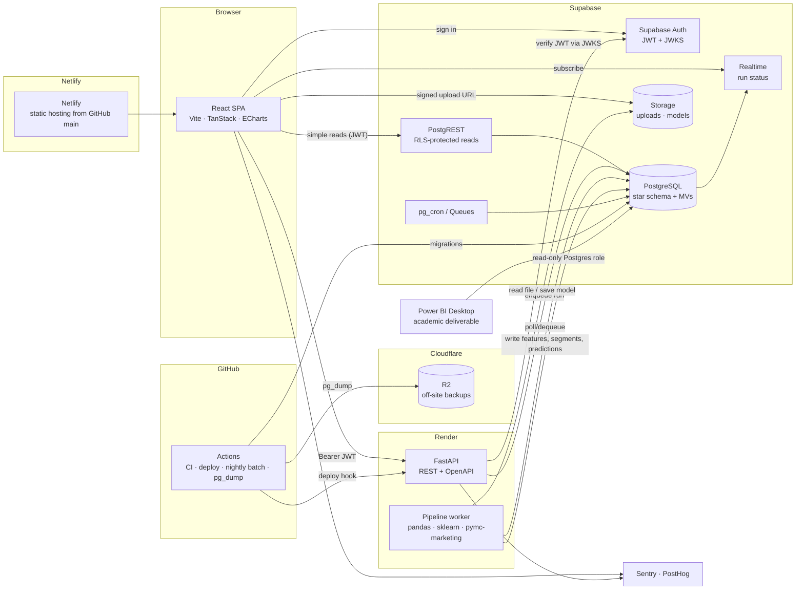

# CustomerIQ — Tech Stack Recommendation

**Date:** 2026-10-21
**Builds on:** [`viability-analysis.md`](./viability-analysis.md)

> **Decision update (2026-10-21, user decision):** frontend hosting moved from Cloudflare Pages to **Netlify**, deployed from GitHub on every push to `main` (Netlify's Git integration; pull requests get Deploy Previews). Render (API + worker), Supabase and Cloudflare **R2 for backups** are unchanged. Netlify Functions can't run Python, so nothing backend moves there. **Firecrawl** is added as a development-time MCP server for web research. Sections below are updated to match.

---

## TL;DR

| Layer | Recommendation | Why, in one line |
|---|---|---|
| Frontend | **React + TypeScript + Vite** (web SPA), Tailwind + shadcn/ui, **Apache ECharts**, TanStack Query/Table/Router, Zustand | This is an analytics dashboard used at a desk. A web SPA is the cheapest and fastest route. React Native would add cost and give users nothing extra. |
| Backend | **Python 3.12 + FastAPI**, REST + OpenAPI | The ML stack (pandas, scikit-learn, BG/NBD) only exists in mature form in Python. Node.js has no real equivalent. |
| Auth | **Supabase Auth** (JWT), verified in FastAPI via JWKS, with Postgres Row-Level Security | One identity system covers the frontend, the database and the API. |
| Database | **Supabase (managed PostgreSQL)** | Relational, SQL-native data. Matches the PostgreSQL plan from the viability analysis. Has an official MCP server. |
| Secondary stores | Supabase Storage (uploads + model files), materialized views instead of a cache, `pg_cron` / Supabase Queues instead of Redis | No extra services at MVP. |
| Hosting | **Netlify** (frontend, auto-deployed from GitHub `main`), **Render** (FastAPI + worker), **GitHub Actions** (CI/CD + batch ML) | Push-to-deploy from GitHub; low cost; all have MCP servers. |
| Cost | **~$1–8/mo MVP → ~$42–67/mo at 1k users → ~$170–265/mo at 10k users** | Stays under $50 at MVP and early pilot; the 1k tier reaches $50 once a dedicated worker is needed. The 10k tier assumes paying customers. |

> **Reminder from the viability analysis:** commercial SaaS was a **NO-GO as written**, because Klaviyo and Shopify already ship these features. This stack is picked so the **academic/portfolio build is the first phase of the product**. If customer interviews then show demand in a niche (for example, explainable B2B reorder prediction), you scale the same stack instead of rewriting it. Don't build multi-tenant billing until that check passes.

---

## 1. Frontend

### Framework: React 18/19 + TypeScript + Vite (single-page app)

**Why web React and not React Native:**
- The users (marketing analysts, CRM teams, business analysts) work on desktops with large screens, dense tables and multi-chart dashboards. Mobile is a secondary "glance at KPIs" case.
- The charting and data-grid libraries for React DOM are far better than those for React Native. Most mature chart libraries are DOM, SVG or canvas based.
- A responsive web app already works on phones and tablets. If a native app is ever needed, **Expo** can reuse the TypeScript types, API client and TanStack Query hooks. Plan the code for that (logic in hooks, not in components), but don't build it now.

**Why Vite SPA and not Next.js:**
- There is no SEO need. Every page sits behind login.
- The heavy server-side work runs in Python, not Node.js. A Next.js server would be a third runtime to host and pay for.
- A static SPA deploys from GitHub to Netlify with no server to run (Netlify Free to start, Personal at $9/mo once deploys exceed the free credits).
- If you later need a marketing site, add a separate static site (Astro or a Next.js static export).

### Key libraries mapped to features

| Feature (from the concept) | Library | Notes |
|---|---|---|
| Segment charts, RFM scatter/3D, revenue trends, cohort heatmaps | **Apache ECharts** via `echarts-for-react` | Canvas rendering handles thousands of customer points, and it has heatmaps, scatter, treemaps, sankey and dataZoom. Recharts is simpler but struggles above about 5k points and has no heatmap. |
| Customer tables (sort, filter, paginate 5k+ rows) | **TanStack Table** + **TanStack Virtual** | Headless, so it styles with shadcn/ui. Use server-side pagination for large tenants. |
| Server data fetching and caching | **TanStack Query** | Caches, deduplicates and refetches API and Supabase calls. Can handle about 90% of state. |
| Routing | **TanStack Router** (or React Router 7) | Type-safe search params, useful for shareable filtered dashboard URLs such as `?segment=at-risk&window=60`. |
| UI kit | **Tailwind CSS v4** + **shadcn/ui** (Radix primitives) | Accessible, and you own the component code. |
| Forms (upload config, thresholds, campaign cost inputs) | **React Hook Form** + **Zod** | Zod schemas can be generated from the OpenAPI spec. |
| CSV/XLSX upload preview | **Papa Parse** (CSV) and the **Uppy** or `tus-js-client` resumable upload to Supabase Storage | The browser only previews files. Parsing happens in Python. |
| Supabase client (auth, direct reads) | `@supabase/supabase-js` | |
| Typed API client | **openapi-typescript** + **openapi-fetch** | Generated from the FastAPI OpenAPI spec, so types stay in sync. |
| Testing | **Vitest** + **Testing Library**, **Playwright** for end-to-end tests | Playwright also has an MCP server (section 5). |

### State management
- **Server state → TanStack Query.** Segments, predictions, KPIs and model runs all come from the backend. Don't copy them into a global store.
- **URL state → router search params.** Dashboard filters (date range, segment, prediction window, country) live in the URL so views can be shared and bookmarked.
- **Client UI state → Zustand.** Only for small cross-page items: sidebar state, selected tenant, theme, upload wizard progress.
- **Not Redux.** There is nothing here that needs it.

---

## 2. Backend

### Runtime and framework: Python 3.12 + FastAPI

**Python vs. Node.js:** Python wins clearly for this project.

| Need | Python | Node.js |
|---|---|---|
| Data cleaning (1M+ rows, Excel input) | pandas / Polars, openpyxl | danfo.js (immature), SheetJS |
| K-means, logistic regression, random forest, metrics, calibration | **scikit-learn** (the reference implementation) | No equivalent with comparable maturity |
| BG/NBD / Gamma-Gamma CLV (the recommended baseline) | `pymc-marketing`, `lifetimes`, `btyd` | None |
| Explainability (SHAP, permutation importance) | `shap`, scikit-learn | None |
| Same code in notebooks (research) and production | Yes | No |

Using Node.js would mean running Python anyway for the ML, which means two backends. One Python backend is simpler.

**Why FastAPI:** async, built-in Pydantic validation, and an **auto-generated OpenAPI spec** that drives the typed frontend client. It is the standard choice for serving Python ML.

**Supporting libraries**

| Concern | Library |
|---|---|
| Package/env management | **uv** |
| DB access | **SQLAlchemy 2.0** (Core for bulk loads) + **psycopg 3**, or `supabase-py` for simple CRUD |
| Migrations | **Supabase CLI migrations** (SQL files in git). See section 3. |
| Data and ML | pandas (or Polars), NumPy, scikit-learn, pymc-marketing (BG/NBD), shap, joblib |
| Settings and secrets | pydantic-settings |
| JWT verification | PyJWT with `PyJWKClient` (Supabase JWKS) |
| Lint, format, test | Ruff, mypy, pytest |
| Observability | Sentry SDK |

### API architecture: REST (FastAPI + OpenAPI), plus Supabase direct reads where safe

- **tRPC is ruled out.** It only works with a TypeScript backend. The OpenAPI → `openapi-typescript` pipeline gives the same end-to-end type safety across Python and TypeScript.
- **GraphQL isn't needed.** The data access patterns are fixed dashboard queries, not open-ended graph traversal. It would add complexity for no gain.
- **Split of responsibilities:**
  - **Frontend → Supabase directly (PostgREST + RLS):** simple, tenant-scoped reads of precomputed tables and views (KPIs, segment summaries, customer lists). This avoids a Python hop.
  - **Frontend → FastAPI:** anything that runs Python, such as dataset ingestion and validation, starting a pipeline run, on-demand scoring or what-if analysis ("if campaign cost = £2, which customers are worth contacting?"), SHAP explanations, and report export.

**Representative endpoints**
```
POST /v1/datasets                 # register an upload (file already in Supabase Storage)
POST /v1/datasets/{id}/process    # clean → load → RFM → segment → predict (background job)
GET  /v1/runs/{id}                # job status / metrics
GET  /v1/customers/{id}/explain   # SHAP / feature contributions for one customer
POST /v1/scoring/what-if          # threshold & campaign-ROI simulation
GET  /v1/models/{run_id}/metrics  # ROC-AUC, PR-AUC, calibration curve, confusion matrix
```

### Long-running work (training, large uploads)
HTTP requests should never run training directly. For the MVP:
1. The API inserts a `pipeline_runs` row with status `queued`.
2. A **Render Background Worker** (or a FastAPI `BackgroundTasks` call in the same service at MVP) picks it up, runs the pipeline, writes results to Postgres, and updates the status.
3. The frontend polls `GET /v1/runs/{id}` with TanStack Query, or subscribes through **Supabase Realtime** on the `pipeline_runs` row.
4. **Growth:** move the queue to **Supabase Queues (pgmq)** so you still don't need Redis.

Scheduled retraining for the demo dataset can run on **GitHub Actions cron** (free and has more RAM than a $7 instance), writing results back to Supabase.

### Authentication: Supabase Auth
- Email/password + magic link + Google OAuth (common for business users). Add SAML SSO only if enterprise customers ask (it requires the Supabase Team plan).
- **Frontend:** `supabase-js` handles sign-in and refresh and stores the session.
- **FastAPI:** each request carries `Authorization: Bearer <supabase access token>`. Verify it with **PyJWT against the project's JWKS endpoint** (Supabase asymmetric signing keys), then read `sub` and the custom `org_id` claim.
- **Multi-tenancy:** a custom access-token hook adds `org_id` to the JWT. **RLS policies** on every tenant table use `org_id = (auth.jwt() ->> 'org_id')::uuid`.
- **Never send the `service_role` key to the browser.** In FastAPI, use it only in the worker, and filter by `org_id` explicitly in every query, because it bypasses RLS.

---

## 3. Database

### Primary: Supabase (PostgreSQL 15+)

**Why Supabase over Firebase or MongoDB Atlas:**

| Criterion | Supabase | Firebase (Firestore) | MongoDB Atlas |
|---|---|---|---|
| Data shape (transactions → customers → segments, joins, aggregates) | **Relational, which fits** | Document store with weak aggregation/joins, which fits poorly | Aggregation pipeline works, but RFM is natural in SQL |
| SQL skills from the project concept | **Yes** | No | No (MQL) |
| Power BI / BI tool connectivity (academic deliverable) | **Native Postgres connector** | Poor | Atlas SQL / BI Connector (extra setup) |
| Auth + storage + realtime + cron + queues in one bill | **Yes** | Yes | No (auth separate) |
| Pricing predictability | Flat $25 Pro + usage | Per-read/write billing, and dashboards are read-heavy, which can surprise you | Flex/dedicated tiers |
| Official MCP server | **Yes** (already connected in this environment) | Yes (Firebase CLI MCP) | Yes |

Firestore's per-document-read pricing is a poor fit for an analytics dashboard that aggregates thousands of rows per view. MongoDB is workable but gives up the SQL skills and BI connectivity the project is built around.

### Schema approach
A **star schema in Postgres**, with every tenant-scoped table keyed by `org_id` and protected by RLS. Raw data, curated data and model outputs are kept in separate layers.

```
-- Tenancy
organizations(id, name, plan, created_at)
memberships(user_id → auth.users, org_id, role)

-- Raw / staging (append-only, as uploaded)
datasets(id, org_id, storage_path, source, row_count, status, uploaded_by, created_at)
raw_transactions(dataset_id, org_id, invoice, stock_code, description, quantity,
                 invoice_ts, unit_price, customer_ref, country)          -- partition by org_id later

-- Curated (cleaned: cancellations handled, non-product codes removed)
dim_customer(id, org_id, customer_ref, country, first_purchase_ts, is_wholesale_flag)
dim_product(id, org_id, stock_code, description, is_non_product)
fact_order_line(id, org_id, customer_id, product_id, invoice, invoice_ts,
                quantity, unit_price, line_revenue, is_cancellation)

-- Analytics outputs (written by the Python pipeline, read by the dashboard)
pipeline_runs(id, org_id, dataset_id, status, cutoff_date, horizon_days, params jsonb,
              metrics jsonb, model_path, started_at, finished_at)
customer_features(run_id, org_id, customer_id, recency_d, frequency, monetary,
                  tenure_d, avg_basket, ...)           -- snapshot at cutoff (no leakage)
customer_segments(run_id, org_id, customer_id, rfm_score, rfm_label, kmeans_cluster, segment_name)
customer_predictions(run_id, org_id, customer_id, p_repurchase_60d, model_name,
                     top_drivers jsonb)
segment_summary  -- materialized view: customers, revenue share, avg p_repurchase per segment
```

Design rules:
- **Snapshot features per `run_id` and `cutoff_date`.** This enforces the no-leakage design from the viability analysis and makes every dashboard number reproducible.
- **Clean data in Python, store results in SQL.** Write cancellation and revenue rules once (in the pipeline) and expose them through views. Power BI, the React app and ad-hoc SQL then all read the same definitions.
- Index `(org_id, customer_id)` and `(org_id, invoice_ts)`. Partition `fact_order_line` by `org_id` (list) or by month only when a tenant exceeds about 10M rows.

### Secondary data stores

| Need | MVP choice | Add later when... |
|---|---|---|
| Cache | **Postgres materialized views** (`segment_summary`, monthly revenue), refreshed at the end of each pipeline run, plus TanStack Query client cache | Dashboard p95 latency > 1s at scale → Upstash Redis (free tier available) |
| Search (customers, products) | **`pg_trgm` + Postgres full-text** | Practically never for this product |
| File/object storage (uploads, model `.joblib` files, exports) | **Supabase Storage** (private buckets, RLS policies on `org_id` path prefix) | Off-site backups → Cloudflare R2 (10 GB free, no egress fees) |
| Job queue / scheduling | DB status table + worker; **`pg_cron`** for refreshes | **Supabase Queues (pgmq)** |
| Analytics warehouse | Not needed (Postgres handles about 10–50M rows per tenant fine) | DuckDB/MotherDuck if tenants bring 100M+ rows |

### Backup and migration strategy
- **Migrations:** `supabase/migrations/*.sql` versioned in git, created with `supabase migration new`, tested locally with `supabase start` (Docker), and applied by CI with `supabase db push`. RLS policies, views and functions live in migrations too. Never change the schema through the dashboard UI.
- **Branching:** use Supabase preview branches for PRs once on Pro (optional; they cost extra compute hours).
- **Backups:**
  - Free tier has **no** downloadable automated backups, so run a **nightly `pg_dump` from GitHub Actions** to Cloudflare R2 (free) from day one.
  - Pro includes **daily backups with 7-day retention**. Add **Point-in-Time Recovery (~$100/mo add-on)** only once there are paying customers and contractual recovery-point requirements.
  - Model files are versioned by `run_id` in Storage, so any past prediction can be traced to its model.
- **Restore drill:** restore the latest dump into a local Supabase once a quarter. A backup you've never restored can't be relied on.

---

## 4. Infrastructure and hosting

### Deployment platforms

| Component | Platform | Why |
|---|---|---|
| React SPA | **Netlify** | Git integration with GitHub: every push to `main` deploys production, every PR gets a Deploy Preview. Credit-based pricing: Free has 300 credits/month as a hard cap (a production deploy costs 15, bandwidth 20/GB) and pauses **all** projects on the account when exceeded, so plan on **Personal ($9/mo)** once there is real traffic. Cloudflare Pages ($0) was the original choice and remains the fallback. |
| FastAPI API (+ worker) | **Render** | Deploys straight from a Dockerfile/GitHub, has background workers and cron jobs, and costs **$7/mo Starter (512 MB)**. The free tier sleeps (about 30–60s cold starts), which is fine for demos only. Official MCP server. |
| Database, auth, storage | **Supabase** | Free → Pro ($25/mo, includes $10 compute credit = Micro instance) |
| Batch ML / scheduled jobs / backups | **GitHub Actions** | Free minutes (2,000/mo private, unlimited public). Runners have about 7 GB RAM, more than a $7 Render instance, which suits training on the 1M-row dataset. |
| Errors / product analytics | **Sentry** (free Developer plan), **PostHog** (free tier, 1M events/mo) | Both have MCP servers. |
| Transactional email (invites, "run finished") | **Resend** (free tier, 3k emails/mo) via Supabase Auth custom SMTP | Supabase's built-in SMTP is rate-limited and not for production. |

**Alternatives considered**
- **Railway** (Hobby $5/mo including $5 of usage): the closest Render alternative with usage-based billing. Good if the API sits idle most of the time.
- **Fly.io:** cheapest at small scale, but more operations work (machines, volumes).
- **Google Cloud Run:** scales to zero and has a generous free tier, but more setup (IAM, Artifact Registry) and Python ML images have slow cold starts.

**Memory watch-out:** 512 MB is enough for the API and for scoring with a saved model. It is **not** enough to run pandas on a 1M-row Excel file plus random forest training. At MVP, run heavy pipelines on GitHub Actions or locally. Upgrade the worker to Render Standard (2 GB, $25/mo) only when customer uploads start.

### CI/CD
Monorepo with GitHub Actions:
```
/apps/web        React SPA      → Netlify (Deploy Preview per PR, production on main)
/apps/api        FastAPI        → Render (auto-deploy on main after CI passes)
/packages/ml     pipeline code  → shared by API worker + GH Actions batch jobs + notebooks
/supabase        migrations, seed (UCI demo data), RLS tests
/notebooks       academic analysis (reads the same /packages/ml code)
```

| Workflow | Trigger | Steps |
|---|---|---|
| `ci.yml` | every PR | web: `pnpm lint typecheck test build`; api: `uv run ruff check`, `mypy`, `pytest`; db: `supabase start` + apply migrations + RLS tests (pgTAP); contract: regenerate OpenAPI types and fail if there's a diff |
| `deploy.yml` | push to `main` | `supabase db push` (migrations) → Render deploy hook → Netlify (Git integration builds `main` automatically) |
| `e2e.yml` | PR (on preview URL) | Playwright smoke: log in, upload sample, see segments |
| `nightly.yml` | cron | `pg_dump` → R2; retrain demo model; refresh materialized views |

Secrets go in GitHub Actions secrets and the Render/Netlify environment settings. Never commit them.

**Today (before `apps/web` exists):** `netlify.toml` at the repo root builds a static viewer of the research documents (`scripts/build-site.sh` → `site/`), so the GitHub → Netlify pipeline is live from day one. When the SPA is scaffolded, `netlify.toml` switches to building `apps/web`.

### Estimated monthly costs
In this B2B product, **"users" are analyst seats.** Cost depends mostly on **data volume per tenant** (transaction rows and pipeline runs), not seat count. The estimates assume about 5 seats per org (1k users ≈ 200 orgs, 10k users ≈ 2,000 orgs), with an average tenant of about 100k–1M transaction rows. *Prices come from published list prices and should be checked against current pricing pages before committing.*

| Item | MVP / pilot | ~1k users | ~10k users |
|---|---|---|---|
| Netlify | $0 Free (300 credits, ~20 deploys) | $9 Personal | ~$20 Pro |
| Supabase | $0 Free *(pauses after 7 days idle, no backups)* | $25 Pro (Micro compute incl.) | $25 Pro + compute upgrade (Medium ≈ +$50) + disk/egress overage ≈ **$75–110** |
| Render API | $0 free (cold starts) – $7 Starter | $7 Starter | $25 Standard |
| Render worker (pipelines) | $0 (use GitHub Actions) | $0–25 (Standard when uploads begin) | $25–50 (1–2 Standard) |
| GitHub Actions | $0 | $0 | $0–10 |
| Sentry | $0 | $0 | $26 Team |
| PostHog | $0 | $0 | $0 (likely within free tier) |
| Resend | $0 | $0 | $0–20 |
| Cloudflare R2 (backups) | $0 | $0 | $0–2 |
| Domain | ~$1 | ~$1 | ~$1 |
| Firecrawl (dev-time web research only) | $0 free tier | $0 (or a paid plan if research volume grows) | $0–paid |
| **Total** | **≈ $1–8/mo** | **≈ $42–67/mo** | **≈ $170–265/mo** |

**Staying under $50/month:**
- The MVP is well under budget.
- At ~1k users you are at about $42/mo (Supabase Pro + Render Starter + Netlify Personal) **unless** you need a dedicated pipeline worker. Keep heavy jobs on GitHub Actions until revenue covers the $25 Render Standard upgrade.
- Upgrade Supabase to Pro ($25) as soon as **any external user** relies on it, because free projects pause and have no backups.
- 10k users is past the budget, but at even $20–50/org/month, 2,000 orgs is $40k+ MRR. Infrastructure would be well under 1% of revenue.

---

## 5. MCP server availability

| Component | MCP server | Status | What it enables in Claude Code |
|---|---|---|---|
| **Supabase** | Official Supabase MCP (`mcp.supabase.com`) | **Already connected in this environment** | List tables, run SQL, apply migrations, generate TypeScript types, read logs, check security/performance advisors (for example, missing RLS policies), manage preview branches, deploy Edge Functions |
| **GitHub** | Official GitHub MCP | **Already connected** | Issues, PRs, code review, Actions run status and job logs, so Claude can fix CI failures |
| **Netlify** | Official Netlify MCP (`@netlify/mcp`) | Available | Check deploys and build logs, manage site settings and environment variables |
| **Cloudflare** | Official Cloudflare MCP servers | Available (R2 backups only) | Manage the R2 backup bucket |
| **Firecrawl** | Firecrawl MCP | **Already connected in this environment** | Web search and page scraping for research: current library docs, competitor features and pricing, regulations. Development-time only; never used by the product at runtime and never sent customer data |
| **Render** | Official Render MCP (`mcp.render.com`) | Available | Create and inspect services, read deploy and runtime logs, query metrics, manage env vars |
| **Sentry** | Official Sentry MCP | Available | Pull production stack traces into the coding session; Claude can investigate and fix them |
| **PostHog** | Official PostHog MCP | Available | Query product analytics and feature flags (for example, "which dashboard pages do users actually open?") |
| **Playwright** | Microsoft Playwright MCP | Available (Chromium already preinstalled here) | Claude can drive the real app: log in, upload a file, check charts render, take screenshots |
| **Context7** | Upstash Context7 MCP | Available | Pulls current docs for libraries (FastAPI, TanStack, ECharts, scikit-learn) instead of relying on training data |
| Firebase / MongoDB Atlas | Official servers exist | Not chosen | Not a reason to choose them, because Supabase's MCP covers the same ground for our database |

### What this enables in the development workflow
1. **Schema work from the editor:** Claude writes a migration, applies it to a dev branch through Supabase MCP, runs the advisors to catch missing RLS or indexes, and regenerates `database.types.ts`, all in one session.
2. **Data checks on real data:** "What's the 60-day repurchase base rate at a 2011-06-01 cutoff?" runs as SQL against the loaded UCI data. This is week-1 validation task #2 from the viability analysis, done directly.
3. **Production feedback loop:** a Sentry error leads Claude to read the stack trace, reproduce it with Playwright, write the fix, open a PR through GitHub MCP, and watch Actions until it's green.
4. **Deploy and debug:** Render and Netlify MCP give direct access to deploy logs and env-var checks without switching between dashboards.
5. **Cost and usage checks:** Supabase and Render usage plus PostHog analytics show when you are close to a pricing tier.

Keep the MCP servers on **development and staging projects** by default. Give Claude read-only access to production (Supabase MCP supports `read_only` mode and project scoping), and never use service-role credentials in MCP config.

---

## 6. Integration map



### Request flows
1. **View dashboard:** SPA → Supabase PostgREST (JWT, RLS by `org_id`) → `segment_summary` materialized view. No Python involved, so it's fast.
2. **Upload new data:** SPA gets a signed upload URL → file goes **directly to Supabase Storage** (not through the API) → `POST /v1/datasets` → worker parses, cleans, loads `fact_order_line`, computes features at the cutoff, segments, predicts, writes outputs, refreshes the materialized views → status changes, pushed through Realtime.
3. **Explain or what-if:** SPA → FastAPI → loads the model from Storage (cached in memory per `run_id`) → returns SHAP values or ROI simulation.
4. **Academic deliverable:** Power BI Desktop connects to Supabase Postgres with a **read-only role** on the same views. Notebook results, the web app and Power BI therefore show the same numbers.

### Potential integration pain points (and mitigations)

| # | Pain point | Mitigation |
|---|---|---|
| 1 | **JWT verification between Supabase and FastAPI** (key rotation, legacy HS256 vs. new asymmetric keys) | Use JWKS with `PyJWKClient` (it caches keys), check `aud`/`iss`/`exp`, and add an integration test using a real token from local `supabase start`. |
| 2 | **Service-role key bypasses RLS:** a single missing `WHERE org_id = …` leaks one tenant's data to another | Use a repository layer that requires `org_id`, run the Supabase security advisor in CI, and add pgTAP tests that check cross-tenant reads fail. |
| 3 | **Connection limits:** each Render instance plus the worker opening direct Postgres connections exhausts a Micro instance | Connect through the **Supavisor pooler** (transaction mode, port 6543). Disable psycopg prepared statements (`prepare_threshold=None`) and use SQLAlchemy `NullPool` with the transaction pooler. |
| 4 | **PostgREST row cap** (default 1,000 rows): dashboards silently truncate | Return aggregates from views/RPC functions, paginate customer tables server-side, and never send raw transactions to the browser. |
| 5 | **Large uploads and timeouts:** a 45 MB XLSX through the API hits request limits; training inside a request times out | Upload directly to Storage with signed URLs, process asynchronously in a worker, and report progress through Realtime. |
| 6 | **Worker memory:** a 1M-row Excel file plus random forest exceeds 512 MB | Convert to Parquet or CSV on first read, use dtype-optimized pandas or Polars, run heavy jobs on GitHub Actions or a 2 GB worker, and limit random forest depth and size. |
| 7 | **Type drift across Python and TypeScript** (Pydantic models, DB schema, TS types) | CI regenerates OpenAPI → TS types and Supabase → `database.types.ts`, and fails on any diff. |
| 8 | **Inconsistent business logic** (revenue, cancellations, "active") across SQL, Python and Power BI | Keep one definition in `/packages/ml` + DB views. Power BI and the SPA read views only and never recompute from raw data. |
| 9 | **Supabase free-tier pausing and Render free cold starts** make demos look broken | Upgrade Supabase to Pro and Render to Starter before any external user, or keep a GitHub Actions keep-alive ping for the academic demo. |
| 10 | **CORS / environments:** Deploy Previews on per-PR Netlify subdomains | Have FastAPI allow `deploy-preview-*--<site>.netlify.app` previews plus the production domain via regex, and add both to Supabase Auth redirect URLs. Keep separate Supabase projects for dev/staging and prod. |
| 11 | **Timezones and currency:** UCI data is UK local time in GBP, while tenants will vary | Store `timestamptz` in UTC plus a tenant timezone setting. Store currency per dataset and do not mix currencies within a run. |
| 12 | **PII and compliance** once real customer data arrives (GDPR/CCPA) | Store only `customer_ref` (hashed or opaque, with no names or emails) in the MVP. Add a data-processing agreement, per-tenant deletion (cascade on `org_id`) and a retention policy before onboarding real merchants. |

---

## Official documentation

**Frontend**
- React: https://react.dev/
- TypeScript: https://www.typescriptlang.org/docs/
- Vite: https://vite.dev/guide/
- Tailwind CSS: https://tailwindcss.com/docs
- shadcn/ui: https://ui.shadcn.com/docs
- Apache ECharts: https://echarts.apache.org/en/index.html, React wrapper: https://github.com/hustcc/echarts-for-react
- TanStack Query: https://tanstack.com/query/latest/docs
- TanStack Table: https://tanstack.com/table/latest/docs
- TanStack Router: https://tanstack.com/router/latest/docs
- Zustand: https://zustand.docs.pmnd.rs/
- React Hook Form: https://react-hook-form.com/docs; Zod: https://zod.dev/
- openapi-typescript / openapi-fetch: https://openapi-ts.dev/
- Vitest: https://vitest.dev/guide/; Playwright: https://playwright.dev/docs/intro
- Expo (future mobile): https://docs.expo.dev/

**Backend and ML**
- Python: https://docs.python.org/3/
- FastAPI: https://fastapi.tiangolo.com/
- Pydantic: https://docs.pydantic.dev/
- uv: https://docs.astral.sh/uv/; Ruff: https://docs.astral.sh/ruff/
- SQLAlchemy: https://docs.sqlalchemy.org/en/20/; psycopg 3: https://www.psycopg.org/psycopg3/docs/
- pandas: https://pandas.pydata.org/docs/; NumPy: https://numpy.org/doc/stable/; Polars: https://docs.pola.rs/
- scikit-learn: https://scikit-learn.org/stable/user_guide.html
- PyMC-Marketing (BG/NBD, CLV): https://www.pymc-marketing.io/
- SHAP: https://shap.readthedocs.io/
- PyJWT: https://pyjwt.readthedocs.io/

**Data and platform**
- Supabase docs: https://supabase.com/docs
  - Auth: https://supabase.com/docs/guides/auth; JWT signing keys: https://supabase.com/docs/guides/auth/signing-keys
  - Row Level Security: https://supabase.com/docs/guides/database/postgres/row-level-security
  - CLI and migrations: https://supabase.com/docs/guides/local-development
  - Storage: https://supabase.com/docs/guides/storage; Realtime: https://supabase.com/docs/guides/realtime
  - Cron: https://supabase.com/docs/guides/cron; Queues: https://supabase.com/docs/guides/queues
  - Connection pooling: https://supabase.com/docs/guides/database/connecting-to-postgres
  - Backups: https://supabase.com/docs/guides/platform/backups
  - Pricing: https://supabase.com/pricing
  - MCP: https://supabase.com/docs/guides/getting-started/mcp
- PostgreSQL: https://www.postgresql.org/docs/current/
- Netlify: https://docs.netlify.com/; Deploys from Git: https://docs.netlify.com/deploy/deploy-overview/; Monorepos: https://docs.netlify.com/build/configure-builds/monorepos/; Pricing: https://www.netlify.com/pricing/; MCP: https://github.com/netlify/netlify-mcp
- Cloudflare R2 (backups): https://developers.cloudflare.com/r2/
- Firecrawl: https://docs.firecrawl.dev/; MCP: https://docs.firecrawl.dev/mcp-server; Pricing: https://www.firecrawl.dev/pricing
- Render: https://render.com/docs; Pricing: https://render.com/pricing; MCP: https://render.com/docs/mcp-server
- GitHub Actions: https://docs.github.com/en/actions; GitHub MCP: https://github.com/github/github-mcp-server
- Sentry: https://docs.sentry.io/; MCP: https://docs.sentry.io/product/sentry-mcp/
- PostHog: https://posthog.com/docs; MCP: https://posthog.com/docs/model-context-protocol
- Resend: https://resend.com/docs
- Playwright MCP: https://github.com/microsoft/playwright-mcp
- Context7: https://github.com/upstash/context7
- Claude Code MCP setup: https://docs.claude.com/en/docs/claude-code/mcp
- Power BI (academic deliverable): https://learn.microsoft.com/en-us/power-bi/; PostgreSQL connector: https://learn.microsoft.com/en-us/power-query/connectors/postgresql

**Alternatives referenced**
- Railway: https://docs.railway.com/; Fly.io: https://fly.io/docs/; Google Cloud Run: https://cloud.google.com/run/docs
- Vercel pricing / Hobby terms: https://vercel.com/docs/plans/hobby
- Firebase: https://firebase.google.com/docs; MongoDB Atlas: https://www.mongodb.com/docs/atlas/

---

## Recommended build order (fits the 6–10 week plan)
1. **Week 1:** repo scaffold (monorepo, uv, pnpm), Supabase project + first migrations, load the UCI data with the cleaning pipeline in `/packages/ml`, then run the viability analysis's validation queries through Supabase MCP.
2. **Weeks 2–4:** RFM + K-means + prediction pipeline with out-of-time validation. Write outputs to the analytics tables. Run it from notebooks and GitHub Actions.
3. **Weeks 4–6:** FastAPI (auth, runs, explain, what-if) + React dashboard (KPIs, segments, customer table, model metrics page).
4. **Weeks 6–8:** upload flow, Realtime run status, Playwright end-to-end tests, Sentry, and a Power BI report on the same views for the academic deliverable.
5. **Only after validation interviews:** multi-tenant onboarding, billing (Stripe), and per-tenant scheduled retraining.
